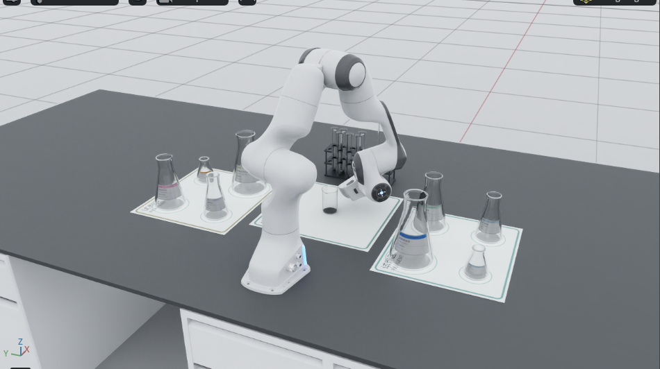
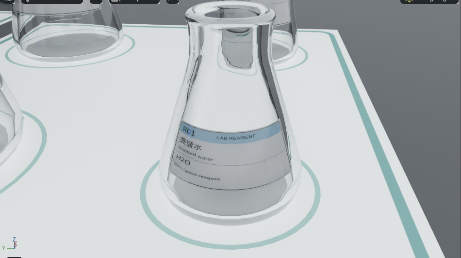

# 透明/玻璃锥形瓶模型对比诊断

日期：2026-10-23（Asia/Shanghai）  
范围：同一 `tabletop_third_person` 观测、同一 RGB/原始深度/实例分割/标定，比较未接入透明几何模型的原始深度基线、ReMake，以及 DFNet 的实际可用状态。报告只使用已有观测 artifact，不读取 USD/仿真真值回填几何。

## 结论摘要

本次目标是 `mixing_vessel` 类锥形瓶，选取回放中置信度最高、位置最适合作为工作流目标的实例：`entity://observed-45e51b6def3b416da8ef696395dad39c`，mask 框 `[774,603,829,695]`，置信度 0.99。它是场景理解类别，不代表系统已通过瓶型/身份真值验证。

| 路线 | 当前结果 | 直观判断 | 选型含义 |
|---|---|---|---|
| 未接入透明模型：原始 RGB-D / raw depth | RGB 中能看到目标并得到 mask，但 mask 内深度 q05/q50/q95 为 2.019/2.043/2.069 m；历史回放 mask→深度点云为 3,213 点 | 深度集中在远背景区，不能据此确认瓶体表面 | raw-depth 基线可复现，但玻璃瓶体几何仍无可靠证据 |
| ReMake | 同一目标生成 4,100 点的 object point cloud；深度 q05/q50/q95 约 0.739/0.830/1.205 m；该锥形瓶没有抓取候选（当前探针把 mixing vessel 排除为抓取源） | mask 内有连续的恢复深度和点云；不把别的物体候选借给它 | 作为下一轮主候选验证；仍需几何误差/瓶口功能点验证 |
| DFNet | `dfnet-r2-20261023-a` 在 understanding 阶段失败，缺少 DFNet checkpoint | 没有可比较的模型输出 | 不能把 DFNet 判定为效果差，先补齐权重并重跑同一输入 |

**当前建议：** 如果必须先选一个继续工程验证，选 ReMake；理由是它在同一输入上留下了恢复深度和逐物体点云，且该实例的局部几何提取可复现。这个选择表示“下一轮验证优先级”，不表示 ReMake 已通过玻璃几何精度或可执行抓取验收。

## 全景中间结果


全景图从左上到右下依次为：RGB 与全部实例 mask、raw depth、ReMake depth、用于恢复的多实例 union mask、原始整帧点云投影、ReMake 逐物体点云投影。颜色只用于显示深度/点云结构，不代表真值误差。

## 工作流目标锥形瓶


目标对象引用：`entity://observed-45e51b6def3b416da8ef696395dad39c`。像素框为 `[774, 603, 829, 695]`，mask 像素数为 `4,100`。

图中八个面板依次展示：

1. RGB 与目标实例 mask；
2. 同一 mask 内的原始深度基线；
3. ReMake 恢复深度；
4. `ReMake - raw` 的诊断差异；
5. raw-depth 与 ReMake 目标点云并排投影，采用共同相机坐标显示范围；
6. 当前目标候选状态；该锥形瓶在这条探针工作流中是容器，被排除在抓取源之外，因此没有对应 GraspNet 候选；
7. DFNet 运行状态，明确标出缺 checkpoint、无模型输出；
8. 预留空白面板，不承载推断信息。

候选不是执行结果：当前 `process_preparation` 仍为 `unavailable: geometry/feature qualification remains unverified`，没有启动运动。

## 目标对象数值对比

| 指标 | Raw depth 基线 | ReMake |
|---|---:|---:|
| mask 像素 | 4,100 | 4,100 |
| 深度 q05 / q50 / q95（m） | 2.019 / 2.043 / 2.069 | 0.739 / 0.830 / 1.205 |
| 几何点数 | 历史回放 `replay-cloud-7.npy`：3,213 | 4,100 |
| 几何状态 | 历史回放成功提取局部 geometry/features；深度统计仍集中在约 2.04 m | `unverified_estimate`, `visible_surface` |
| GraspNet 候选 | 不适用：该锥形瓶不是抓取源 | 不适用：该锥形瓶不是抓取源 |
| `proposed` 候选 | 不适用 | 不适用 |
| 最高候选分数 | — | — |

Raw depth 与 ReMake 的深度值不应直接被当成“ReMake 误差为多少”：当前没有目标锥形瓶的独立公制真值测量。这里的价值是展示模型是否从原始深度的背景/错误表面中恢复出可供后续点云查询的结构。

## 模型状态与复现证据

- 主对比记录：`out/releases/v16.0.0/remake-r2-20261023-c/perception.json`
- 同帧 RGB：`out/releases/v16.0.0/remake-r2-20261023-c/artifacts/labutopia/rgb/aee040c9364741cdb2242ce505a3f096.png`
- 原始深度：`.../depth/d36b98d9728f4ee284db7b41d7c3b2eb.npy`
- ReMake 恢复深度：`.../recovered-depth/706ec2206c5842fe91494f6520f523a9.npy`
- ReMake 透明区域 mask：`.../transparent-mask/e2aab2850fcf448ba3eef3cf9458f508.npy`
- 目标 mask：`.../instance-mask/7fdff4eebe354d33b593cfb8c8537aa4.npy`
- 目标点云：`.../object-point-cloud/3d699527aefb46b2a02479201b85a40a.npy`
- 目标候选摘要：`assets/transparent-model-comparison-20261023/target-summary.json`
- DFNet 失败记录：`out/releases/v16.0.0/dfnet-r2-20261023-a/perception.json`

本次可视化由 `scripts/render_transparent_model_diagnosis.py` 生成：

```bash
.venv/bin/python scripts/render_transparent_model_diagnosis.py \
  --run out/releases/v16.0.0/remake-r2-20261023-c \
  --out docs/diagnostics/assets/transparent-model-comparison-20261023 \
  --target-index 7
```

## 后续选型顺序

1. 先补齐 DFNet checkpoint，在同一 RGB、mask、标定和 GraspNet 设置下重跑；否则只能比较 raw 与 ReMake。
2. 对目标锥形瓶单独测瓶口、瓶身接触区和深度覆盖率，不用全图平均值替代。
3. 对两个模型使用同一候选采样和准备检查，比较 `proposed` 数量、最高分、候选落点是否覆盖可夹持区域。
4. 只有在独立几何误差和准备资格通过后，才把“候选更多/分数更高”转化为执行模型选择。

## 补充对照：LocateAnything 指定目标后的五行对比（2026-10-24）

上一版使用的是回放中的场景理解实例 mask；本次改为完整执行 `LocateAnything → SAM2 → RGB-D → GraspNet`，并把同一个目标 mask 同时交给 raw-depth 和 ReMake 两条几何路径。主图集中显示右侧大型锥形瓶，左列为未加入 ReMake 的 raw-depth，右列为 ReMake。


### 本次结果

| 指标 | Raw-depth | ReMake |
|---|---:|---:|
| 目标 mask 像素 | 25,546 | 25,546 |
| 深度 q05 / q50 / q95（m） | 1.706 / 1.842 / 2.191 | 0.715 / 0.835 / 1.097 |
| 目标点云 | 25,546 | 25,546 |
| GraspNet 解码候选 | 915 | 259 |
| GraspNet 保留候选 | 32 | 32 |
| 最高分 | 1.000 | 1.000 |

LocateAnything 使用 `800x600` 缩放输入查询 `conical flask`，返回 8 个框；选定框从缩放图 `[498,306,573,442]` 映射到原图 `[996,612,1146,884]`。SAM2 使用该框生成 mask。两侧使用同一 RGB、同一 mask、同一标定和同一 GraspNet 设置。

### 错误原因与修复

| 问题 | 原因 | 修复 |
|---|---|---|
| 原图直接运行 LocateAnything OOM | 1600x1200 输入在模型加载后触发约 5.93 GiB 推理峰值，显存余量不足约 10 MiB | 使用 800x600 缩放图推理，再将框按 2 倍映射回原图；模型权重未被删除 |
| 之前图中锥形瓶没有 GraspNet 位姿 | 旧探针把 `mixing_vessel` 作为容器排除在抓取源之外 | 新诊断仅为离线对照，直接对 LocateAnything/SAM2 目标点云调用同一 GraspNet Provider；不进入运动准备 |
| 旧图目标不够明显 | 全景图展示整帧，目标像素区域较小 | 新增目标裁剪五行双列图，固定显示 RGB、分割、深度、点云和位姿 |
| DFNet 没有结果 | 当前配置目录只有 `remake.tar` 与相对深度权重；本地常见缓存路径未找到 `dfnet.tar`，已有 run 在 understanding 阶段因 provider failure 退出。Google Drive 请求超时，Baidu 提取码校验失败，未取得 checkpoint | 保留 `pending_checkpoint` 状态；取得官方权重后复用同一目标和配置重跑，不能用 ReMake 代替，也不能把缺权重写成模型效果差 |

本次对照仍是离线诊断。GraspNet 分数和候选数量不等于碰撞通过、几何真值精度或运动授权。

详细产物见 [`transparent-model-comparison-20261023-locateanything.md`](transparent-model-comparison-20261023-locateanything.md)。

## ReMake Agent 标签与参数化动作复核（2026-10-24）

使用同一 `tabletop_third_person` 传感器，通过现有 `isaacsim_lab.agent_host` 发起只读 Agent 任务。新运行目录：`out/releases/v16.0.4/agent-label-qualification-token-budget/`；任务 `task_1d02787c63b24544` 最终状态为 `succeeded`，完成节点 `complete_read_only_inspection`。运行设置了 `OMNI_KIT_ACCEPT_EULA=YES`，但没有启用模拟运动。

### 标签观测结果

Agent 从 RGB-D 识别出试剂瓶类别，但无法可靠读取八个锥形试剂瓶标签上的文字，因此没有给瓶子赋予化学身份。另一个左后方大瓶被机械臂明显遮挡，瓶身、标签和瓶口均不完整。原始理解结果保存在 `artifacts/labutopia/understanding/db64da726c4c4c41bdc672bbf159e28b.json`；RGB 与观测图像保存在 `artifacts/labutopia/rgb/911d08d9b23440ab857497bc463dee9e.png`、`rgb/524cc57f54ba4682b849c342f90a65af.png`。因此当前结论是“瓶体类别可辨，标签文字不可读/身份未解析”，不能据此选定试剂瓶执行倾倒。

### Provider 错误及修复

首次启用 EULA 后，模型响应在 `4060` 字符处结束，解码位置为 `line 136, column 31, position 4060`，输出恰好终止于未完成对象。这确认失败原因是视觉结构化输出的 `max_output_tokens=2048` 不足以容纳本场景八个目标及属性，而不是 ReMake 几何恢复失败。

| 检查项 | 修复前 | 修复后 |
|---|---|---|
| 输出预算 | 2048 tokens，八目标 JSON 被截断 | 默认提高至 4096 tokens，仍可由 Provider 构造参数覆盖 |
| 失败诊断 | 仅保存 `JSONDecodeError` | 保存输出长度、行列/字符位置及最多 640 字符的局部响应摘录 |
| Agent 结果 | Understanding 返回 provider failure，任务停在 `executing` | 新运行完整返回 understanding，Agent 任务结算为 `succeeded` |
| 标签身份 | 无有效判读 | 八个试剂瓶标签均标记不可可靠读取；不推断内容 |

失败响应与修复后结果分别保存在 `agent-label-qualification-final/` 与 `agent-label-qualification-token-budget/`。两次失败尝试均未产生动作；其遗留任务已通过 Coordinator `cancel_task` 生命周期接口正常取消，未直接修改数据库。修复后运行也生成 ReMake 恢复深度、实例 mask、逐物体点云和 understanding artifact；这些表示估计结果，不代表独立真值或几何精度验收。

### 倾倒/搅拌动作参数检查

Agent Host 指引使用已有通用 `pour_cycle` 与 `stir_cycle` 能力。倾倒的 `tilt_rad`、`hold_s`，以及搅拌的 `radius_m`、`depth_m`、`turns`、`duration_s`、`direction` 均从子任务 `parameters` 传入；没有动作顺序、瓶数或数值默认值写死在提示中。集成测试确认参数投影保留原值，Agent Host 测试确认缺少工艺参数时要求补充输入。

本次成功 Agent 运行是只读标签资格检查，不是倾倒/搅拌动作执行测试。任务未提供这些工艺参数，且标签、瓶口/棒端功能点和运动准备均未通过，因此没有创建动作节点，也没有模拟器或真实机械臂运动证据。要执行后续动作，需先补充目标选择及工艺参数，并完成针对该目标的清晰观测和 `manipulation.prepare`。

## 复核更正与参数契约修复（2026-10-24）

本节补充对上一节动作结论的代码复核。此前写“Agent Host 与 Runtime 参数投影保留原值”，范围说得过宽：当时测试确认的是部分参数对象投影，未覆盖 Agent 语义入口的必需参数校验，也未证明 `stir.direction` 能经 held-operation Schema 到达 Provider。

### 标签可读性诊断

成功运行的第三人称观测为 `1600×1200`。八个试剂瓶的实例框可检测，但文字不可可靠读取、瓶身身份未解析；左后方瓶体另被机械臂遮挡。瓶身标签在整幅图内只占较小区域，玻璃反射、透视和遮挡共同限制文字识别。现有证据表明首先需要改善观测，不足以将失败归因于 ReMake 的深度能力。

处理顺序建议：保留全景完成场景定位；通过不接触目标的安全观察姿态取得标签正视近景；必要时提高真实渲染分辨率或调整视场，并同步使用匹配的相机标定；按实例分割裁出标签 ROI，透视校正后做 OCR；最后用 ROI 到原图的坐标映射将文字结果绑定回对应瓶体。放大插值不能恢复未采集到的细节。本轮没有改变相机姿态或重新采集，因此标签识别仍未修复，任何身份都不得按固定位置推断。

参考运行图像：`out/releases/v16.0.4/agent-label-qualification-token-budget/artifacts/labutopia/rgb/911d08d9b23440ab857497bc463dee9e.png`；结构化结果：`out/releases/v16.0.4/agent-label-qualification-token-budget/artifacts/labutopia/visual-inference/49ff95be57eb48a68663b7dd68f99815.json`。

### 标签视角复拍（2026-10-24）

为区分标签位置问题与全景分辨率/视角问题，在 LabUtopia 当前 `tabletop_station.usda` 上分别运行 `preview_tabletop_station.py --view third-person` 和 `--view wrist-preview`。两次均使用同一场景、默认光照、静态暂停仿真；没有移动机械臂、改 USD 或执行操作。原始桌面截图裁出 Isaac Sim 视口后保存在 `out/releases/v16.0.6/label-viewpoint-comparison-20261024/`。

| 视角 | 可见结果 | 判读 |
|---|---|---|
| 第三人称全景 | 八个瓶子、操作台和机械臂关系可见；单瓶标签在画面中很小，无法稳定辨字 | 适合场景定位，不适合直接读标签 |
| R01 腕部近景预览 | 标签位于玻璃瓶身外侧曲面；可辨认 `R01`、`蒸馏水`、`Distilled water` 和 `H2O`，但仍能看到玻璃高光/折射 | 目标正面近景显著改善人眼可读性；不是 OCR 或 Agent 识别验收 |

本次没有把标签向外移动。构建检查报告显示 8/8 标签面存在，标签朝向 `robot.preview_camera.eye`；资产文档记录其距相机侧瓶壁约 3 mm。近景中可见的标签正处于外侧表面。全景失败的直接改进方向是先定位再近距离正视观测，而非继续偏移标签。若后续模型仍误读，应保存相机原始帧和该瓶实例 mask，按 mask 裁取 ROI 后分别检查 OCR/视觉理解；不要以插值放大代替真实近景采集，也不要由标签贴图真值反推模型已识别。





**证据边界：** 本次通过静态渲染确认视角差异和人眼可辨字段；未运行 LocateAnything、Agent 或 OCR，也未把近景结果绑定为感知 artifact，因此标签识别任务仍待同视角重新采集并评估。预览脚本输出确认 Physics paused、未创建控制器或运动命令。

### ReMake Agent 近景复测（2026-10-24）

为把上一节的人眼预览变成 Runtime 感知输入，LabUtopia Adapter 新增配置驱动的 R01 标签近景传感器。位姿从场景现有 `lab:wrist_inspection_eye_m` / `lab:wrist_inspection_target_m` 属性读取；相机只用于静态观察，不移动机械臂，也不改场景 USD 或标签几何。运行目录：`out/releases/v16.1.0/agent-label-closeup-r2-20261024/`。

首轮 Agent 已成功采集 RGB-D，但视觉理解报 `ModuleNotFoundError: No module named 'PIL'`。`Pillow>=10` 已在 `isaacsim_lab` 依赖中声明，`paos` 运行环境缺装。补装 Pillow 13.0.0 后复跑；首轮 35 mm 焦距画面过窄，只显示标签局部，因此把焦距改为配置值 3.5 mm，并复用已有 R01 inspection 位姿。

复测实际保存 1280×960 RGB、深度、点云和标定。ReMake 使用 CUDA `cuda:0`，推理耗时 0.430 s，生成 1280×960 恢复深度；元数据将几何标为 `unverified_estimate`。Agent/视觉理解从当前 RGB 返回 `R01 / LAB REAGENT / 蒸馏水 / Distilled water / H2O / Simulation reagent`，目标实体置信度字段为 0.98。图中标签清楚可读；瓶口和上部轮廓超出画面，左右边缘的其他瓶体未能消歧，模型没有逐字符置信度。


理解结果、ReMake 中间结果与任务记录分别在 `artifacts/labutopia/understanding/54a13366de214e50b494914ec7a07e26.json`、`geometry-recovery/b37f67ba6e85402db2090255fccc4279.json`、`acceptance.json`。本次是只读 Agent 交互，没有创建 PAOS 任务；`acceptance.json` 记录模型回复、`tasks: []`、`simulated_motion_enabled: false`。Host 因无任务记录返回进程码 1，但视觉 Query 已成功结算并留下 artifact。

动作抽象复核另外运行 4 项定向契约测试：倾倒缺参在内部 Tool 调用前拒绝；搅拌的必填方向 `cw/ccw` 进入 held 参数；非法搅拌参数在感知前拒绝；Host 明确要求由用户提供工艺参数。倾倒、搅拌轨迹及机械臂运动均未执行。本次 Agent 只验证标签理解，不生成 GraspNet 抓取候选。

### 动作契约发现与修复

PAOS 的动作所有权与生命周期仍采用单一 `manipulation.execute_subtask` 外层 Action，并在内部按 prepare、acquire、held prepare、process、return preparation、place 运行；Provider/Adapter 持有具体路径和部署限值。该结构无需将每个动作提升为新的顶层 Action。但原 Agent 指引写 `pour_cycle` / `stir_cycle`，实际语义子任务只接受 `pour` / `stir`，并映射到 `object.pour` / `tool.stir`；cycle 名称属于旧接口。

原始 held `stir` Schema 不含 `direction` 且拒绝额外字段，运动代码却会在缺少方向时按 `ccw` 生成轨迹。因此 Agent 传 `direction` 会被拒绝，不传则使用固定方向。另一个问题是 `SemanticSubtaskRequest` 和 `SubtaskSpec` 原先只要求 parameters 是 JSON 对象，缺参可能在初始目标 acquire 后才由 held prepare 拒绝。

本轮代码修复统一 workflow 领域层的 pour/stir 参数 Schema，并在语义任务创建与 SubtaskSpec 构造阶段校验必需字段；复合 Action ToolSpec 和 held-operation ToolSpec 复用相同字段定义，搅拌要求 `direction` 且只接受 `cw` / `ccw`；Agent Host 改用 `operation="pour"` / `operation="stir"`，明确对应内部 Tool。部署限值仍由 Provider 在无运动 preparation/路径规划边界检查，不移入通用语义层。

| 项目 | 修复前 | 修复后 |
|---|---|---|
| Agent 操作名 | 指引 `pour_cycle` / `stir_cycle`，语义请求实际接受 `pour` / `stir` | 指引与 `semantic_subtasks` 契约一致：`pour` / `stir` |
| 搅拌方向 | held-operation Schema 不接收；轨迹默认 `ccw` | 必填 `direction`，限定 `cw` / `ccw` 并透传到 held prepare/process 参数 |
| 缺少必需值 | 有机会在 acquire 之后才由 Provider Schema 拒绝 | 任务请求/SubtaskSpec 在开始内部 Tool 序列前失败 |
| 执行边界 | 参数化声明与真实轨迹能力不一致 | 外层 Action/结算不变，Provider 保持机制与安全限值所有权 |

验证仅包括契约/投影/单元测试与静态检查，不执行倾倒、搅拌或机械臂运动；不代表运动路径、抓取稳定性或工艺结果通过真实仿真验收。标签改进仍需重新采集同场景近景后评估。

## 2026-10-24 原场景全链路 Agent 验收与修复（v16.1.1）

本次启用 `agent_host --execute`，向 Agent 显式给出两次倾倒和一次搅拌的参数，要求完成选择、抓取、加工和归位。首轮在感知检查停止，`acceptance.json` 为 `simulated_motion_enabled=true`、`tasks=[]`、`controller_outcomes=[]`，退出码 1。记录目录：`out/releases/v16.1.1/agent-fullchain-20261024-2314-r1/`。这次停止源于观测不足；授权和工艺参数均已提供。

### 标签：图像可读，模型漏掉了编号

首轮近景推理读出五项文本 `LAB REAGENT / 蒸馏水 / Distilled water / H2O / Simulation reagent`，漏掉左上角 `R01`。Agent 随后写下“可见文本没有 R01”，这只能描述模型返回结果：实际 RGB 图像中编号清晰可见。诊断应定位为转录遗漏，不能据此判断标签未贴出或移入瓶内。


修改 `RGBLabelPointInference` 的通用指引，要求检查标签边角的短编号、逐行读取并保留换行；不传入预期编号，不填补不可辨字符。同一张原图进行三次独立模型调用，3/3 都返回 `R01` 及其余五项内容。原始结果保存在 `label-prompt-replay.jsonl`；这是单帧重复性验证，R02、跨视角关联和换位选择尚未验收。当前图像不需要通过移动标签解决编号漏读，后续视角需要同时覆盖瓶口和标签。

### 参数化动作：参数实际改变路径

独立 Agent 审核语义输入 → `SubtaskSpec` → held preparation → `process_waypoints` → 过程判定与结算。通用层定义 `pour`、`stir` 和参数语义，Adapter 负责坐标、挂载关系、运动路径与部署限值，Runtime/Coordinator 负责持有和任务生命周期。

| 动作 | 已验证的参数变化 | 验证量 |
|---|---|---|
| pour | `tilt_rad`: 0.65、1.2、1.5；`hold_s`: 0.6、1.8 | 根据 TCP 与物体挂载关系还原瓶口位置、倾角、停留时长和恢复直立 |
| stir | `radius_m`: 0.009、0.018、0.025；`depth_m`: 0.04、0.055、0.06；`turns`: 1、2；`duration_s`: 4、7；`direction`: cw、ccw | 根据 TCP 与棒尖偏置还原半径、深度、角位移、方向和轨迹分配时长 |
| 部署边界 | 倾角 1.51 rad、半径 0.026 m、深度 0.061 m | 超限明确拒绝；部署上界本身可以通过 |

6 文件共 147 项无运动测试通过。发现旧 `test_phase_pipeline.py` 的搅拌 fixture 缺少现已必填的 `direction`，造成 4 项失败，补齐显式 `ccw` 后全部通过。`duration_s` 为请求的过程时长，入槽补偿圈数以及速度、加速度约束可能增加执行耗时。以上测试证明参数影响生成路径；实际抓取和工艺执行仍待几何观测合格后验收。

### 动作前的实际阻塞

全景标签未读清，R02 没有可用的唯一身份。近景主瓶顶部被裁切，瓶口不可见；全景杯口点存在落在实例 mask 外的问题，棒的工作端不可确认。ReMake 已真实运行：全景 0.393 s，近景 0.107 s，CUDA、seed=0，状态均为 `unverified_estimate`。

在透明区域 union mask 内，仅比较原始和恢复深度都有限且大于零的像素：

| 视角 | 有效配对像素 | 原始深度中位数 | ReMake 中位数 | 绝对变化中位数 / P95 |
|---|---:|---:|---:|---:|
| 标签近景 | 580,738 | 0.2235 m | 0.2657 m | 0.0441 / 0.0869 m |
| 全景 | 101,712 | 2.0792 m | 0.8879 m | 1.1403 / 1.5025 m |

这些数值是相对原始深度的变化，原始透明深度不是真值，因此不能解释为精度。现有 `resolve` / `refresh_process` 需要经过独立验证的几何；当前模型接口没有自动产生该资格的入口。仍需完整功能区观测和独立几何误差测量，之后才能进入原计划的单物体抓取归位、单次倾倒、单次搅拌和完整任务验收。

完整实验配置、参数、版本、模型元数据路径及以上数值保存在本次目录的 `run-metadata.json`。历史只读检查、这次启用执行但动作前失败、以及无运动轨迹测试分别保留。

### 新场景复测与真实 GraspNet 查询

第二轮重新启动原场景与 Agent，保存到 `out/releases/v16.1.1/agent-fullchain-20261024-2330-r2/`。新采集的 R01 近景经更新后的通用提示完整返回六项标签内容，包含 `R01`；这补充了单帧回放之外的新采集识读证据。全景仍不能可靠确认 R02，不能把近景相机名称当作瓶子身份。

随后对这一轮实际识别的唯一 R01 实体及其恢复点云调用真实 GraspNet，返回 `available` 和 32 个候选。`recorded-target-grasp.json` 保留该实体、观测、标定和候选，`query_recorded_grasp.py` 可复现查询。查询使用历史采集时刻的 freshness，仅用于离线诊断；没有生成当前场景的准备记录或执行许可，不能把候选数量解释为抓取成功。

### 多相机时间错误：先定位写盘，再定位点云计算

前两轮一次请求全景与近景都返回 `capture_skew_exceeded`，阈值保持 50 ms。第一项修复将相机读取与 PNG/数组持久化分开，先复制全部视图，再写盘。第二轮仍失败，说明只去掉写盘延迟不够：Isaac 点云 getter 的计算也发生在逐相机读取之间，逐次取 UTC 会把导出耗时当成不同采样时刻。

最终修复读取 Isaac 已有的 `rendering_frame` 与 `rendering_time`。每个相机读取 RGB、深度、点云前后必须帧信息稳定；只有多路帧信息相同才采用共同采样时刻。不同帧、读期间换帧和无效帧信息均返回不可用。没有帧 API 的 Provider 保留独立时间；混合 Provider 也不统一时间。没有放宽原有新鲜度或 50 ms 偏差要求。

相关测试覆盖同帧慢点云读取、不同帧、换帧、numpy 整数有理帧时间、缺少元数据、缓冲复制及旧 Provider 慢读。最终相机、引擎、标签理解、Host、动作轨迹与编排六文件回归为 **175 passed**。

### 第三轮最终结果（2026-10-24 23:57）

第三轮目录 `out/releases/v16.1.1/agent-fullchain-20261024-2350-r3/` 于 23:46:55 启动、23:57:46 结束，目录时间标记不是实际开始时间。联合 `scene.observe` 返回 `available`，freshness 为 539 ms；随后两个视角的理解均返回结果。ReMake 全景推理 0.394 s、近景 0.102 s。近景模型再次逐字读出 R01 全标签。

观测摘要投影没有保留完整 `views`、原始采样时间和实测偏差。understanding 输入中的 `capture_skew_ms=0` 来自 Agent 请求，不能作为独立同步测量。因此本轮能够确认联合查询从不可用恢复到可用，不能报告“实测双相机偏差为零”。这个证据缺口保留在 Agent 原始验收记录中。

| 验收环节 | 最终证据 | 结果 |
|---|---|---|
| 原场景联合观测 | 第三轮 Query `available`，539 ms | 接口恢复；同步原始记录不足 |
| 标签文字 | 新采集近景读出 R01、中文、英文、化学式 | R01 可读；R02 未确认 |
| ReMake 深度/点云 | 两视角真实 CUDA 推理及中间 artifacts | 有输出；几何仍未独立验证 |
| GraspNet | 第二轮保存 R01 点云，32 个实际候选 | 离线候选诊断通过 |
| 参数动作 | 真实轨迹生成器参数变化与越界测试 | 参数通路/轨迹测试通过 |
| 目标绑定与准备 | R01 身份像素越出 mask、瓶口裁切、杯口点越出 mask、棒端未定 | 不合格 |
| 抓取→倾倒→搅拌→归位 | 第三轮 `tasks=[]`、`controller_outcomes=[]` | 未执行；全链路未通过 |

当前下一步是补齐 R02、瓶口、杯口和棒端的可观测视角，定位身份点与实例分割错配，并建立独立几何测量后再进入执行。需要修复的是观测与几何能力，已有仿真执行授权仍有效。DFNet 尚无本场景同条件实测结果，最终模型选择保持未定。

