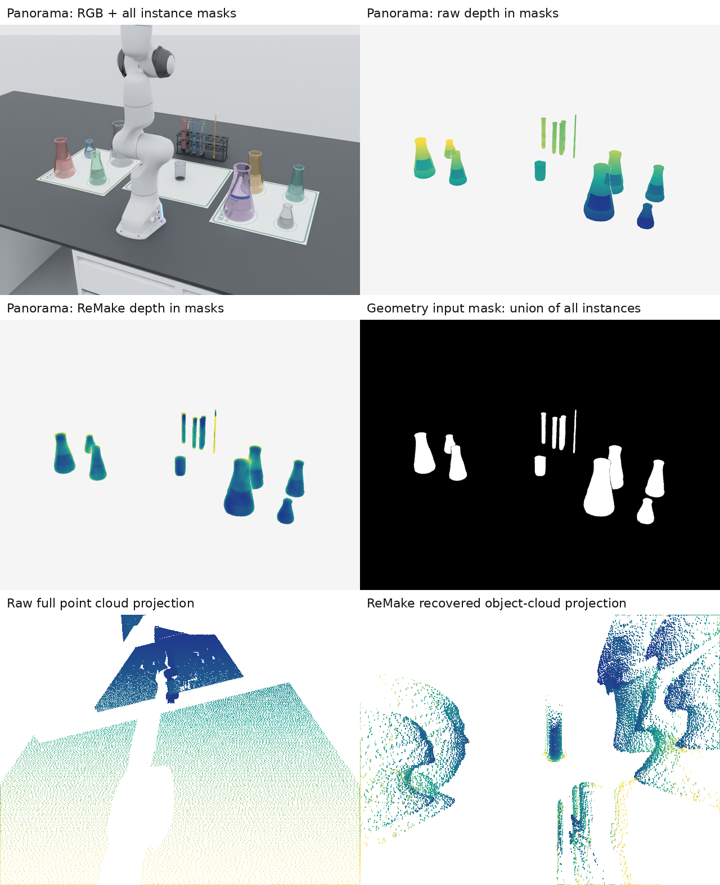
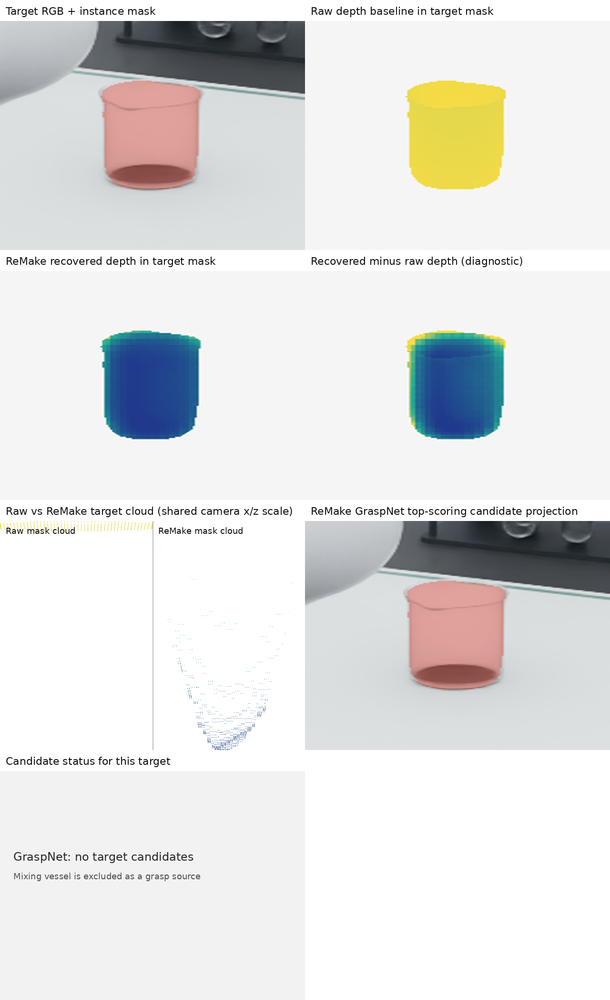
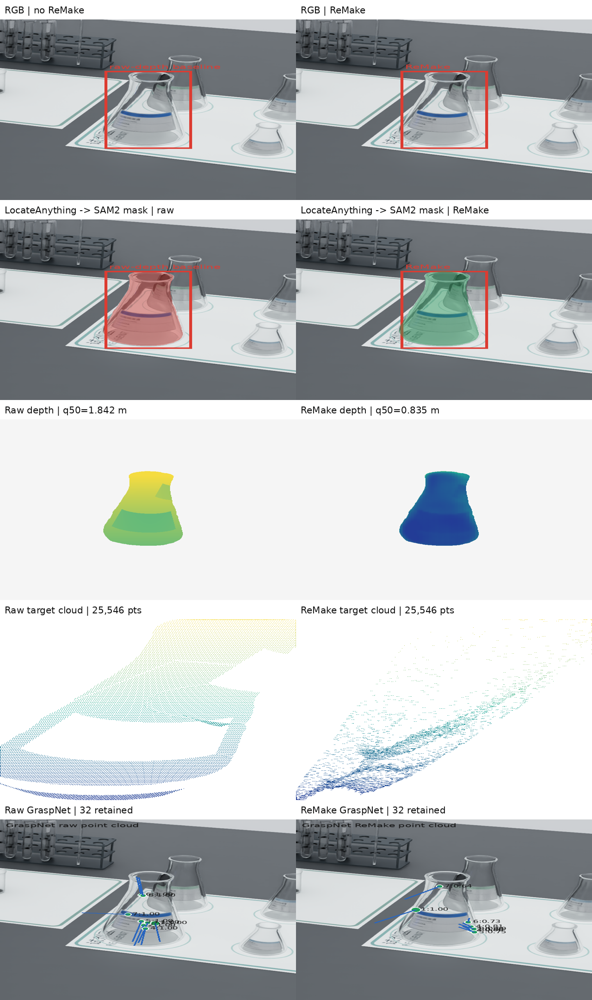

# 透明/玻璃锥形瓶模型对比诊断

日期：2026-10-23（Asia/Shanghai）  
范围：同一 `tabletop_third_person` 观测、同一 RGB/原始深度/实例分割/标定，比较未接入透明几何模型的原始深度基线、ReMake，以及 DFNet 的实际可用状态。报告只使用已有观测 artifact，不读取 USD/仿真真值回填几何。

## 结论摘要

本次目标是 `mixing_vessel` 类锥形瓶，选取回放中置信度最高、位置最适合作为工作流目标的实例：`entity://observed-45e51b6def3b416da8ef696395dad39c`，mask 框 `[774,603,829,695]`，置信度 0.99。它是场景理解类别，不代表系统已通过瓶型/身份真值验证。

| 路线 | 当前结果 | 直观判断 | 选型含义 |
|---|---|---|---|
| 未接入透明模型：原始 RGB-D / raw depth | RGB 中能看到目标并得到 mask，但 mask 内深度 q05/q50/q95 为 2.019/2.043/2.069 m；历史回放 mask→深度点云为 3,213 点 | 深度集中在远背景区，不能据此确认瓶体表面 | raw-depth 基线可复现，但玻璃瓶体几何仍无可靠证据 |
| ReMake | 同一目标生成 4,100 点的 object point cloud；深度 q05/q50/q95 约 0.739/0.830/1.205 m；该锥形瓶没有抓取候选（当前探针把 mixing vessel 排除为抓取源） | mask 内有连续的恢复深度和点云；不把别的物体候选借给它 | 作为下一轮主候选验证；仍需几何误差/瓶口功能点验证 |
| DFNet | `dfnet-r2-20261023-a` 在 understanding 阶段失败，缺少 DFNet checkpoint | 没有可比较的模型输出 | 不能把 DFNet 判定为效果差，先补齐权重并重跑同一输入 |

**当前建议：** 如果必须先选一个继续工程验证，选 ReMake；理由是它在同一输入上留下了恢复深度和逐物体点云，且该实例的局部几何提取可复现。这个选择表示“下一轮验证优先级”，不表示 ReMake 已通过玻璃几何精度或可执行抓取验收。

## 全景中间结果



全景图从左上到右下依次为：RGB 与全部实例 mask、raw depth、ReMake depth、用于恢复的多实例 union mask、原始整帧点云投影、ReMake 逐物体点云投影。颜色只用于显示深度/点云结构，不代表真值误差。

## 工作流目标锥形瓶



目标对象引用：`entity://observed-45e51b6def3b416da8ef696395dad39c`。像素框为 `[774, 603, 829, 695]`，mask 像素数为 `4,100`。

图中八个面板依次展示：

1. RGB 与目标实例 mask；
2. 同一 mask 内的原始深度基线；
3. ReMake 恢复深度；
4. `ReMake - raw` 的诊断差异；
5. raw-depth 与 ReMake 目标点云并排投影，采用共同相机坐标显示范围；
6. 当前目标候选状态；该锥形瓶在这条探针工作流中是容器，被排除在抓取源之外，因此没有对应 GraspNet 候选；
7. DFNet 运行状态，明确标出缺 checkpoint、无模型输出；
8. 预留空白面板，不承载推断信息。

候选不是执行结果：当前 `process_preparation` 仍为 `unavailable: geometry/feature qualification remains unverified`，没有启动运动。

## 目标对象数值对比

| 指标 | Raw depth 基线 | ReMake |
|---|---:|---:|
| mask 像素 | 4,100 | 4,100 |
| 深度 q05 / q50 / q95（m） | 2.019 / 2.043 / 2.069 | 0.739 / 0.830 / 1.205 |
| 几何点数 | 历史回放 `replay-cloud-7.npy`：3,213 | 4,100 |
| 几何状态 | 历史回放成功提取局部 geometry/features；深度统计仍集中在约 2.04 m | `unverified_estimate`, `visible_surface` |
| GraspNet 候选 | 不适用：该锥形瓶不是抓取源 | 不适用：该锥形瓶不是抓取源 |
| `proposed` 候选 | 不适用 | 不适用 |
| 最高候选分数 | — | — |

Raw depth 与 ReMake 的深度值不应直接被当成“ReMake 误差为多少”：当前没有目标锥形瓶的独立公制真值测量。这里的价值是展示模型是否从原始深度的背景/错误表面中恢复出可供后续点云查询的结构。

## 模型状态与复现证据

- 主对比记录：`out/releases/v16.0.0/remake-r2-20261023-c/perception.json`
- 同帧 RGB：`out/releases/v16.0.0/remake-r2-20261023-c/artifacts/labutopia/rgb/aee040c9364741cdb2242ce505a3f096.png`
- 原始深度：`.../depth/d36b98d9728f4ee284db7b41d7c3b2eb.npy`
- ReMake 恢复深度：`.../recovered-depth/706ec2206c5842fe91494f6520f523a9.npy`
- ReMake 透明区域 mask：`.../transparent-mask/e2aab2850fcf448ba3eef3cf9458f508.npy`
- 目标 mask：`.../instance-mask/7fdff4eebe354d33b593cfb8c8537aa4.npy`
- 目标点云：`.../object-point-cloud/3d699527aefb46b2a02479201b85a40a.npy`
- 目标候选摘要：`assets/transparent-model-comparison-20261023/target-summary.json`
- DFNet 失败记录：`out/releases/v16.0.0/dfnet-r2-20261023-a/perception.json`

本次可视化由 `scripts/render_transparent_model_diagnosis.py` 生成：

```bash
.venv/bin/python scripts/render_transparent_model_diagnosis.py \
  --run out/releases/v16.0.0/remake-r2-20261023-c \
  --out docs/diagnostics/assets/transparent-model-comparison-20261023 \
  --target-index 7
```

## 后续选型顺序

1. 先补齐 DFNet checkpoint，在同一 RGB、mask、标定和 GraspNet 设置下重跑；否则只能比较 raw 与 ReMake。
2. 对目标锥形瓶单独测瓶口、瓶身接触区和深度覆盖率，不用全图平均值替代。
3. 对两个模型使用同一候选采样和准备检查，比较 `proposed` 数量、最高分、候选落点是否覆盖可夹持区域。
4. 只有在独立几何误差和准备资格通过后，才把“候选更多/分数更高”转化为执行模型选择。

## 补充对照：LocateAnything 指定目标后的五行对比（2026-10-24）

上一版使用的是回放中的场景理解实例 mask；本次改为完整执行 `LocateAnything → SAM2 → RGB-D → GraspNet`，并把同一个目标 mask 同时交给 raw-depth 和 ReMake 两条几何路径。主图集中显示右侧大型锥形瓶，左列为未加入 ReMake 的 raw-depth，右列为 ReMake。



### 本次结果

| 指标 | Raw-depth | ReMake |
|---|---:|---:|
| 目标 mask 像素 | 25,546 | 25,546 |
| 深度 q05 / q50 / q95（m） | 1.706 / 1.842 / 2.191 | 0.715 / 0.835 / 1.097 |
| 目标点云 | 25,546 | 25,546 |
| GraspNet 解码候选 | 915 | 259 |
| GraspNet 保留候选 | 32 | 32 |
| 最高分 | 1.000 | 1.000 |

LocateAnything 使用 `800x600` 缩放输入查询 `conical flask`，返回 8 个框；选定框从缩放图 `[498,306,573,442]` 映射到原图 `[996,612,1146,884]`。SAM2 使用该框生成 mask。两侧使用同一 RGB、同一 mask、同一标定和同一 GraspNet 设置。

### 错误原因与修复

| 问题 | 原因 | 修复 |
|---|---|---|
| 原图直接运行 LocateAnything OOM | 1600x1200 输入在模型加载后触发约 5.93 GiB 推理峰值，显存余量不足约 10 MiB | 使用 800x600 缩放图推理，再将框按 2 倍映射回原图；模型权重未被删除 |
| 之前图中锥形瓶没有 GraspNet 位姿 | 旧探针把 `mixing_vessel` 作为容器排除在抓取源之外 | 新诊断仅为离线对照，直接对 LocateAnything/SAM2 目标点云调用同一 GraspNet Provider；不进入运动准备 |
| 旧图目标不够明显 | 全景图展示整帧，目标像素区域较小 | 新增目标裁剪五行双列图，固定显示 RGB、分割、深度、点云和位姿 |
| DFNet 没有结果 | 当前配置目录只有 `remake.tar` 与相对深度权重；本地常见缓存路径未找到 `dfnet.tar`，已有 run 在 understanding 阶段因 provider failure 退出。Google Drive 请求超时，Baidu 提取码校验失败，未取得 checkpoint | 保留 `pending_checkpoint` 状态；取得官方权重后复用同一目标和配置重跑，不能用 ReMake 代替，也不能把缺权重写成模型效果差 |

本次对照仍是离线诊断。GraspNet 分数和候选数量不等于碰撞通过、几何真值精度或运动授权。

详细产物见 [`transparent-model-comparison-20261023-locateanything.md`](transparent-model-comparison-20261023-locateanything.md)。

## ReMake Agent 标签与参数化动作复核（2026-10-24）

使用同一 `tabletop_third_person` 传感器，通过现有 `isaacsim_lab.agent_host` 发起只读 Agent 任务。新运行目录：`out/releases/v16.0.4/agent-label-qualification-token-budget/`；任务 `task_1d02787c63b24544` 最终状态为 `succeeded`，完成节点 `complete_read_only_inspection`。运行设置了 `OMNI_KIT_ACCEPT_EULA=YES`，但没有启用模拟运动。

### 标签观测结果

Agent 从 RGB-D 识别出试剂瓶类别，但无法可靠读取八个锥形试剂瓶标签上的文字，因此没有给瓶子赋予化学身份。另一个左后方大瓶被机械臂明显遮挡，瓶身、标签和瓶口均不完整。原始理解结果保存在 `artifacts/labutopia/understanding/db64da726c4c4c41bdc672bbf159e28b.json`；RGB 与观测图像保存在 `artifacts/labutopia/rgb/911d08d9b23440ab857497bc463dee9e.png`、`rgb/524cc57f54ba4682b849c342f90a65af.png`。因此当前结论是“瓶体类别可辨，标签文字不可读/身份未解析”，不能据此选定试剂瓶执行倾倒。

### Provider 错误及修复

首次启用 EULA 后，模型响应在 `4060` 字符处结束，解码位置为 `line 136, column 31, position 4060`，输出恰好终止于未完成对象。这确认失败原因是视觉结构化输出的 `max_output_tokens=2048` 不足以容纳本场景八个目标及属性，而不是 ReMake 几何恢复失败。

| 检查项 | 修复前 | 修复后 |
|---|---|---|
| 输出预算 | 2048 tokens，八目标 JSON 被截断 | 默认提高至 4096 tokens，仍可由 Provider 构造参数覆盖 |
| 失败诊断 | 仅保存 `JSONDecodeError` | 保存输出长度、行列/字符位置及最多 640 字符的局部响应摘录 |
| Agent 结果 | Understanding 返回 provider failure，任务停在 `executing` | 新运行完整返回 understanding，Agent 任务结算为 `succeeded` |
| 标签身份 | 无有效判读 | 八个试剂瓶标签均标记不可可靠读取；不推断内容 |

失败响应与修复后结果分别保存在 `agent-label-qualification-final/` 与 `agent-label-qualification-token-budget/`。两次失败尝试均未产生动作；其遗留任务已通过 Coordinator `cancel_task` 生命周期接口正常取消，未直接修改数据库。修复后运行也生成 ReMake 恢复深度、实例 mask、逐物体点云和 understanding artifact；这些表示估计结果，不代表独立真值或几何精度验收。

### 倾倒/搅拌动作参数检查

Agent Host 指引使用已有通用 `pour_cycle` 与 `stir_cycle` 能力。倾倒的 `tilt_rad`、`hold_s`，以及搅拌的 `radius_m`、`depth_m`、`turns`、`duration_s`、`direction` 均从子任务 `parameters` 传入；没有动作顺序、瓶数或数值默认值写死在提示中。集成测试确认参数投影保留原值，Agent Host 测试确认缺少工艺参数时要求补充输入。

本次成功 Agent 运行是只读标签资格检查，不是倾倒/搅拌动作执行测试。任务未提供这些工艺参数，且标签、瓶口/棒端功能点和运动准备均未通过，因此没有创建动作节点，也没有模拟器或真实机械臂运动证据。要执行后续动作，需先补充目标选择及工艺参数，并完成针对该目标的清晰观测和 `manipulation.prepare`。

