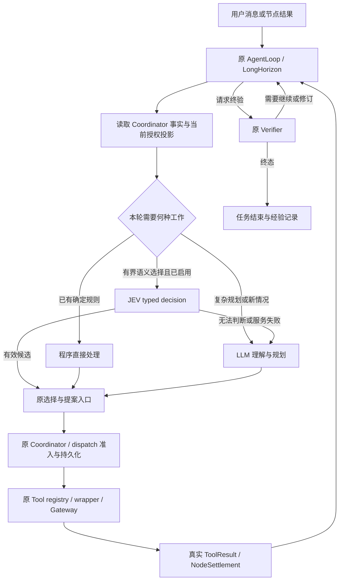

# JEV 参与 PAOS Agent Loop 的重构诊断与实施设计

日期：2026-10-14。源码参考：`eb789fcb`，分支 `feature/planning-loop`。
状态：诊断与拟议架构；本次保存文档，运行代码、模型配置和 Runtime 均未修改。

同日复审：依据源码 `32b6812f` 和最近十次真实任务（会话 80–89）修订实施顺序，详见
[多次运行诊断](JEV_RECENT_RUNS_DIAGNOSIS_20261014.md)。86 次已持久化节点选择全部为单 Tool 候选，
19 次已走确定性路径，7 次 scene.bind 均遗漏相同三个来源字段；应先完善输入/交接和常规片段，再接 JEV。

## 1. 结论与重构目标

建议把 JEV 接成 **同一个 Agent Loop 内可选的局部语义决策能力**，覆盖入口、方法选择、
节点选参、常规分支和经验检索。大语言模型负责目标理解、计划构造、跨步骤约束、开放参数、
新情况分析与复杂恢复。确定性程序负责事实读取、精确投影、调度、执行对账和已定义状态转移。

因此，System 1 应贯穿 Agent 的多个决策点；System 2 在需要构造新方法或解释复杂情况时介入。
Agent 是这条完整闭环的宿主，JEV 和大语言模型是它使用的两类认知能力。

本次重构的成功标准是：在任务质量与既有执行约束保持的条件下，减少每个有效节点、每个完成任务
的生成式模型调用和用户等待。仅增加一个分类器，或给每次大模型调用再增加一次 JEV 调用，达不到该目标。

推荐实施主线：**selection 成功直接交接 → 声明式输入与紧凑工作集 → 常规方法片段可执行化 →
JEV 节点/片段选择 → 有证据支持的局部恢复与复杂规划升级**。入口和 Lesson 排序独立推进，
收益单独核算；不让已有完整确定结果再经过 JEV。

## 2. 本地测试实际支持什么

### 2.1 实测结果

数据来自 2026-10-09 的同一组合成中文数据：20 条 development、60 条 evaluation。
本次读取既有 JSON 产物并按 `case_id` 与 gold 重新核对，没有重新调用在线模型。

| 指标 | JEV evaluation 实际值 | 架构含义 |
| --- | ---: | --- |
| 返回合法联合答案 | 54/60，90.0% | 远程服务不可作为必经且无回退的入口 |
| 有效答案中的 intent 正确 | 54/54 | 支持已测类别的有限语义判断能力 |
| 有效答案中的 intent/route 联合正确 | 51/54，94.4% | 不能作为全部请求的成功率 |
| 全部请求的联合成功 | 51/60，85.0% | 包含 6 次最终失败后的真实覆盖边界 |
| 应进 System 2 的有效请求 | 17 条，3 条错分 conversation | 升级召回为 14/17；必须单独优化复杂请求的识别 |
| HTTP 尝试 / transport failures / 重试 | 77 / 23 / 17 | 交互路径不能照搬离线重试配置 |
| 成功单次尝试延迟：均值 / 最大值 | 1.351 s / 28.782 s | 均值不含此前失败尝试和等待，需另测端到端尾延迟 |
| route ECE / multiclass Brier / NLL | 0.104 / 0.084 / 0.186 | 概率有参考价值；仍需按决策任务单独校准 |

三个 route 错误是 `e05a/e05b/e05c`，均为 `system2 -> conversation`，属于同一 family。
这给出一个明确的失败模式，不能把三个相近变体当成三种独立失败原因。

evaluation 的 gold intent 实际分布为：status_query 24、task_control 24、analysis 6、
clarification_answer 6。它没有覆盖 new_task、conversation、mixed_or_unclear；gold route
也没有 conversation。development 还出现过 `new_task -> task_control` 错分。

因此，已有数据支持“JEV 值得进入有限决策验证”，尚未证明完整入口分类、Skill 选择、节点选参、
续段或恢复能替换大模型。后面这些能力均是待验证设计候选。

三个 Laya checkpoint 在相同 evaluation 上的联合正确率为 25.0%、38.3%、41.7%，虽然本地
成功推理均值为 34–61 ms，当前配置不能作为已合格的快速替代。此次 JEV 请求使用
`jev-latest`，实际返回 `jev-1.13.0`；应记录真实服务版本，不能将本次结果视为未来版本保证。

### 2.2 证据位置

- [对比报告](SYSTEM1_INTENT_ROUTING_COMPARATIVE_EXPERIMENT_REPORT_20261009.md)：指标定义与测试方法。
- [结果记录](SYSTEM1_INTENT_ROUTING_EXPERIMENT_RESULTS_20261009.md)：各 run 与已知错误。
- 原始 evaluation：`out/jev-intent-probe/20261009T102953Z-4c8740d6/{predictions,attempts,errors}.jsonl`、`metrics.json`。
- 数据与配置：`research/decision-api-intent-probe/samples.jsonl`、`jev_config.json`。
- 既有 runner 是离线预测工具；其输出不创建 task，也不执行选中的 route。

## 3. 当前问题的诊断

### 3.1 入口简化只能解决一部分开销

`AgentLoop._process_message()` 负责消息、会话与澄清；普通消息随后进入生成式回合。
入口分类可以减少状态查询和明确任务控制的生成式调用，但复杂任务运行后的每个节点仍可能调用模型。
要显著减少重复调用，需要同时拆开节点中的“局部选择”和“开放推理”。

当前 waiting_for_user 入口在处理普通消息时直接把下一条文本交给 `resolve_clarification()`。
若用户此时问进度或要求暂停，单凭“任务正在等待回答”不能证明新消息就是答案。
重构应先保留显式命令处理，再判断消息与待回答问题的关系，之后才调用原澄清 owner。

### 3.2 已有可复用的闭环骨架

| 当前位置（源码参考时的行号） | 已有职责 | 本次应如何利用 |
| --- | --- | --- |
| `agent/loop.py:467` `persist_deterministic_query_selection` | 唯一、输入完整且无需语义选取的只读 Query 直接选定 | 保留零模型路径；不要为已确定结果增加 JEV |
| `agent/loop.py:826` `_run_agent_loop` | 模型/工具迭代、预算、可见工具、进度与失败 | 容纳认知能力切换，复用工具消费与记录规则 |
| `agent/loop.py:1857` `run_node_turn` | task/revision/node 与 SkillUse、节点上下文 | 主要替代位置；JEV 和 LLM 消费相同来源的事实 |
| `agent/planning_loop.py:1069` `AgentLoopNodeExecutor.__call__` | blocked 检查、执行对账、pending selection 消费、节点回合 | 先处理既有事实，再请求新的认知决策 |
| `agent/loop.py:1950` `run_segment_continuation_turn` | 段结束后的继续、重规划、验证与澄清 | 局部类别可拆；新节点图仍需规划能力 |
| `agent/recovery_decisions.py:217` `select_recovery` | 已知效果/证据失败的确定性处理，其他情况调用模型 | 已确定分支不改；复杂恢复保留 LLM |
| `agent/experience/activation.py:251` `relevant_lessons` | 同 Skill/version 内词重叠过滤与排序 | 候选语义重排；它当前不消耗 LLM 调用 |
| `agent/prompt_context.py:1547,1649` | node/continuation 的只读工作集 | 同源构造 JEV 的紧凑投影，保留任务阶段和目标事实 |
| `planning/contracts.py:563` `DecisionTrace` | 选择依据、证据、可恢复 selection | 复用持久化归属；模型输出不另建事实库 |

表中路径均以 `PhyAgentOS/` 为前缀，行号属于上述源码参考。实现时用符号定位。

### 3.3 更换模型不能修复事实投影缺口

近期 continuation 诊断已发现：执行事实存在，但压缩后的模型工作集未重建 Skill、完成效果与目标状态，
从而产生重复读取和重复思考。当前投影已加入 workflow、phase、completed effects、goal ledger 和
current-world context。JEV 接入必须消费这些已有投影，避免再从完整聊天历史另造一套摘要。

同样，当前实体身份歧义、缺失引用、scene lineage 失配由既有 Coordinator/consumer 处理。
事实不足时，应取得 Query 证据、澄清或进入原恢复路径。提高模型能力或置信度不能补出观测事实。

## 4. 依据 PAOS 原则划分所有权

| PAOS 原则 | 重构约束 |
| --- | --- |
| 认知与执行分离 | JEV/LLM 产生选择或提案；工具执行始终走原 registry/wrapper/Gateway |
| 唯一任务事实源 | Coordinator/SQLite 持有 task、revision、selection、record 与 settlement |
| Execution / Evidence / Verdict 分离 | JEV 概率不证明执行完成；任务成功仍由原 Verifier 判定 |
| node-scoped、证据驱动 | 输入来自当前节点授权事实与相关方法；下一步取决于真实结果 |
| Skill Use 与 Runtime Binding 分离 | 推荐或切换方法不转移在途执行 ownership，不隐式重绑 Runtime |
| 通用扩展 | Core 只认识决策类型、候选引用、ToolSpec 和现有状态；业务语义归 Skill/adapter |
| provider-neutral | 定义独立 typed decision capability；JEV 实现与普通 chat provider 分开 |
| 一节点一结算单元 | 工具链由原子节点组成，除非某个既有 Tool 真正拥有完整复合效果 |
| 有界与可恢复 | 共用既有回合预算、deadline、执行对账和持久化恢复，不增加第二个执行循环 |
| Anti-OverDefense | 用现有类型、版本、事务、测试和执行边界，不新增 hash、冻结协议或审批平台 |

依据：[框架介绍](../zh/01-framework-introduction.md)、[开发者手册](../zh/03-developer-manual.md)、
[Planning 设计](PLANNING_MODULE_DESIGN.md)、[Tool 输入选择](AGENT_TOOL_INPUT_SELECTION_DESIGN.md)、
[Runtime ownership ADR](../adr/0001-runtime-ownership-and-skill-use.md)、
[扩展指南](../user_development_guide/README.md)。

## 5. JEV 可以承担哪些工作

以下“可承担”表示结构上适合、需要相应测试后启用；只有入口两道 choice 已有本地实测。

| 决策点 | 程序先做什么 | JEV 候选职责 | 大语言模型保留什么 | 收益与顺序 |
| --- | --- | --- | --- | --- |
| 消息入口 | 命令解析、会话/task 关联、可用控制动作 | 意图、与澄清问题的关系、明确控制语义 | 新任务、混合要求、解释和歧义消解 | P1；已有部分测量 |
| Skill/方法发现 | 读取可用目录，按现有版本和能力条件筛选 | 按目标对现成方法排序，允许无合适候选 | 组合新方法、比较冲突约束、生成任务计划 | P2；减少目录阅读和部分选择回合 |
| 节点 Tool 选择 | 产生真实候选，确定性选取已适用 Query | 在多个合法实现中匹配当前节点的语义要求 | 方法未知、需要新增步骤或开放参数 | P1；最直接的节点回合替代候选 |
| 节点输入与实体选择 | 提供授权 source、可选实体、完整字段投影 | 选择现成候选 ID、属性/指代匹配、预定义参数档位 | 多跳空间关系、冲突指代、开放文本/数值构造 | P2；无需生成大段 JSON |
| Skill 中的局部分支 | 获取最新结果并计算精确条件 | 在方法已定义的分支中判断文本语义 | 新分支、跨节点约束、新事实调查方法 | P2/P3；减少重复理解方法 |
| 段续接 | 读取当前 goal ledger、settlement 与可用片段 | 现成下一片段的适配选择或请求正式验证 | 生成新 graph、重规划、复杂完成条件分析 | P3；只有省掉后续 LLM 才计替代 |
| 失败处理 | 先消费机器可判定故障、unknown 对账与既有恢复约束 | 对已解释清楚的常规失败匹配已有恢复方法 | 根因分析、多因故障、新恢复图、不可满足目标 | P4；逐类验证，复杂恢复优先保留 LLM |
| Lesson/上下文排序 | Skill/version/scope 过滤，保留必需事实 | 同 scope 的语义相关性排序 | 条件冲突、经验抽象、迁移有效性分析 | 可并行；属于检索增强，可能增加成本 |
| 经验分类 | 持久化 episode、执行与 verdict 关联 | 已有类别/cluster 匹配、候选相关性 | 新 Lesson、因果归因、Skill 修订与评估解释 | P4；离线辅助 |

明确保留给程序的工作：ID/版本匹配、依赖拓扑、状态轮询、精确字段取值、已定义状态转移、
schema 校验、settlement、预算计时。控制器继续负责实时运动、轨迹和底层反馈。

明确保留给 LLM 的工作：把开放目标转成可执行的当前语义片段、构造 DAG、处理新约束、开放生成、
解释未知异常、设计新方法。恢复选择即使只有 stop/replay/replan 三项，也可能包含复杂因果推理。

## 6. 目标架构：同一闭环，三种决策方式



图中状态读取等纯信息响应可以直接返回用户；需要改变任务或执行 Tool 的结果才进入对应原接口。
System 1 和 System 2 的输出共享下游所有权与准入边界。

### 6.1 组件位置与扩展方式

拟议新增文件名称是实现建议，并非当前已有 API：

| 位置 | 建议变更 | 边界 |
| --- | --- | --- |
| `providers/decision.py`（拟新增） | 小型 DecisionProvider 协议与内存结果类型 | 只表达有限问题、候选、概率、服务失败 |
| `providers/jev.py`（拟新增） | JEV HTTP 适配、版本/用量/延迟返回 | 复用项目 HTTP 基础设施，不依赖 Gateway/SQLite |
| `agent/decisions.py`（拟新增） | 决策点适用性、题目构造、结果消费和升级策略 | 策略属于 Agent；没有自己的 task 或执行调度 |
| `agent/prompt_context.py` | 从同源事实构造紧凑 decision view | 必需 workflow、goal、效果与证据保留；只裁掉无关内容 |
| `agent/loop.py` / `agent/planning_loop.py` | 在新的节点模型调用前接入可选 decision 路径 | 原 resume、selection、Tool 执行和进度记录复用 |
| 原 Skill activation / recovery / continuation | 后续分批接入相同能力 | 不在第一阶段同时改造全部路径 |
| 现有 config / providers 装配位置 | 配置 provider 和各决策点的 off/shadow/active | 默认关闭，关闭即恢复原认知路径 |

上述路径以 `PhyAgentOS/` 为前缀。当前只需普通可选 provider 与窄接口；没有独立进程、专用数据库
或大型插件框架的必要。以后出现本地 GPU 依赖冲突、进程隔离等实际需求，再通过同一协议接 worker。

`PlannerPlugin` 要求 compose_plan/propose_replan；JEV 的候选选择不满足完整 planner 接口。
也不应把 JEV 包装成伪造 tool calls 的 chat provider。业务调用点使用通用 typed capability，
增加其他实现时只替换 provider 和其已验证的能力范围。

### 6.2 最小决策输入与结果

输入由宿主构造：决策点、当前消息/目标、必要的方法约束、当前事实、候选 ID 与描述、现有身份引用、
本轮剩余时间。仅向远程服务发送该问题需要且允许发送的文本投影；图像、完整历史和内部配置不随意附带。

结果是以下三类普通内存值：

```text
selected: candidate_id + probabilities + observed_model_version + timing/usage
escalate: 固定原因码，如 insufficient_context / no_suitable_candidate / ambiguous
unavailable: timeout / transport_error / invalid_response
```

它们是认知处理结果，不是 task 或 Tool 的终态。HTTP/类型失败由 adapter 报告；语义弃权和
任务适用性由 Agent 消费。JEV 的 choice 选择已提供候选，score 对描述等级评分，noul 判断 yes/no
概率；首阶段只依赖项目实际测过的 choice，其他题型按需单独验证。

Tool 与参数相互依赖时，候选必须是程序能够完整解析的选择组合，或先选 Tool 再生成该 Tool 的候选。
不能把分别独立选出的 Tool、实体、source 和参数强行拼成一次有效调用。
若组合规模很大或缺少可枚举参数，直接走原 LLM 节点回合。

候选匹配后，程序把 ID 解析成原 `forge_plan_select` 所需的 Tool、source 和语义选择，沿用现有
consumer projection 与 schema 校验。精确坐标、几何、传感器数值和执行身份来自原事实 owner。
`decision_reason` 可记固定来源与候选匹配结果；需要因果解释时由 LLM 提供，不伪造 JEV 推理文本。

## 7. Agent Loop 必须如何运行

### 7.1 节点闭环

1. 读取当前 task/revision/node、有效 settlement、暂停/取消状态及现有执行记录。
2. 已有 invocation/record 时按原 `_resume_node` 对账；blocked selection 按当前顺序处理。
3. 有可消费的 pending selection 时使用原恢复消费路径；不再为同一选择调用 JEV 或 LLM。
4. 满足现有唯一只读 Query 规则时使用 `persist_deterministic_query_selection()`。
5. 需要新的语义选择时，检查该决策点是否已经验证并启用、事实是否齐备、候选是否完整可消费。
6. 符合条件才调用 JEV。有效选择经原 admission 持久化；弃权、不可用或不能消费的答案交给 LLM。
7. LLM 接收原目标、当前完整必要投影及固定失败原因；一次升级后本轮不再回到 JEV。
8. selection 成功后立即结束节点认知回合，原 executor 经 registry/wrapper 消费；不再请求模型决定“执行它”。
   独立处理 selection handoff，保留决策/执行预算区别、工具使用记录、经验归因、进度与失败语义。
9. Query 结果或 Action/Session 终态结算后，重新读取事实，再决定下一节点、续段、恢复或终验。

接入 JEV 时需复用或抽取现有工具消费逻辑，避免复制一套执行与记录实现。
现有零模型快速路径只涵盖特定 Query；不能因为某个 Action 只有一个候选，就把它自动归入该路径。

### 7.2 何时让 System 2 介入

- 当前决策需要生成新的方法、DAG、约束组合、开放参数或说明。
- 事实缺失、候选不足、候选意义冲突，或这一决策类型尚无质量证据。
- 当前任务有多意图、目标变化、新增约束，或不能确认输入是否回答了待澄清问题。
- JEV 弃权、答案不符合当前候选、服务失败，或该决策点的质量策略不接受其结果。
- 真实结果表明现有方法不适用，需要调查、重规划或新的恢复图。

升级只增加推理能力。外部事实仍经现有 Query 或用户澄清取得；确定性 blocked admission 不能被
“再问大模型”改成执行许可。模型无可用候选时可解释缺口或选择原有恢复操作。

### 7.3 预算、超时与恢复

JEV 的离线配置为 30 秒 timeout、最多 2 次 transport retries；这适合收集实验数据，不能直接用于
减少交互等待。在线 JEV 使用本轮剩余 deadline 的一部分，为 LLM 回退留时间；首版采用单次有界尝试，
具体时间与置信策略由新的校准集和实测延迟决定，不照抄固定概率阈值。

显式停止命令和取消处理继续使用原路径，不等待 JEV。取消在途认知请求不表示物理执行已经停止，
真实停止状态仍来自原执行 owner。

JEV 调用失败仅导致认知升级，不等同于恢复策略 STOP。若 LLM 也失败，走该调用位置原有的
provider-failure 语义。当前 node executor 有 `waiting_for_agent_provider` 恢复路径；
`select_recovery()` 的模型异常则会返回 stop，两者不能混称为同一个行为。

在 JEV/LLM 请求返回前 task/revision/scene 已改变，答案通过现有身份与准入检查失效；
重新读取当前事实，不能消费旧选择。重启后先读持久化 selection/execution，再考虑新的认知请求。

## 8. 稳定工具序列怎样减少大模型调用

收益有三个不同来源，需要分别实施和计量：

1. **程序替代重复决定。** 已有声明和事实足以唯一决定的 Query、字段映射、轮询与已知恢复直接执行
   原程序路径。这部分节省不归功于 JEV。
2. **JEV 替代局部语义回合。** 已有图的某个节点需要在有限 Tool/输入候选中选择，JEV 成功后能直接
   经原 selection 接口进入执行，从而省掉该节点的 LLM 回合。
3. **复用成熟 Skill 片段。** 对反复使用的方法，把可复用结构留在 Skill 的工作流描述/规划扩展中，
   由既有 compiler 生成当前事实可绑定的节点。JEV 选择现成片段，LLM 处理新方法与偏离情况。

第三项是后续能力设计，不应宣称现有全部 Skill 已经是可直接运行的模板。新片段仍需经过现有编译，
只绑定已取得的 immutable refs；动作后的动态实体不能提前绑定整条长图。source_scope、
predecessor 关系和当前 scene 的约束继续生效。

连续执行的是已确定方法的多个原子节点。每个节点仍有 selection、execution、settlement，
新的事实或用户中断仍能改变后续路径。只有一个 Tool 真正承担完整终态效果时，才暴露复合 Tool。

例如“将当前确认的物体按已知规则归位”：LLM 初次理解目标与约束；程序产生当前可绑定节点；
JEV 在多个合适方法或实体候选中做局部选择；controller 执行动作；Runtime 返回结果；
程序更新证据和当前场景；发生新歧义才让 LLM 重新分析。该流程是拟议示例，尚无本项目 JEV 闭环实测。

## 9. 续段、恢复和上下文的特别约束

### 9.1 续段不能只替换标签

如果 JEV 返回 CONTINUE 后仍必须让 LLM 生成完整节点图，本轮增加了一次分类调用。
只有下一片段已完整定义、当前绑定齐全，程序能沿原接口物化时，才能省去生成式回合。
FINALIZE 仅请求现有 Verifier；Action 成功与目标完成是不同事实。

### 9.2 恢复先利用现有确定性分支

当前 unknown world change、证据失效及部分不可自动恢复情况已经根据持久化事实处理。
JEV 的后续空间是“多种已有常规方法之间仍需语义匹配”的剩余部分。unknown、未确认停止、
有副作用的重放与新的因果诊断继续按原恢复与 LLM 路径处理。

在接入恢复前单独验证：JEV 无答案必须升级，不能默认返回 stop/replay；接受一个标签前还必须满足
已有 replay/replan 条件。任何重规划图仍由完整 planner 或已声明片段产生。

### 9.3 上下文排序必须保留必要工作集

JEV 可重排同 scope 的可选 Lesson、Skill 摘要和辅助文档；当前节点输入、原目标、方法约束、
失败事实、unknown 和必要 provenance 由程序按原规则保留，不参与任意删减。
Lesson 应从现有 Skill/version/status 合法集合做语义候选发现；仅重排词重叠 top-k 无法挽回前面
已经漏掉的同义表达。结果按原数量上限输出，API 不可用时可继续使用原词面排序。

## 10. 分阶段实施与验收

本节按最近十次任务的重复问题调整；具体事件、文件接入和验收矩阵见
[多次运行诊断第 3–7 节](JEV_RECENT_RUNS_DIAGNOSIS_20261014.md)。

### P0：完成选择后直接交接

交付：在原 AgentLoop 增加独立的 selection-success handoff，原 executor 消费持久化选择。
成功选择后新增模型请求为 0；同响应后续调用按原 deferred 语义处理；失败选择仍可纠正。
blocked admission 先于 pending selection 消费，已有 execution 仍由原 owner 对账。

### P1：声明式输入与紧凑工作集

交付：consumer 声明来源映射、程序装配精确参数、对确定性 Query 扩展投影支持。
优先消除七次 scene.bind 的 calibration/observation/scene 字段遗漏；来源/实体不唯一时保留语义选择。
按节点、续段、复杂规划拆工作集，测量 system/Skill/事实/schema/历史组成，保留相关成功、失败和 unknown 事实。

完成条件：来源唯一且输入完整的只读节点使用 0 次模型；多来源不自动选第一条；
跨场景同名实体不复用；提示减少的同时原目标、方法、对账义务和完成效果保持完整。

### P2：常规方法片段可执行化

交付：Skill 声明少量常用发现、绑定与检查点片段，通过原 compiler/continuation 接口物化。
唯一适用且条件完整时程序推进，多种方法需要语义匹配时构成下一阶段的 JEV 候选。
动态实体根据实际结果晚绑定，保留原 source_scope/predecessor 关系和逐节点结算。

完成条件：选定已有片段后无需 LLM 补写图；正常 continuation 不冒充失败 replan；
Query 成功但业务 unavailable 或证据缺口未解决时，不自动推进到依赖该事实的 Action。

### P3：JEV 节点与片段选择

交付：可选 typed provider、JEV adapter、同源决策投影及 off/shadow/active 配置。
先使用保存事实、固定 provider 和 Fake Gateway；影子模式不写 task/执行状态、不阻塞主回合。
只有候选能够完整消费、专项质量达标的决策点才启用；先覆盖只读节点/片段，Action/Session 另做完整验收。

完成条件：接受路径 1 次 JEV、0 次 LLM；弃权/超时至多尝试一次 JEV 后升级，保留回退预算；
先对账再决策，revision 变化拒绝旧答案，不重放 completed/unknown Action。
候选覆盖、原始选择准确率、误接受、升级召回、实际免去 LLM 的比例与含失败等待的耗时分别统计。

### P4：有界恢复与复杂规划升级

交付：依据已有结构化故障和证据缺口匹配已定义调查/恢复方法；新根因、新方法和新图仍由 LLM 处理。
JEV 无答案先升级，不能映射为 STOP；原 LLM 恢复异常仍按原安全语义收敛，并单独标记 provider 原因。
改变该异常的任务生命周期需要另行设计原 Coordinator ownership，不在 adapter 内创建新状态。

完成条件：unknown、持有状态与视觉身份缺口不被模型推断为已解决；暂停/取消/重启通过原机制收敛；
单位任务 LLM 调用与主动运行等待下降，业务结果不被外层 Query succeeded 掩盖。
关闭决策点只回退尚未发生的认知选择，已有 selection/invocation 继续由原 owner 对账。

### 独立工作：入口与经验

入口继续补齐 new_task、conversation、mixed_or_unclear、等待澄清时的新要求，按 family 分离校准与测试。
控制必须明确 pause/resume/stop 操作、目标 task 和当前状态；现有两道 choice 测试尚未验证具体控制操作。
Skill/经验排序独立评估，不作为 P0–P4 的前置条件。历史 60 条入口样本不能证明节点或恢复能力。

## 11. 衡量收益与验证方法

先区分三个量：候选决策占比、JEV 策略接受率、接受后真正免去 LLM 的比例。
把所有模型调用一概估成“可被快模型替换”会高估收益。

对一个原本需要 LLM 的决策，设原耗时为 L，构造候选耗时为 P，含失败等待的 JEV 耗时为 J，
无需再调用 LLM 的比例为 a，升级处理额外成本为 H，近似顺序耗时为：

```text
T_new = P + E[J] + (1 - a) × (L + H)
净收益条件：a × L > P + E[J] + (1 - a) × H
```

这只是选择测量指标的模型。实际报告需使用配对任务的端到端时间、p50/p95、调用数、tokens/费用、
正确完成率、误接受、必要升级召回、重规划次数及无进展回合。当前 1.351 秒不提供 L，也不包含
完整 JEV 失败等待，因此本次不能给出已实现的提速倍数或替代百分比。

新增决策路径的必要回归包括：disabled 行为一致、accepted 无额外 LLM、弃权升级一次、超时保留
回退预算、revision 变化拒绝、pending selection 重用、invocation 对账、取消打断、LLM 同时不可用、
等待澄清时的状态查询，以及 Tool/参数候选组合的一致性。使用固定返回的 provider 和 Fake Gateway。

现有相关测试命令如下，供后续实现回归；新增 provider/decision 测试文件在实现时随功能添加。
这些代码测试未在本次文档修改中运行：

```bash
.venv/bin/python -m pytest -q tests/test_agent_foundation.py tests/test_planning_loop.py tests/test_forge_tool_api.py
.venv/bin/python -m ruff check PhyAgentOS tests
.venv/bin/python -m compileall -q PhyAgentOS tests
```

本次文档验收使用既有 JSON 重新核对计数、源码符号核对、相对链接检查、UTF-8 检查和
`git diff --check`。未运行模型、创建任务、调用 Gateway、读取相机或执行仿真/物理动作。

## 12. 新增机制的必要性与七维设计自检

| 具体失败场景 | 为什么普通版本/类型不足 | 采用的处理 |
| --- | --- | --- |
| JEV 返回合法但错误的 conversation 标签 | 类型只能保证属于枚举，不能证明语义正确 | 分决策点评测、语义弃权与 LLM 升级；不把概率当事实 |
| 远程 JEV 长尾/超时耗尽交互等待 | Git/版本不限制运行时间 | 消费现有 deadline，限制单次等待并预留升级时间 |
| 请求返回时节点状态已变化 | 分类响应不具有任务状态权威性 | 复用已有 revision/scene/selection admission 和事务，不新增 hash |
| 两个独立答案组合后不适配同一 consumer | 单字段合法不代表组合有效 | 枚举完整选择或分阶段选择，复用最终 consumer 校验 |

这是认知分工所需的消费规则，不新增全局 gate、第二套状态库或 Runtime 执行接口。
既有安全、权限、数据完整性与正式发布措施继续生效。

- 架构：一个 Agent Loop、一个 task owner、一条物理执行路径；provider 无副作用。
- 正确性：区分事实、选择、执行、验证；已测入口能力与待测节点能力分别陈述。
- 可观测性：已有事件/trace 关联决策点、provider/model、候选、升级原因与耗时；不新建事实账本。
- 恢复与幂等：先对账再决策，消费原 pending selection，模型切换不重复执行。
- 机器人安全：控制、准入、校准、限幅、碰撞与终验仍归原 owner。
- 扩展：新增模型改 provider，新增方法改 Skill，新增能力改 ToolSpec/adapter；Core 无对象专用分支。
- 收敛：一个决策点至多一次 JEV 尝试后升级；已有预算和 provider-failure 路径终止无进展循环。

后续实现首先完成 P0 与 P1 的只读节点切片，再通过 P2 形成完整的阶段消费链；P3 才启用 JEV 替代。
入口同步补齐复杂请求、澄清和具体控制操作的数据。所有开关以各决策点的实际验收决定，不以单次演示代替质量证据。
