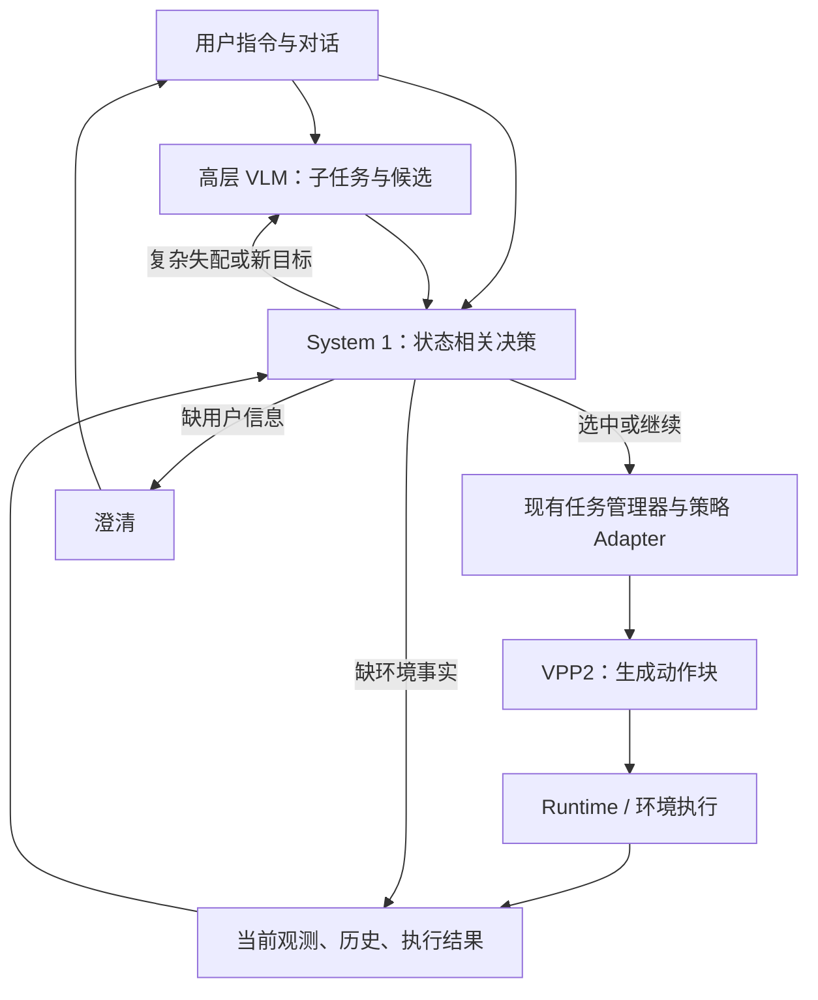

# VLM—System 1—VPP2：执行前与执行中的桥接决策诊断

日期：2026-10-15。关联：[具身决策数据集与模型诊断](EMBODIED_SYSTEM1_DATASET_AND_MODEL_DIAGNOSIS_20261015.md)。
用户问题：在上层 VLM 和下层 VPP2 之间增加 System 1 模型，用于匹配详细指令与执行，是否适合作为数据集和模型研究方向？

## 1. 结论与研究问题

该位置适合研究低延迟、状态相关的执行决策：判断上层子任务是否忠实于用户目标、能否绑定当前对象、是否适合当前策略，以及何时继续、切换、补充信息或请求重规划。
VPP2 是语言与视觉条件下生成连续动作块的策略；它通常不提供一个供分类器直接选择的固定动作名称表。
因此“匹配”应定义为目标—场景—能力—执行阶段的兼容判断，而不是指令文本与关节动作名称之间的相似度。

若上层已经给出正确、适用且完整的指令，中间模型只重复确认，新增时延可能大于收益。
研究价值来自可测量的指令失配拦截、有效子任务续接、及时恢复，以及减少高层 VLM 的重复调用。
三层连线本身不是充分的方法贡献，需要与已有 VLM+VPP2、提示增强、规则和通用小模型作对照。

## 2. 官方资料核查

用户提供 Gemini 说明全文及分享链接。分享页最初只返回登录壳；以下事实依据官方论文 v3、项目主页和公开代码，未把转述中的性能/部署承诺直接当作事实。
仓库核查版本：`roboterax/video-prediction-policy-2` 的 `72c17acf022494ff63617be86079bb92e92f5bf8`，提交时间 2026-10-12T04:57:04Z。
论文：[arXiv:2610.10270v3](https://arxiv.org/html/2610.10270v3)，修订日期 2026-10-13。

| 核查项 | 官方资料支持的事实 | 对本研究的含义 |
|---|---|---|
| 高层 VLM | 第 3.3 节明确由 VLM 负责子任务规划、语义理解和记忆，并生成贴近训练字幕的详细描述 | VLM+VPP2 已有；需证明中间决策层的增量 |
| 高层规划实验 | v3 Figure 9：五个任务组、每任务 50 次；平均成功率由 27.6% 到 57.6% | 应以带 VLM 的系统作为关键对照，不能只对比裸 VPP2 |
| 视频主干训练 | 第 3.2 节为动作训练早期冻结主干基础参数，同时通过 LoRA 适配 | 不能概括为所有阶段完全冻结 |
| RoboDojo 配方 | 当前公开版本为 joint Video + Action2B，包含历史帧条件 | “完全无记忆”不是该版本的准确描述 |
| 动作专家 | 论文通用专家 0.9B；当前 LIBERO 文档约 1B，RoboDojo 为 Action2B | 需选择具体模型配方，不能混用配置和性能 |
| 延迟 | 第 3.2 节报告 BF16、torch.compile、五步动作去噪下约 0.12+0.10=0.22 秒/块 | 是该设置的推理时间；不是未来预测时间跨度，也不是完整控制频率保证 |
| 当前 RoboDojo 推理 | 10 Euler steps、shift 1、horizon 32/execute 24、history 8/stride 25 | 与论文延迟段设置有差异，接入时需重新测量 |
| LIBERO 输入 | 两视图横向拼接，224×448；动作 7 维，本体状态 8 维 | 不应统一假定所有版本都用 416×240 和同一动作空间 |

详细语言不能唯一确定物理轨迹；相同目标通常允许多种有效运动。视频预测也是模型假设，实际执行结果由观测和环境反馈确定。
文本中的“不要碰蓝杯”可作为策略条件，但是否遵守仍需 Runtime 约束和执行后证据判断。
硬件显存、量化支持和具体 GPU 延迟需要对应版本实测，本诊断没有据转述给出部署保证。

## 3. 源码可见的接入位置

当前 RoboDojo 路径：

```text
TASK_ENV.get_obs()
  -> Model.update_obs(obs): 图像、本体状态、指令及历史
  -> Model.get_action()
  -> RoboDojoVPP2Policy._infer_action_chunk(observation, instruction)
  -> infer_action(prompt, input_image, proprio, condition_video, ...)
  -> 动作块反归一化并截取执行前缀
  -> TASK_ENV.take_action(action)，逐动作更新观测
```

源码依据：

- `policy/VPP2/model.py:L30-L41`：读取 task_instruction，兼容 instruction/instructions。
- `policy/VPP2/model.py:L112-L164`：三视图与双臂 EE16 状态打包；输出 EE16 动作再映射为左右臂字段。
- `policy/VPP2/model.py:L284-L303`：调用动作块推理并截取 replan_steps 个动作。
- `src/vpp2/policy.py:L381-L428`：使用当前状态、历史、自然语言 prompt 推理动作。
- `src/vpp2/data.py:L11-L13`：使用 robot-view 指令模板包装 task 文本。
- `policy/VPP2/deploy.py:L20-L34`：环境拥有 episode 终止判断，逐动作执行并更新历史。
- `policy/VPP2/model.py:L312-L321` 与 `src/vpp2/policy.py:L430-L442`：reset 是 episode/client 历史重置。

可在上层子任务管理器与策略适配器之间接入 System 1，保留 VPP2 内部 Video DiT—Action DiT 的计算路径。
新 JSON 决策记录是上层研究接口；原版 VPP2 仍通过其已有图像、状态与文本输入工作。
子任务完成、用户澄清和高层重规划需要由上层管理器实现；读取原版 get_action 不会自动得到这些语义结果。

## 4. 推荐职责划分

| 模块 | 主要职责 |
|---|---|
| 高层 VLM / System 2 | 理解开放目标、提出子任务与候选、复杂重规划、处理新问题 |
| System 1 决策模型 | 结合当前事实选择、判断语义缺口、选择信息源、识别续接/切换/升级条件 |
| 现有任务管理器 | 保存目标、约束、当前子任务、执行结果与取消状态，应用决策 |
| 策略 Adapter | 将选中子任务渲染为策略熟悉的文本，处理观测、动作空间与归一化 |
| VPP2 | 根据文本、图像、本体状态和该版本支持的历史生成动作块 |
| Runtime / 环境 | 执行动作、处理实际停止与控制边界、返回可观测事实 |

System 1 是快认知层；VPP2 是连续动作策略。两者都可能较快，但应按职责区分，避免把 System 1 当作 VPP2 的动作专家替代品。



## 5. System 1 应学的桥接任务

| 任务 | 输入中的关键证据 | 输出示例 |
|---|---|---|
| 用户目标忠实性 | 原始请求、约束、VLM 子任务 | 保留/偏离目标、缺失约束 |
| 指代与对象绑定 | 当前对象及历史对应关系 | 选中对象/多个候选/需观测 |
| 子任务充分性 | 目标对象、目的地、方式、完成条件 | 信息足够/缺哪项 |
| 策略适配性 | 任务语义、已知能力、该策略实测范围 | 使用策略/不支持/需升级 |
| 继续或切换 | 当前子任务、动作进度、后置条件证据 | 继续/进入已批准的下一子任务 |
| 恢复与信息获取 | 失败结果、当前环境、未知效果 | 核对/重观察/询问/请求重规划 |

动态候选来自 VLM 已提出的子任务、能力注册表、当前对象集合或已有恢复方法。
模型选择对象、方法和下一个决策；关节命令与数值几何继续由对应策略/Runtime 产生。
“策略适合该任务”的预测若解释为成功概率，应由相应 rollout 结果训练和校准，不能直接等同于分类置信度。

建议的上层决策记录示例（设计草案，不是现有 VPP2 API）：

```json
{
  "decision": "continue_subtask",
  "subtask_id": "place_red_cup",
  "target_id": "cup_3",
  "destination_id": "tray_1",
  "policy_id": "vpp2",
  "missing_information": []
}
```

对象 ID 由上层提供。若原版策略只接受文本，Adapter 必须用当前观测中可区分的描述指称对象；ID 本身不会让 VPP2 获得对象绑定能力。
首期可以选完整的指令候选，再由简单模板渲染；任意长文本修复留给高层 VLM。

## 6. 与“模糊人类指令”目标的关系

模型若只看到 VLM 已经扩写的详细指令，会丢失原始歧义。例如用户说“拿我的杯子”，VLM 未经依据扩写为“拿红杯”，语句详细但偏好仍未确定。
桥接模型需要同时看到原始请求、已确认信息、VLM 提议和当前证据，才能判断详细描述是否增加了无依据的选择。
若所有环境事实都来自同一 VLM 的同一次错误描述，文本模型也难以发现错误；应比较独立感知输入，或为需要视觉核对的样本升级处理。

数据集保留两个关联任务组：

1. 人类交互：识别意图、定位歧义、选择澄清、更新偏好与目标。
2. 规划—执行接口：检验子任务与事实的关系、适配能力、继续/切换、恢复和升级。

两组可以共享编码器，通过决策问题区分；不必为每个位置新建模型和状态库。
以第一组保留通用人类歧义问题，以第二组提供 VPP2 场景下的执行收益证据。

## 7. 时序与动作块边界

推荐在任务开始、子任务边界、观测明显变化、用户插话、失败事件和受控检查点触发 System 1。
普通动作生成继续使用 VPP2 的闭环；电机控制周期由 Runtime 保持。
System 1 的具体调用频率需要根据状态变化、策略块长度和延迟实测确定，不能从 0.22 秒直接推导。

接入时需验证的具体行为：

- 子任务文本更新后，下一个动作块使用新文本；已经排队的旧动作不能因改了字符串而被视为已取消。
- 取消/暂停由现有执行所有者处理，并核对实际结果；System 1 返回 stop 不等于机器人已停止。
- 子任务切换与 episode reset 分开。每次切换都 reset_client 会清除历史条件，可能损害记忆任务。
- RoboDojo 适配器逐执行动作采集历史，不能只在 System 1 调用时采集。
- 动作块执行完成不等于子任务后置条件满足；应检查放置、抓取或目标关系证据。
- 文本和观测用于何次推理、何个子任务由现有宿主标识管理；按当前系统机制处理过期结果即可。

这些是跨执行边界的实际集成问题；本轮不新增冻结协议、哈希机制或重复门禁。

## 8. 数据集新增内容

基本记录为“原始请求＋高层候选＋决策时可见状态＋策略能力/版本＋执行前缀→桥接决策”。
保留实际完成条件、后续观测和最终 outcome 供标注与评测；未来信息不进入决策输入。

建议成组构造：

- 正确明确指令：应该继续，避免训练成一律升级。
- 语言明确但目标错误：VLM 选错对象、目的地、顺序或加入用户未授权偏好。
- 观测变化：对象移动、遮挡、已被其他动作完成、旧描述失效。
- 能力变化：同任务在不同本体、夹爪、策略支持范围下的适配选择。
- 执行变化：尚未完成、已完成、无进展、明确失败、结果未知。
- 多种合理方案：不同对象或方法均满足用户允许范围。
- 多轮修订：用户中途换目标、取消、补充限制；动作可能已部分执行。
- 语言相似但执行不同，语言不同但目标等价的配对样本。

标签来源结合独立人工标注、可检查的模拟器事实和真实 rollout；保留失败原因归属。
一次执行失败可能源于策略随机性、感知错误或动作能力，不能自动标为 System 1 选错。
纯教师 VLM 输出不能同时充当全部训练标签和唯一评测真值。

通用字段使用 capability、target、goal、constraint、progress、decision；将具体 VPP2 配方放在后端元数据中。
要证明跨策略泛化，至少在另一种语言条件策略或已有 Skill 执行器上测试，不能只改 VPP2 的工具名称。

## 9. 对照与评测

| 对照 | 目的 |
|---|---|
| VPP2 直接接用户指令 | 衡量高层理解/分解的收益 |
| VLM+VPP2 | 关键已有架构基线 |
| VLM+规则桥接+VPP2 | 衡量 learned decision 超过普通规则的收益 |
| VLM+通用小模型+VPP2 | 衡量领域数据与训练方法的收益 |
| VLM+所提 System 1+VPP2 | 完整方法 |
| 理想桥接决策+同一 VPP2 | 诊断下层执行能力上限 |

在相同任务、初始场景、种子和下层策略配置下比较。异步调度若也改变，应单独消融。
同时比较固定频率 VLM 与合理的事件触发 VLM，避免用过度调用的大模型基线夸大节省。

离线指标：歧义/失配检测、目标绑定、继续/切换、信息源选择、漏升级、错误直接执行、概率校准、候选召回。
闭环指标：原始用户目标完成率、错误对象/目的地/顺序率、不必要提问、恢复成功率、VLM 调用数、总耗时和 p95 延迟。
成本包含感知、候选生成、文本编码、System 1、VLM 回退、VPP2 与执行等待；共享 GPU 时记录竞争影响。
预测视频与真实观测分别保存，不能把预测成功当作已执行成功。

消融：原始指令、场景状态、执行历史、反事实训练、校准与升级分别移除；另测跨领域、跨 VLM 和跨下层策略。
使用官方基准时区分原生 direct-policy 结果与增加规划/感知/记忆后的 agent 结果。当前 LIBERO-PRO 发布协议明确为 direct-policy；新增模块后的分数应独立报告。

## 10. 实施顺序与推荐选择

1. 先跑通选定 VPP2 官方推理和一个匹配的仿真环境，测实际输入、动作块、完成判断和资源消耗。
2. 固定一个 VLM+VPP2 基线，记录子任务、当前证据、执行结果和调用成本，定位真实桥接错误。
3. 从这些决策时刻标注数据，并结合通用歧义数据；以规则、普通编码器和候选排序模型起步。
4. 离线评测后以 shadow 方式记录 System 1 建议，比较宿主实际决策，检查必要升级和错误行动。
5. 在仿真中接入事件驱动决策，再测试第二种执行后端和未见场景；根据收益决定是否扩展视觉输入或潜变量输入。

首期推荐外置语义/状态决策层，不改 VPP2 的 MoT 网络。这样能独立训练并归因收益，也便于跨策略迁移。
若以后直接读取视频潜变量并学习成功价值或预测—观测偏差，应作为后续模型研究：它增加视觉表征、训练数据与后端耦合需求。
本轮保存诊断与建议，没有安装模型、下载权重、执行训练或驱动仿真/硬件。

## 11. 主要依据

- [VPP2 论文 v3，第 3.2、3.3 节与 Figure 9](https://arxiv.org/html/2610.10270v3)
- [官方 README](https://github.com/roboterax/video-prediction-policy-2/blob/72c17acf022494ff63617be86079bb92e92f5bf8/README.md)
- [RoboDojo 配方与推理](https://github.com/roboterax/video-prediction-policy-2/blob/72c17acf022494ff63617be86079bb92e92f5bf8/docs/robodojo.md)
- [LIBERO 配方与输入](https://github.com/roboterax/video-prediction-policy-2/blob/72c17acf022494ff63617be86079bb92e92f5bf8/docs/libero.md)
- [策略 Adapter](https://github.com/roboterax/video-prediction-policy-2/blob/72c17acf022494ff63617be86079bb92e92f5bf8/policy/VPP2/model.py)
- [策略推理](https://github.com/roboterax/video-prediction-policy-2/blob/72c17acf022494ff63617be86079bb92e92f5bf8/src/vpp2/policy.py)
- [部署循环](https://github.com/roboterax/video-prediction-policy-2/blob/72c17acf022494ff63617be86079bb92e92f5bf8/policy/VPP2/deploy.py)
- [独立视频预测提示增强](https://github.com/roboterax/video-prediction-policy-2/blob/72c17acf022494ff63617be86079bb92e92f5bf8/src/vpp2/enhance_prompt.py)：此脚本存在不等于公开了完整闭环高层规划器。
- 用户提供的 Gemini 分享：https://share.gemini.google/I5uOPoldTe9o；用于定位核查问题。
