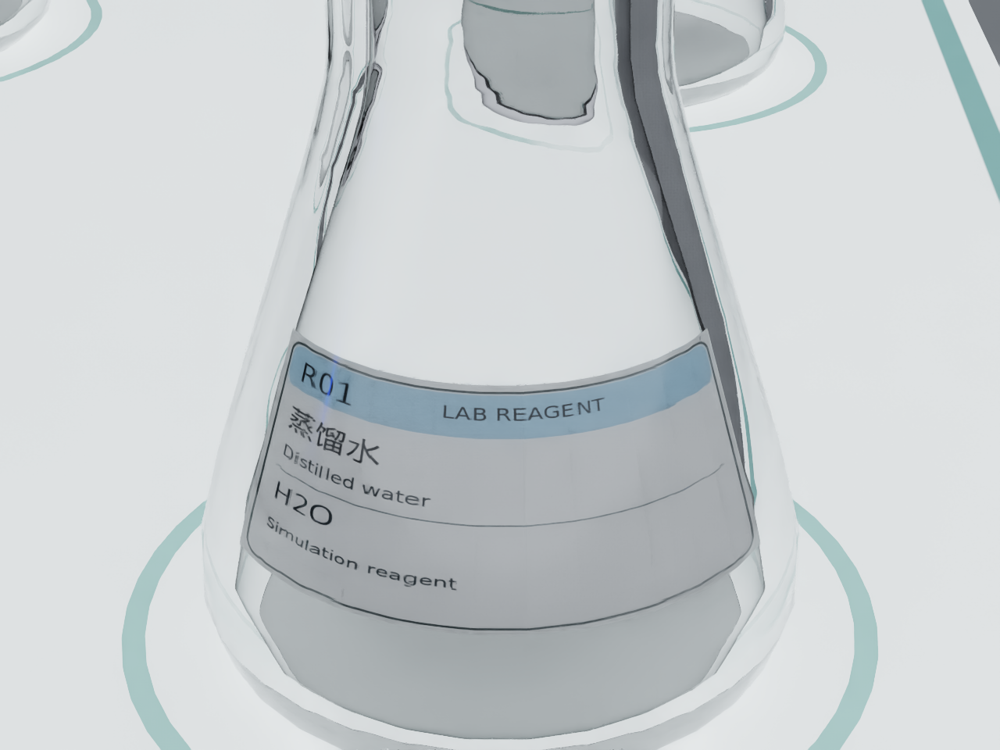
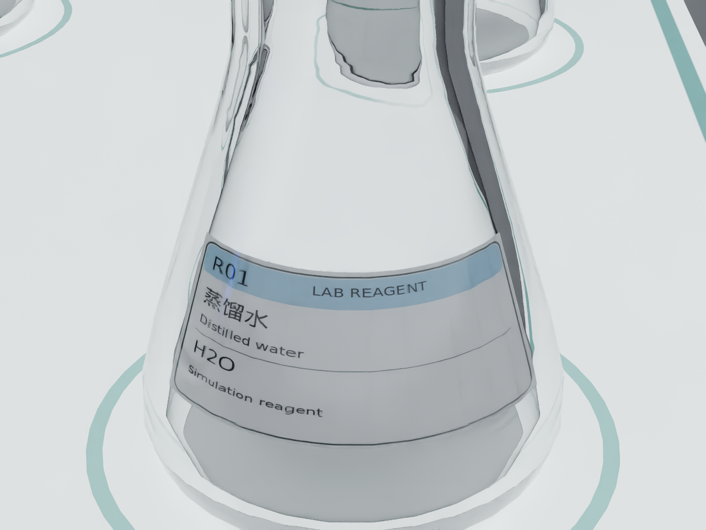

# 透明材质深度恢复模型对比汇报

日期：2026-10-24
场景：`tabletop_third_person`；目标：右侧大型锥形瓶
流程：LocateAnything → SAM2 → raw/ReMake 深度 → 点云 → GraspNet

标签复测补充：Agent 使用静态 R01 inspection 相机，通过 ReMake RGB-D 流程识别出完整标签文本；透明几何仍为未独立测量的估计结果。

## 1. 目的

在同一帧 RGB-D、同一目标和同一抓取配置下，对比未加入 ReMake 与加入 ReMake 后的中间结果，评估玻璃锥形瓶的深度恢复如何影响点云和抓取候选。DFNet 计划使用同一流程作为第三个模型对照，但本轮没有获得权重，因此没有 DFNet 推理结果。

## 2. 对比图

左列：raw-depth baseline。

右列：ReMake。

从上到下：RGB、LocateAnything→SAM2 分割、深度、目标点云、GraspNet 抓取位姿。两侧的 RGB 和分割完全相同，差别从深度恢复开始。

## 3. 实验设置

- RGB 原始尺寸：`1600x1200`。
- LocateAnything：`nvidia/LocateAnything-3B`，revision `c32291ca5e996f5a7a485845b4f57a233936bba0`，输入缩放到 `800x600`，查询词 `conical flask`，seed `0`。
- 目标框：缩放图 `[498,306,573,442]`，映射到原图 `[996,612,1146,884]`。
- SAM2：`sam2.1_hiera_l.yaml`，`sam2.1_hiera_large.pt`。
- GraspNet：`checkpoint-rs.tar`，点数预算 `12,000`，score threshold `0.02`，seed `0`，保留上限 `32`。
- 运行方式：离线 dry-run；没有调用 `manipulation.prepare`，没有执行机械臂动作。

## 4. 结果

| 项目 | Raw-depth | ReMake |
|---|---:|---:|
| SAM2 mask 像素 | 25,546 | 25,546 |
| 深度 q05 / q50 / q95（m） | 1.706 / 1.842 / 2.191 | 0.715 / 0.835 / 1.097 |
| 目标点云点数 | 25,546 | 25,546 |
| GraspNet 解码数 | 915 | 259 |
| GraspNet 保留数 | 32 | 32 |
| 最高候选分数 | 1.000 | 1.000 |

Raw-depth 点云主要落在较远的背景/错误深度区间；ReMake 点云在目标区域形成更连续的近距离结构。当前没有独立的锥形瓶公制真值，因此不能把深度差直接写成模型误差。

## 5. 错误原因和修复

### 5.1 LocateAnything 原图推理显存不足

1600x1200 原图直接推理时，模型已经占用大部分显存，推理峰值还需要约 5.93 GiB，剩余显存约 5.92 GiB，触发 CUDA OOM。模型缓存完整，权重没有被删除。

修复方式：用同一 RGB 的 800x600 缩放副本运行 LocateAnything，再按 2 倍坐标映射回原图。缩放推理成功返回 8 个候选框。

### 5.2 旧探针没有锥形瓶抓取位姿

旧探针把 `mixing_vessel` 视为容器，排除在抓取源之外，因此之前图中候选数为 0。这不是 GraspNet 模型没有输出，而是探针的对象资格规则没有对该目标发起查询。

本次对照绕开运动准备，仅把 LocateAnything/SAM2 目标点云分别送入同一个 GraspNet Provider，得到 raw 与 ReMake 的离线候选。候选不具备执行授权。

## 6. DFNet 状态

当前检查 `/home/yanxu/.cache/paos/transparent_geometry/checkpoints/`，只有 `remake.tar` 和 `depth_anything_v2_vits.pth`，没有 `dfnet.tar`；同时在 `/home`、`/mnt`、`/opt` 和 `/tmp` 的本地文件检查中未找到 DFNet checkpoint。已有 `out/releases/v16.0.0/dfnet-r2-20261023-a/perception.json` 记录了 DFNet 在 understanding 阶段因 provider failure 退出，未产生模型输出。

本轮尝试访问 TransCG 官方 README 列出的 Google Drive 和 Baidu 下载入口。Google Drive 请求超时；Baidu 分享页可以打开，但提取码校验接口返回失败。权重没有下载，DFNet 没有运行。这是下载/权重缺失导致的实验阻塞，不是 DFNet 的效果结果。恢复条件：取得官方训练权重并放到 `~/.cache/paos/transparent_geometry/checkpoints/dfnet.tar`，随后复用本报告同一输入、mask、标定及 GraspNet 配置完成第三列对照。

因此目前不能用 DFNet 与 ReMake 做公平数值比较，也不能据此判定 DFNet 效果好或差。补齐 DFNet 权重后，必须复用本报告的 RGB、目标框、SAM2 mask、标定、GraspNet checkpoint、点数预算和阈值，追加一列 DFNet 深度、点云和抓取位姿。

## 7. 当前选择结论

在现有证据范围内，ReMake 是唯一完成了同目标深度、点云和 GraspNet 对照的透明几何模型，可以作为下一轮工程验证的暂定选择。这个结论不是最终模型定型：DFNet 尚未完成同场景推理，且两种模型都还缺少独立几何真值和运动准备验证。

## 8. 产物

- 主图：`docs/diagnostics/assets/transparent-model-comparison-20261023-locateanything/locateanything-remake-grasp-comparison.png`
- LocateAnything 响应：`locateanything-response.json`
- SAM2 mask：`target-mask.npy`
- raw/ReMake 点云：`raw-target-point-cloud.npy`、`remake-target-point-cloud.npy`
- raw/ReMake GraspNet 候选：`raw-grasps.json`、`remake-grasps.json`
- 汇总：`comparison-summary.json`
- 配置：`run-config.json`

## 9. ReMake Agent 复核：标签与工艺动作

2026-10-24 在原 `tabletop_third_person` 场景使用 `isaacsim_lab.agent_host` 再发起只读 Agent 任务。任务 `task_1d02787c63b24544` 以 `succeeded` 结束，完成节点为 `complete_read_only_inspection`。运行启用了 Isaac Sim EULA，但未启用模拟运动。

标签结果：Agent 识别到多个试剂瓶，但明确报告八个锥形瓶标签文字无法可靠读取，化学身份未解析；左后方另一个大瓶被机械臂遮挡，无法完整观察。没有依据瓶子位置猜测内容。对应 RGB、ReMake 中间结果和 Agent 运行记录保存在 `out/releases/v16.0.4/agent-label-qualification-token-budget/`。

失败修复：之前两次 Agent 尝试的结构化视觉响应均以 `JSONDecodeError` 结束。保存的响应诊断显示输出在 4060 字符处终止于未闭合目标对象，解析位置为 `line 136, column 31`。根因是视觉模型请求仅预留 2048 output tokens，无法容纳该场景的八个对象字段。现将默认预算提高至 4096，并保留构造参数覆盖能力；失败 artifact 同时记录输出长度、解码位置及有界响应摘录。两条失败任务随后经 Coordinator 生命周期接口正常取消；相同场景重跑后 understanding 返回完整结果，Agent 任务成功结算。该修复改善了解析完整性，没有改善图像本身的标签清晰度。

动作抽象检查（复核更正）：原 Agent Host 指引曾写 `pour_cycle` / `stir_cycle`，但语义任务实际接受 `pour` / `stir`，对应内部 Tool `object.pour` / `tool.stir`。原搅拌 held-operation Schema 缺少 `direction`，因此该参数不能通过 Schema；若缺失，轨迹实现还会固定采用 `ccw`。原语义入口也没有在抓取前验证完整参数。不能据此前部分投影测试声称全链路已经参数化。

| 范围 | 本轮证据 | 结论 |
|---|---|---|
| 锥形瓶标签 | 成功 Agent 返回的 understanding artifact | 目标可按瓶体类别分割；八个试剂瓶标签不能可靠读取，身份不可确认 |
| ReMake | 同次运行的恢复深度、mask、点云和几何 artifact | 完成中间结果生成；仍是未独立测真值的估计几何 |
| `pour` / `stir` | 修复前代码与契约审查 | 发现名称不一致、搅拌方向无法透传、缺参可能延后到 acquire 后才失败 |
| 任务完成 | Coordinator outcome | 只读检查成功；不等同于操作工作流成功 |

后续选型仍以第 7 节为准：ReMake 仅是现有证据下优先继续验证的模型，并未因本次 Agent 成功而通过标签识别或运动资格验收；DFNet 仍需取得权重后按相同输入补测。

## 10. 标签清晰度与动作契约修复

标签识别的首要问题是观测质量。`1600×1200` 全景中瓶身标签只占小区域，玻璃反光、透视和机械臂遮挡降低可读性。后续建议先安全地采集正对标签的近景，必要时提高真实渲染分辨率/调整视场并同步更新标定；再用实例 mask 裁剪标签 ROI、透视校正并运行 OCR，将 ROI 坐标映射回瓶体实例。单纯插值放大不能补回未采集的信息。本次未移动相机或重新采集，标签状态仍是未解析。

本轮已修复动作契约：workflow 领域参数定义被语义请求、复合子任务和 held-operation ToolSpec 共用；`pour` 必需 `tilt_rad` / `hold_s`，`stir` 必需 `radius_m` / `depth_m` / `turns` / `duration_s` / `direction`，方向限于 `cw` / `ccw`。入口现在在任何子任务内部动作前拒绝缺参；Host 使用真实语义 operation 名并映射到内部 Tool。PAOS 单外层 Action、内部 prepare/acquire/process/place 生命周期保持不变，具体路径和部署限值仍归 Provider/Adapter。

验证范围为参数 Schema、任务构造、方向投影和既有编排测试；未运行 pour/stir，也未执行机械臂运动。因此契约一致性得到测试支持，但真实仿真运动效果与标签近景识别仍待单独验收。

## 11. 标签视角复拍

2026-10-24 在 LabUtopia 原锥形瓶场景分别打开第三人称全景和 R01 腕部近景预览。场景、材质和标签几何保持不变；没有驱动机械臂或执行动作。全景能交代瓶子与工作台布局，但单瓶标签太小；腕部近景中人眼可辨 R01、蒸馏水、Distilled water 和 H2O。近景仍有玻璃高光/折射，且这只是静态视口观察，不是 LocateAnything、Agent 或 OCR 的识别成绩。

结论是先保留现有外贴标签和约 3 mm 瓶壁间距，工作流采用全景定位目标、再正视近景读取标签。不得仅因全景不可读而把标签继续外移；若感知模型在新近景帧中仍误读，再单独排查反光、分辨率、曝光及标签 ROI。视角对照图与运行记录位于 `out/releases/v16.0.6/label-viewpoint-comparison-20261024/`；完整诊断及证据边界见 [`transparent-model-comparison-20261023.md`](../diagnostics/transparent-model-comparison-20261023.md)。

## 12. R01 近景 Agent 复测与动作参数验证

2026-10-24 将 R01 场景中已有的静态 inspection 位姿接入 Isaac Adapter，复用 `scene.observe → scene.understand` 和 ReMake。Agent 收到的 `1280×960` 近景实际读出 `R01`、`LAB REAGENT`、`蒸馏水`、`Distilled water`、`H2O`、`Simulation reagent`。understanding artifact 将主瓶类别置信度记为 `0.98`，但没有逐字符置信度。该帧标签足够清晰，瓶口及上部轮廓未完整入镜，边缘其他瓶体仍有歧义。

首轮失败原因是 `paos` 环境缺少已声明依赖 Pillow，场景理解报 `No module named 'PIL'`；安装 Pillow 13.0.0 后成功。初始 35 mm 近景视场过窄，改用配置化 3.5 mm 焦距复测，图像完整呈现标签。ReMake 以 `cuda:0` 推理 0.430 s，恢复深度尺寸为 `1280×960`；几何状态仍为 `unverified_estimate`，不能作为几何精度结论。

运行记录与所有输入/中间结果保存在 `out/releases/v16.1.0/agent-label-closeup-r2-20261024/`。Agent 只执行只读检查，未创建 PAOS 任务、未调用抓取候选或运动准备；`acceptance.json` 的 `tasks` 为空且 `simulated_motion_enabled` 为 `false`。Host 对空任务列表返回进程码 1，视觉 Query 本身成功并生成 understanding、ReMake depth、mask 与点云 artifacts。

倾倒/搅拌参数契约定向测试 4 项通过：缺少倾倒参数在内部 Tool 调用前失败；搅拌方向必填并透传；非法搅拌参数在感知前拒绝；Host 指引要求缺参时询问用户。此结果验证请求/参数通路，不验证轨迹质量或运动结果；本轮没有执行倾倒、搅拌或机械臂运动。此前 raw/ReMake/GraspNet 对照见本报告第 2–5 节；本次标签 Agent 复测没有生成新的抓取候选。

## 13. 启用执行后的原场景验收与修复

2026-10-24，按原方案再次发起 PAOS Agent，并启用 Isaac 仿真执行。指令包含两个 `pour` 和一个 `stir`，给定倾角 0.87 rad、停留 0.6 s，以及搅拌半径 9 mm、深度 40 mm、2 圈、4 s、逆时针。首轮在标签和功能点检查停止，尚未创建动作任务。

### 标签识别

本轮发现的是模型转录遗漏：原始近景能清楚看到左上角 `R01`，模型却只返回其余五项文字。完善通用识别指引后，对同一原图重复推理三次，三次都读出编号、中文名称、英文名称和化学式。这说明当前 R01 标签图像已具备识读条件，优先修正读取流程即可，无需再次移动标签。单帧三次复测尚不能代表所有瓶子和视角的识别率。

### 动作抽象

倾倒和搅拌使用参数化领域动作，参数经过同一请求校验和准备流程传入 Adapter。此次测试改变实际轨迹参数，依据 TCP、物体挂载关系和工具尖端偏置检查输出几何。倾角、保持时间、搅拌半径、深度、圈数、时长和方向均能改变对应结果；超出部署限值会被拒绝。6 文件 147 项测试通过，并修复旧搅拌测试 fixture 缺少必填方向引起的 4 项回归。

PAOS 现有结构可以承载这些参数化动作：领域层拥有语义，Adapter 拥有具体运动机制，Runtime/Coordinator 拥有执行与结算。实际动作效果仍取决于当前物体、功能点、抓取和准备结果。

### 模型选择与验收结论

ReMake 已在原场景真实运行，本轮全景和近景推理分别约 0.393 s、0.107 s。标签识读来自 RGB 视觉模型，ReMake 负责透明深度恢复，二者的成绩分别评价。恢复深度相对原始深度的绝对变化中位数为全景 1.1403 m、近景 0.0441 m；原始透明深度不是真值，这组数值只用于提示几何变化规模。

完整动作验收仍未通过：R02 身份未确认、近景瓶口被裁切、杯口 landmark 与实例 mask 不一致、搅拌棒工作端不可确认，且恢复几何仍无独立精度验证。下一步按原计划补齐这些观测和误差测量，再运行单物体抓取归位、倾倒、搅拌及完整组合任务。目前不能据此认定 ReMake 已适合执行，也不能在缺少 DFNet 实际对照结果时确定最终模型。

首轮完整记录为 `out/releases/v16.1.1/agent-fullchain-20261024-2314-r1/`；错误原因、修复前后结果和复现信息见[原诊断文档](../diagnostics/transparent-model-comparison-20261023.md)。

第二轮新建原场景后，Agent 从新采集的近景完整读出 R01 标签，补足了同图三次回放之外的实测证据。对本轮识别实体的保存点云另行运行真实 GraspNet，返回 32 个候选；结果保留观测与标定引用，属于离线候选查询，没有进入运动准备。

同时发现并修复了多相机时间语义错误：PNG/数组保存和点云计算耗时被误算为相机采样差。现在先复制各视图，再持久化；通过 Isaac 的帧信息确认同帧后共用采样时间，不同帧继续拒绝，旧 Provider 保留原时间路径。相机、引擎、视觉理解、Host 和动作六文件回归 175 项通过。前两轮真实联合采集仍属失败记录；最终修复的实测结果单独记录，不覆盖此前失败。

第三轮在 23:57 结束。联合观测返回可用，freshness 为 539 ms，两个视角均完成理解；ReMake 推理为全景 0.394 s、近景 0.102 s，近景再次读出完整 R01。工具摘要没有保存原始双视角采样时间，因此只确认联合接口恢复，不报告实测同步偏差为零。

| 项目 | 当前结果 |
|---|---|
| R01 标签 | 新采集近景可读；全景和 R02 仍未解决 |
| ReMake | 已接入并运行；几何精度资格未通过 |
| GraspNet | 保存的 R01 点云产生 32 个候选，尚无抓取执行反馈 |
| 倾倒、搅拌抽象 | 参数改变真实生成轨迹，相关回归通过 |
| 完整组合任务 | 动作前停止，任务及控制器结果均为空，未通过验收 |

阻断集中在 R01 身份点与 mask 错配、瓶口裁切、杯口点越界、搅拌棒工作端未确定及几何缺乏独立验证。后续应先补齐这些观测，再按抓取归位、单次倾倒、单次搅拌、组合任务逐级验收。ReMake 当前保留为已集成候选；DFNet 的同场景实测尚未完成，现阶段不能确定玻璃处理的最终模型。
