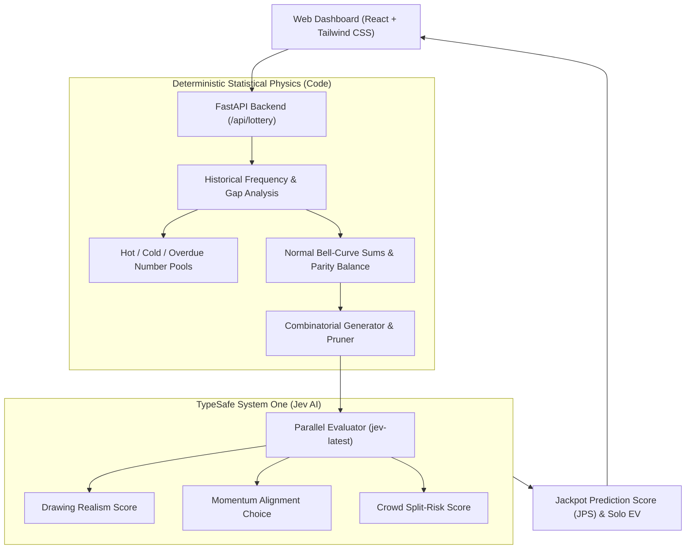

# 🎰 JevPot: AI-Powered Jackpot Number Predictor & Intelligence Oracle

> **Guessing & predicting the highest possibility winning lottery numbers with [TypeSafe System One](https://docs.typesafe.ai/) and `Jev`.**

JevPot is a professional jackpot prediction system built for players and syndicates seeking the **highest possibility, mathematically optimized winning lottery combinations**.

Instead of treating lottery draws as blind guesses, JevPot combines **deterministic combinatorial physics** (normal sum bell-curves, parity ratios, decade dispersion, consecutive run filters) with **TypeSafe System One (Jev)**'s calibrated AI judgments (`Score`, `Choice`, `Noul`) to rank combinations by drawing realism, momentum alignment, and uncrowded solo jackpot payout value.

---

## 🌟 Core Prediction Capabilities

### 1. 🎯 Highest Possibility Jackpot Number Predictor
- **Multi-Game Support**:
  - **Mega 6/45** (Standard Pick 6/45)
  - **Power 6/55** (Vietlott / High Odds Pick 6/55)
  - **US Powerball (5+1)** (5 main numbers 1–69 + Powerball 1–26)
  - **US Mega Millions (5+1)** (5 main numbers 1–70 + Mega Ball 1–25)
- **4 Prediction Strategies**:
  - 🎯 **Optimal Statistical Balance**: AI-tuned combination of hot numbers, overdue rebound, and normal bell-curve spread.
  - 🔥 **Hot Momentum Surge**: Rides active numbers appearing frequently in recent draw cycles.
  - ❄️ **Overdue / Cold Rebound**: Targets long-gap numbers due for historical regression to the mean.
  - 🛡️ **Solo Jackpot Maximizer**: Focuses on uncrowded numbers (>31) to protect you from having to split the jackpot if you win.
- **Pin Your Lucky Numbers**: Lock in 1 or 2 favorite numbers (e.g. `7, 24`), and Jev will complete the combination with optimal statistical balance.

### 2. 🔍 Pre-Purchase Ticket Analyzer & Checker
- Test any ticket you intend to purchase against historical distributions.
- Calculates the **Jackpot Purity Index (JPI)** and warns against birthday calendar crowding (numbers ≤ 31) and play-slip cognitive patterns that dilute your expected payout.

### 3. ✨ Dream & Hunch Oracle
- Translates personal dreams, omens, or milestones into lottery candidate numbers.
- Jev rates narrative prominence (`Score`) and narrative atmosphere (`Choice`), then completes tickets using anti-split high-purity numbers.

---

## 🚀 Quickstart

### 1. Launch JevPot
```bash
./run.sh
```
Or directly:
```bash
source .venv/bin/activate
python -m uvicorn jevpot.api.app:app --host 0.0.0.0 --port 8000 --reload
```
Open **[http://localhost:8000](http://localhost:8000)** in your browser!

### 2. Run Tests
```bash
pytest -v
```

---

## 🏗️ Architecture



---

## 📜 License
MIT License. Built with TypeSafe AI.
