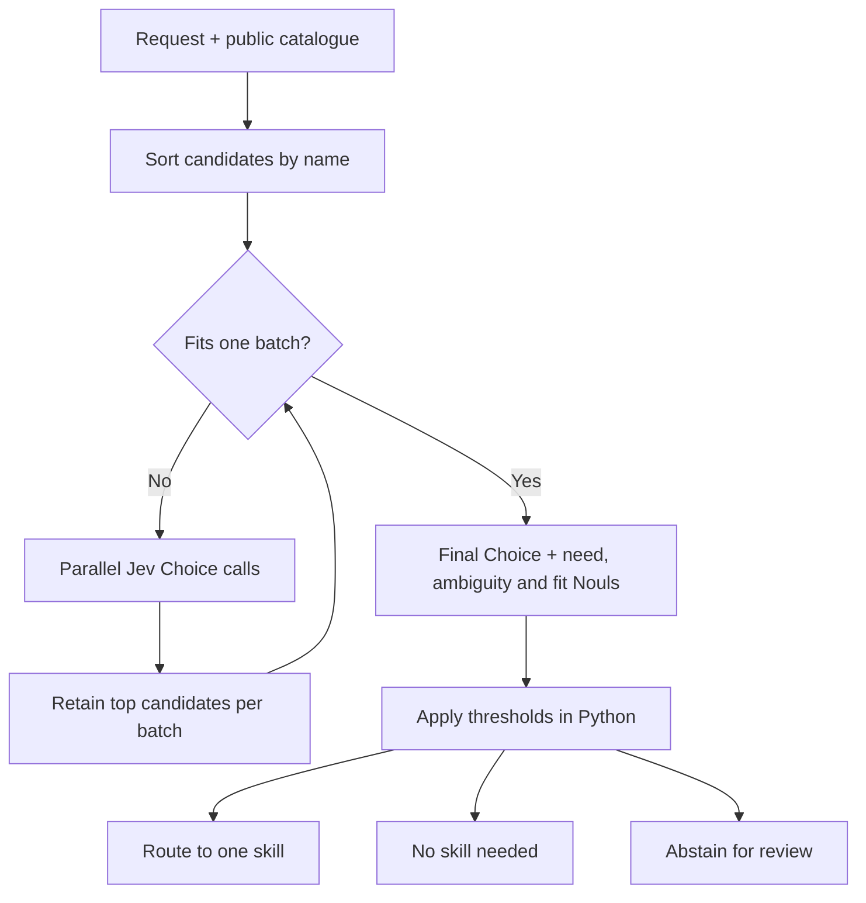

# Jev Agent Skill Router


[](https://github.com/GodsBoy/jev-agent-skill-router/actions/workflows/checks.yml)
[](https://docs.python.org/3/)
[](LICENSE)
[](https://docs.typesafe.ai/)

**68 of 72 synthetic requests routed correctly (94.4%), versus 51 of 72 (70.8%) for a lexical baseline.** The final TypeSafe Jev run selected no wrong skills and made no needless loads, but returned three unnecessary reviews and one client-validation failure. Median end-to-end latency was **1,287 ms**, with p95 **1,406 ms**.

These are **exploratory, reused-data results**, measured on 16 September 2026 with pinned `jev-1.13.0`. The routing questions were revised after inspecting an earlier full run. The original policy scored 64/72 overall and 52/60 on its initially untouched test split. Neither run establishes production accuracy or calibrated probabilities. Typed output guarantees shape, not correctness.

[Final report](results/final-v1.1.md) | [Complete final JSON](results/final-v1.1.json) | [Original full run](results/final.md) | [Evaluation protocol](docs/evaluation.md)

## Why this exists

[Hermes Agent](https://github.com/NousResearch/hermes-agent) is an extensible agent platform whose skills bring task-specific procedures to a wide range of work. The motivating Hermes profile exposes **443 unique skill names**. That scale makes skill selection a useful problem to study separately from skill execution, with uncertainty visible to the caller.

This is an optional routing layer, not a replacement for Hermes. The private catalogue is not included or used in the public benchmark. The benchmark uses **24 synthetic skills and 72 synthetic requests**; development runs select the fixed 12-case subset.

## What this does

A small Python CLI and library accepts a request and a catalogue of skill names with public descriptions. It returns:

- `route`, `no_skill` or `review`, with a selected skill only for `route`;
- a three-valued specialist-needed judgement and its Noul probability;
- final Choice confidence and winner probability;
- every call's actual candidates, distribution and independent judgement evidence;
- measured end-to-end and per-call latency, plus API-returned token usage.

Catalogues are sorted, split into deterministic batches and evaluated in parallel. Two candidates survive each batch. Reduction repeats until a final Choice fits, with explicit no-skill and review options. Separate need, ambiguity and candidate-fit judgements gate the result. The default fixture exercises three parallel batches and a final request. Offline tests also exercise 1,000 skills.

It does not load skills or execute their instructions. The catalogue is entirely synthetic and does not depend on any private installation.

## Routing architecture



Each call retains its own candidate probabilities. The final distribution is conditional on the shortlist, not the full catalogue. Code controls batching and thresholds; Jev supplies the typed judgements. No skill is executed by this library.

## Measured results

| Metric | Jev, policy 1.1 | Lexical baseline |
| --- | --- | --- |
| Exact outcome accuracy | 68/72, 94.4% | 51/72, 70.8% |
| Wrong routes, all cases | 0/72 | 8/72 |
| Needless loads, no-skill labels | 0/18 | 5/18 |
| Review outcomes | 18/72, 25.0% | 12/72, 16.7% |
| API/client errors | 1 | 0 |
| Median request latency | 1,286.82 ms | 0.50 ms |
| P95 request latency | 1,405.86 ms | 0.70 ms |
| API call attempts | 287 | 0 |
| Known input tokens | 255,897 | 0 |
| Known output tokens | 40,731 | 0 |
| Complete token totals | Unknown | 0 |
| Estimated known-input cost | At least USD 0.010747674 | USD 0 |

The input-cost estimate uses TypeSafe's advertised USD 42 per billion input tokens, not billing records. One failed call has unknown usage, so a complete final-run estimate would be misleading. The original error-free full run used 252,752 input tokens and 41,082 output tokens, with an estimated input cost of USD 0.010615584.

All 72 cases are reported, including failures. Fourteen labels require review. The final run adds three unnecessary reviews (`c24`, `n06`, `a08`) and one `invalid_response` review (`n12`). The rejected response's raw body was not retained, so its precise invalid field is unknown. No selective retry replaced it.

## Install and verify

Requires Python 3.11 or later. Commands below use a POSIX shell, from the repository root. The runtime has no third-party dependencies; the development extra pins Ruff and mypy.

```sh
python3 -m venv .venv
. .venv/bin/activate
python -m pip install -e '.[dev]'
python -m unittest discover -s tests -v
ruff check .
ruff format --check .
mypy src
```

## Try the CLI without a key

```sh
jev-router route --baseline --catalogue examples/catalogue.json \
  --request "Repair the multi-stage Dockerfile so the image builds."

jev-router evaluate --baseline-only \
  --json .tmp/baseline.json --markdown .tmp/baseline.md

jev-router validate-results --input results/final-v1.1.json

jev-router report --input results/final-v1.1.json \
  --output .tmp/replayed-report.md
```

`report` renders saved measurements without calling TypeSafe. Output files must not exist, so use new names for subsequent commands. This prevents accidental replacement of published runs. JSON loads reject duplicate keys and non-finite numbers.

## Live routing and evaluation

Set `TYPESAFE_API_KEY` in the process environment through your preferred secret manager or an interactive shell prompt. `.env.example` contains only a placeholder. The application does not read dotenv files and has no key command-line option. Never put a real key in source code, shell history, reports or a catalogue.

```sh
jev-router route --model jev-1.13.0 --catalogue examples/catalogue.json \
  --request "Extract the tables from this scanned PDF with page references."

jev-router evaluate --split development --model jev-1.13.0 \
  --json .tmp/development.json --markdown .tmp/development.md

jev-router evaluate --model jev-1.13.0 \
  --json .tmp/live.json --markdown .tmp/live.md

jev-router validate-results --input .tmp/live.json
```

A live full run sends approximately 288 API requests with the default catalogue and settings. Calls are bounded to four concurrent requests within one case, with no automatic retries and a 600-call ceiling per evaluation. The final measured run made 287 attempts because one failed batch prevented that case's final request. A full run may incur TypeSafe usage charges. Do not run live evaluation without authorising that usage.

`route` and `evaluate` return exit status 2 for API/client failures. Evaluation still writes complete results for all cases; inspect the report rather than hiding that status. Ordinary review decisions return status 0. Invalid input, missing credentials and output-file errors also return 2. The default is a pinned model; `jev-latest` is an optional mutable alias, not a controlled model identifier.

All policy settings are CLI options, including `--batch-size`, `--keep-per-batch`, `--max-workers`, `--confidence-threshold`, `--probability-threshold`, `--margin-threshold`, `--need-threshold`, `--no-skill-threshold`, `--review-threshold` and `--fit-threshold`. Use `jev-router route --help` for option names. Python defaults are defined in `RouterConfig`.

## Library use

```python
from dataclasses import asdict
from jev_router import HttpTransport, Router, RouterConfig, Skill

catalogue = [
    Skill("pdf-extraction", "Extract tables and text from supplied PDF files."),
    Skill("csv-cleaning", "Clean malformed and duplicate rows in supplied CSV files."),
]
router = Router(HttpTransport(), RouterConfig(model="jev-1.13.0"))
decision = router.route("Extract tables from this PDF.", catalogue)
print(asdict(decision))
```

Supply your own transport implementing `evaluate(payload) -> ApiResponse` for offline applications and tests. A transport must return validated `ChoiceAnswer` objects and float Nouls. The provided `parse_response` helper applies the HTTP contract checks. The fake transport in the tests exercises this same parser.

## Reproducibility and history

The JSON artefacts retain UTC dates, model identifiers, dataset and catalogue snapshots and SHA-256 hashes, policy questions, configuration, every case, every call, usage and category/split metrics. The dataset has 24 clear routes and 12 cases in each of four other categories: near neighbours, no skill, ambiguity or unsupported work, and adversarial wording.

| Artefact | Purpose |
| --- | --- |
| `results/development-v1.json` | Original 12-case attempt with `jev-1.12`; all failed at the service boundary |
| `results/development-jev-1.13.0.json` | Same 12 development cases with the available pinned model; 12/12 correct |
| `results/final.json` | First complete policy 1.0 run; 64/72, before test-informed revision |
| `results/final-v1.1.json` | Final complete policy 1.1 run; 68/72, including one validation failure |

The first model pin came from the official cookbook but returned HTTP 400 here. A minimal `jev-latest` probe returned `jev-1.13.0`, which then succeeded when pinned explicitly. The initial router reduced unknown status codes to `transport_error`; later code retains HTTP 400 explicitly. Historical artefacts are not rewritten to hide that diagnostic limitation.

Policy 1.1 clarifies that structured document work can need a specialist even when the result is prose, and that selecting a workflow is different from having every input ready for execution. Thresholds, catalogue and labels were not changed. Seven earlier unnecessary reviews disappeared, two new unnecessary reviews appeared, and one case encountered a response-validation failure. This is not a clean causal comparison: prompts changed, test data were reused and API outputs can vary.

[Architecture notes](docs/architecture.md) explain batching, evidence and failure handling. [Evaluation notes](docs/evaluation.md) define metric denominators and limitations. GitHub Actions runs offline tests, linting, formatting and strict type checking on Python 3.11 and 3.12, without API credentials.

## Technical context

| Component | Role |
| --- | --- |
| [TypeSafe Jev](https://docs.typesafe.ai/) | Typed decisions, probabilities and confidence for the routing layer |
| [Hermes Agent](https://github.com/NousResearch/hermes-agent) | Extensible skill platform that motivates the catalogue-routing problem |
| Devin Fusion | Implementation environment only, not a runtime dependency or the source of benchmark claims |

## Contributing

Keep runtime dependencies minimal and add deterministic fake-transport tests for behaviour changes. Run the checks in [Install and verify](#install-and-verify) before proposing a change. Preserve recorded results, disclose evaluation changes, and never include private catalogues, credentials or production requests.

## Claims and limitations

- **Observed:** the numbers above describe these recorded synthetic runs, including network and local orchestration latency.
- **Vendor claims:** TypeSafe describes Jev as a calibrated decision model and publishes its own latency, cost and cookbook comparisons. Those claims are not established by this experiment. The advertised input price is used only as a cost assumption.
- **Interpretation:** the experiment suggests this decomposition can reduce wrong and needless skill loads compared with simple lexical matching, at the cost of network latency and abstention. It does not establish general superiority.

Typed output prevents invalid shapes, **not incorrect valid decisions**. Choice confidence measures distribution concentration, not workflow correctness. Final probabilities are conditional on retained candidates, not the entire catalogue, and a pruned candidate cannot be recovered. Prompt instructions are not security controls or permission to execute a skill.

This is English-only synthetic routing data, not a production benchmark, a calibration study, a downstream agent comparison or an execution-quality test. There is no repeated-run statistical analysis. The live catalogue exceeds the configured batch size, not the API's maximum choice count. Large-catalogue behaviour beyond that is tested offline only. New inputs and higher-stakes actions need separate evaluation and authorisation controls.

MIT licensed. No service is deployed and no account or repository publication is required to run the local project.
