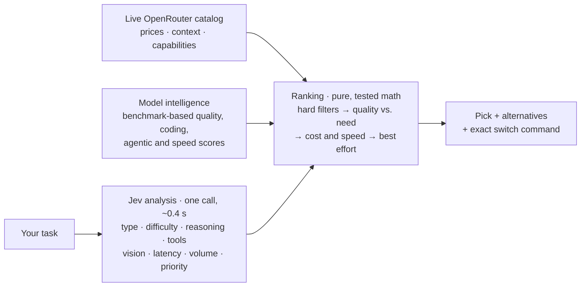

<p align="center">
  
</p>

<h1 align="center">Jev Model Router</h1>

<p align="center">
  <b>Pick the best AI model and reasoning effort for any task in about a second.</b><br>
  A plugin for <b>Claude Code</b>, the <b>Claude desktop app</b> and <b>Codex</b>, powered by TypeSafe's <b>Jev</b> decision model.
</p>

<p align="center">
  <a href="https://github.com/Mandrilsquad1441/jev-model-router/actions/workflows/ci.yml"></a>
  <a href="LICENSE"></a>
  
  
  
</p>

---

Every coding session starts with the same guess: which model, and how hard should it think? Flagship models on every task burn money and time; small models on hard tasks burn hours of rework. **Jev Model Router makes that call for you.**

1. **Jev reads the task** in ~0.4 s for a fraction of a cent: what kind of work it is, how hard, how much reasoning, whether it needs tools, vision, real-time answers or high volume.
2. **Live models are ranked** against what the task actually needs: benchmark-based quality, live OpenRouter prices, speed, and the reasoning effort that fits.
3. **You get a decision you can act on**: the best balance, plus the smartest, fastest and cheapest good-enough alternatives, with the exact command to switch (`/model opus` + `/effort medium`, `codex -m … -c model_reasoning_effort=…`, or an OpenRouter request body).

## Example

In Claude Code, asking *"which model should I use to find the race condition in our Go worker pool?"* gives:

> ## 🧭 Best balance: Claude Fable 5.1 · effort `low`
>
> **Task:** debugging · hard (2.9/4) · reasoning substantial · Jev confidence 100%
> **Signals:** multi-step tool use
>
> **Pick:** `anthropic/claude-fable-5.1` (`fable`) · quality 89/100 (task needs ≈72) · ~$0.123 · ~17s
>
> **Use it:** Use `/model fable` with `/effort low`, or delegate to a subagent with `model: "fable"`.
>
> | # | Model | Effort | Quality | Cost/call | Time/call | Speed |
> |---|---|---|---|---|---|---|
> | 🥇 | Claude Fable 5.1 | low | 89 | $0.123 | 17s | medium |
> | 🥈 | Claude Opus 5 | medium | 84 | $0.096 | 42s | slow |
> | 🥉 | Claude Sonnet 5 | max | 77 | $0.277 | 6m 35s | medium |
>
> **Your call:** 💰 Cheapest good-enough: **Claude Opus 5** (medium, $0.096, ~42s)

The same question about a product feature, *"tag each incoming support email with one of 12 intents, about 40,000 emails a day"*, routes across every provider instead: **DeepSeek V4 Flash** at ~$0.0002 per email, with a tip that its `:batch` variant costs half as much for offline jobs.

## What it saves


On 42 real, labeled developer tasks at live list prices ([full analysis](docs/COST-SAVINGS.md), reproducible with `node scripts/cost-analysis.ts`):

| Setup | Balanced routing | vs. always using the flagship | vs. a common default | Quality bar met |
|---|---|---|---|---|
| Claude Code, 400 tasks/month | ~$791/mo | **−49%** vs Fable 5.1 (high) | −4% vs Opus 5 (high) | 100% |
| Codex, 400 tasks/month | ~$598/mo | **−64%** vs GPT-6 Astra (high) | **−31%** vs Astra (low) | 100% |
| App via API, 100k requests/month | ~$407/mo | **−98%** vs GPT-6 Astra (high) | **−88%** vs Claude Sonnet 5 (medium) | 100% |

`priority: cost` goes further (Claude Code −40% vs Opus 5, Codex −71% vs Astra low) while still meeting every task's quality bar. Cheap one-model habits save money too, but miss the bar on 12–29% of tasks. A measured spot check with real billed calls cut cost by 99% on easy and moderate prompts. Routing itself costs about **$0.08 per 1,000 decisions**. [Methodology and caveats →](docs/COST-SAVINGS.md)

## Install

You need **Node.js 20+** and your own API key (this repository contains no keys):

- **OpenRouter** (recommended): <https://openrouter.ai/keys>. Jev runs through OpenRouter's Decisions API, billed to your account.
- **TypeSafe** (Jev's official API): <https://console.typesafe.ai/keys>.

Without a key the router still works, using offline keyword analysis (less accurate).

### Claude Code (CLI, or the Code tab of the Claude desktop app)

```text
/plugin marketplace add Mandrilsquad1441/jev-model-router
/plugin install jev-model-router@jev-model-router
```

Claude Code asks for your OpenRouter or TypeSafe key and stores it in your system keychain. Change it later with `/plugin configure jev-model-router@jev-model-router`, or set `OPENROUTER_API_KEY` in your environment instead. Restart the session to load the plugin.

### Claude desktop app (chat)

Download `jev-model-router-<version>.mcpb` from the [latest release](https://github.com/Mandrilsquad1441/jev-model-router/releases/latest) and open it, or go to **Settings → Extensions → Install extension**. Enter your key when asked.

### Codex (CLI and app)

```bash
codex plugin marketplace add Mandrilsquad1441/jev-model-router
```

```bash
codex plugin add jev-model-router@jev-model-router
```

Codex passes `OPENROUTER_API_KEY` (or `TYPESAFE_API_KEY`) from your environment to the plugin, so set it before starting Codex. If your Codex app does not see shell variables, store the key once with the plugin's setup command. The `router_status` tool prints the exact command, which prompts for the key without echoing it.

### Any other MCP client (Cursor, VS Code, Windsurf, …)

Clone the repository and point your client at the bundled server. No install step is needed; the bundle has no dependencies.

```json
{
  "mcpServers": {
    "jev-router": {
      "command": "node",
      "args": ["/path/to/jev-model-router/plugins/jev-model-router/dist/server.mjs"],
      "env": { "OPENROUTER_API_KEY": "your-key" }
    }
  }
}
```

## Use it

Just ask: *"Which model should I use for this?"*, *"Cheapest model that can handle this refactor?"*, *"Compare Opus 5 and GPT-6 Astra for a security review."* The plugin's skills tell the agent when to route.

| In Claude Code | What it does |
|---|---|
| `/jev-model-router:route <task>` | Best model and effort for a task, with alternatives |
| `/jev-model-router:compare-models <models>` | Side-by-side comparison, optionally for a task |
| `/jev-model-router:delegate <task>` | Route, then run the task in a subagent on the chosen Claude model |
| `/jev-model-router:setup` | Check keys and configuration |

In Codex the same `route`, `compare-models` and `setup` skills are available; ask for them by name or just describe what you need.

From a terminal, the bundled CLI does the same:

```bash
node plugins/jev-model-router/dist/cli.mjs recommend "write unit tests for the auth module" --host claude-code
```

```bash
node plugins/jev-model-router/dist/cli.mjs compare opus "gpt 6 astra" "gemini 3.8 flash" --task "review this PR for security bugs"
```

### Priorities: you decide the trade-off

| Priority | Picks | Say it with |
|---|---|---|
| `balanced` (default) | The best trade-off of quality, cost and speed | nothing |
| `intelligence` | The smartest option, cost secondary | "best", "most accurate" |
| `speed` | The fastest model that is still good enough | "fast", "quick", "real-time" |
| `cost` | The cheapest model that is still good enough | "cheap", "budget" |

Priorities stated in the task are picked up automatically. You can also pass custom `weights` (for example `{ "intelligence": 1, "cost": 3 }`) or hard `constraints` (providers, maximum price, minimum context, vision, tool calling).

## Tools (MCP)

| Tool | Purpose |
|---|---|
| `recommend_model` | Analyzes a task with Jev and returns the pick, ranked options, per-priority alternatives, and how to switch. Inputs: `task`, optional `priority`, `host` (`claude-code`, `codex`, `any`), `constraints`, `weights`, `context`, `context_tokens`, `output_tokens`, `top_k`. |
| `compare_models` | Compares 2–8 models (loose names like "opus" work), optionally judging fit for a task: strong fit, fits, borderline, too weak, overkill. |
| `search_models` | Browses the live catalog by provider, price, context, vision, tools and reasoning; sorts by intelligence, coding, price, speed, context or newest. |
| `router_status` | Shows the active key (masked), a live Jev check, catalog freshness and defaults. |

Every tool is read-only. Results come as Markdown plus structured JSON.

## Configuration

| Variable | Default | Meaning |
|---|---|---|
| `OPENROUTER_API_KEY` | — | OpenRouter key; enables Jev via OpenRouter |
| `TYPESAFE_API_KEY` | — | TypeSafe key; used instead of OpenRouter when set |
| `JEV_PROVIDER` | `auto` | `openrouter` or `typesafe` to force a route |
| `JEV_ROUTER_PRIORITY` | `balanced` | Default priority |
| `JEV_ROUTER_HOST` | `any` (set per plugin) | `claude-code`, `codex` or `any` |
| `JEV_ROUTER_ALLOW_FREE` | off | Also consider free and data-sharing model tiers |
| `JEV_ROUTER_EXCLUDE` | — | Comma-separated providers or model globs to never pick |
| `JEV_ROUTER_OFFLINE` | off | No network: bundled catalog and offline analysis |
| `JEV_ROUTER_INTEL_URL` | this repo | Where fresh model scores come from; empty disables |

The plugins set the host automatically: Claude Code answers with Claude models and `/model` aliases, Codex with Codex models and `-m` flags, and the desktop extension with every model on OpenRouter.

## How it works



Jev asks eleven narrow questions about the task in a single parallel call; code, not the model, turns the calibrated answers into a decision. Each model is scored at every reasoning effort it supports, on quality against what the task needs, estimated cost per call (including cached session context inside coding agents), and estimated latency. The full design, including every constant, is in [docs/HOW-IT-WORKS.md](docs/HOW-IT-WORKS.md).

**Always current.** Prices and models come from OpenRouter's live catalog (cached for 6 hours, with a bundled snapshot for offline use). Model quality scores come from public benchmarks (Artificial Analysis Intelligence Index, Terminal-Bench Hard) and are refreshed daily from this repository, so new rankings reach you without a plugin update. New releases of known families inherit scores automatically, and unknown models get conservative estimates.

## Privacy and security

- **What leaves your machine:** the task text (up to 6,000 characters) and optional context notes go to Jev through OpenRouter or TypeSafe, under their privacy policies. The model catalog and the model-score file are public downloads that send no data.
- **Keys:** never logged, never included in results, and shown masked (`sk-or-…9de2`). Claude Code and Claude Desktop keep them in secure storage. The setup command writes a config file readable only by you.
- **No telemetry.** The bundled server is not minified, so you can audit exactly what runs.
- Found a problem? See [SECURITY.md](SECURITY.md).

## Quality: tested in loops

| Check | Result |
|---|---|
| Unit and integration tests (math, clients, MCP protocol, CLI, packaging) | 123 passing |
| Live Jev task analysis on 42 labeled tasks: category, difficulty, signals, priority | 100% after label review (first blind run: 100% category, 91% difficulty) |
| End-to-end routing sanity checks, 42 tasks × 3 hosts | 342 / 342 |
| Plugin validation | `claude plugin validate --strict` ✔ · Codex install and discovery ✔ · `mcpb validate` ✔ |
| Jev latency per routing decision | ~0.4 s |

Mutation testing (deliberately breaking the math, the filters or key masking) makes the suite fail, so these tests have teeth.

## Development

```bash
npm install
npm run check   # typecheck, tests, build, bundle smoke test, secret scan
```

Live suites need a key: `npm run test:live`, `npm run eval` (Jev analysis accuracy), `npm run eval:routing` (decision sanity), `node scripts/cost-analysis.ts [--measure]`. See [CONTRIBUTING.md](CONTRIBUTING.md) for updating model scores.

## Credits

[TypeSafe](https://typesafe.ai) built Jev, the System One decision model this plugin runs on. [OpenRouter](https://openrouter.ai) provides the live model catalog and access to Jev. Quality scores are derived from public results by [Artificial Analysis](https://artificialanalysis.ai) and Terminal-Bench. Not affiliated with any of them.

## License

[MIT](LICENSE)
