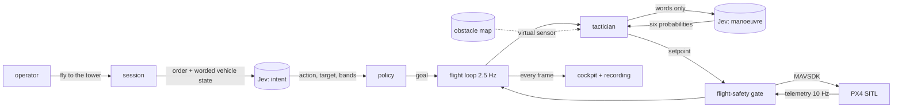
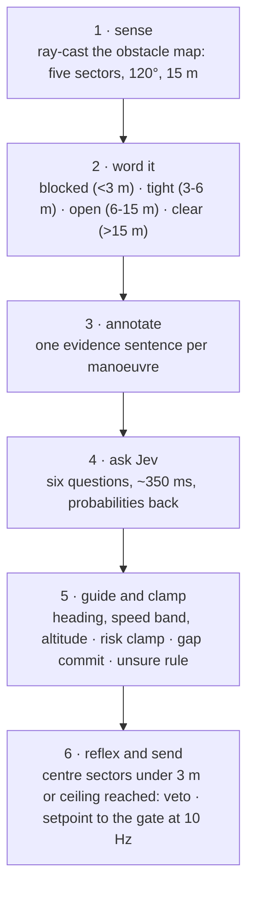

<h1 align="center">jev-pilot</h1>

<p align="center">
A simulated drone flown through an obstacle course by <b>Jev</b>, TypeSafe's System One decision model.<br>
You type an order. Jev reads it. Then, 2.5 times a second, Jev picks the next manoeuvre from six options,
in words, while code keeps the geometry, the vetoes and the vehicle.
</p>

<p align="center">

</p>

<p align="center">
<i>The recorded sample flight, replayed at 4x: 135 Jev decisions, 57 seconds, start to tower, nothing hit.</i>
</p>

---

**Contents** ·
[Why Jev](#why-jev) ·
[Quick start](#quick-start) ·
[The cockpit](#the-cockpit) ·
[How it works](#how-it-works) ·
[The state Jev sees](#the-state-jev-sees) ·
[Policy and safety](#policy-and-safety) ·
[The course](#the-course) ·
[The sample flight](#the-sample-flight) ·
[Configuration](#configuration) ·
[Repository layout](#repository-layout) ·
[Limitations](#limitations)

## Why Jev

Jev is not a chat model. It answers **typed questions** (`choice`, `score`, `noul`) with
calibrated probabilities, in a few hundred milliseconds, and never writes free text. That
shape fits a flight loop unusually well:

- **Fast enough to sit inside the loop.** An answer takes about 350 ms here, so the vehicle
  gets a fresh decision every 400 ms instead of a plan every few seconds.
- **Narrow enough to be safe.** There is no text to parse, no coordinate to invent, and no
  verb that was not on the list. Jev can only pick among options code offered.
- **Honest about uncertainty.** Every option comes back with a probability, so policy can act
  on confidence: hover when Jev is unsure, creep when hovering stops helping.

The price is that Jev is weak at arithmetic and geometry. So this repo keeps both: **no raw
number ever reaches Jev, geometry stays in code**. Distances, bearings and sensor ranges are
computed here and handed over as words like `tight (3-6 m)` or `visible, ahead-left`. Jev
reads the words and makes the call. Code turns the call into a setpoint, vetoes it when the
world has moved on, and hands it to the flight-safety gate, the only thing in this repo that
talks to the vehicle.

Two Jev calls do everything. One reads the order ("fly to the tower" becomes `fly_to` +
`tower` + a speed band). One runs every tick of the flight.

## Quick start

**Just look at it** (no simulator, no API key, 30 seconds):

```bash
git clone https://github.com/alikendir0/jev-pilot && cd jev-pilot
uv venv .venv --python 3.12 && uv pip install --python .venv/bin/python -e ".[dev]"
.venv/bin/jev-cockpit --demo          # -> http://127.0.0.1:8095
```

In the footer, pick `sample-north-run` from the dropdown and press play. That is a real
recorded flight, every frame of it. `--demo` also flies a synthetic loop if you type an
order and confirm it, so every panel can be seen moving.

**Fly it for real** needs PX4 SITL with Gazebo, an OpenRouter key, and four terminals:

```bash
cp .env.example .env                  # add JEV_OPENROUTER_API_KEY

# 1. build the course: the Gazebo world and the sensor's obstacle map, from one description
.venv/bin/python scripts/gen_course.py --course north_run

# 2. PX4 SITL on that world (own terminal)
HEADLESS=1 PX4_GZ_WORLD=jev_north_run make -C /path/to/PX4-Autopilot px4_sitl gz_x500_mono_cam

# 3. the flight-safety gate, vendored here            -> ws://127.0.0.1:8765/ws
.venv/bin/jev-gate

# 4. the cockpit                                      -> http://127.0.0.1:8095
.venv/bin/jev-cockpit
```

Then, in the order bar: `take off`, `yes`, `fly to the tower`. Watch the card on the right.
`stop` ends the loop and holds; `abort` hands the vehicle back to the gate. `land` and
`rtl` round-trip through Jev like any order and ask for a `yes`.

There is also a terminal front end with the same session behind it:

```bash
.venv/bin/python -m jev_pilot         # orders, y/n, stop, abort, land, rtl, status, landmarks, quit
```

## The cockpit

The page is an operator console, not a second brain. It runs the real session and flight
loop in its own process, and every actuation still leaves through the gate. Live frames and
replayed frames render through the same code, so a recording looks exactly like the flight
did.

<p align="center"></p>

**Order bar.** Type an order and press Enter. When Jev is not sure enough to act on its
own, `yes` / `no` buttons appear (the bare `y` and `n` keys work too). The pill on the
right says what the page is showing: the session state with flight mode, altitude and
battery; `waiting for yes / no`; `replay · <file>`; or `safety link down` when telemetry
stops for 3 s. Controls follow the link: while the socket is down or telemetry has stopped,
`send`, `yes`, `no` and `stop` grey out rather than silently dropping what you clicked, and
`abort` is the last one to go. Under the bar, the last three things the pilot said.

**Map.** Metres east and north of home: the obstacle footprints the virtual sensor casts
against, the landmarks with the target's arrival ring, the flown trail, the aircraft with
its heading and commanded velocity, and on every tick **the sensor's five rays**, each as
long as that sector reads and coloured by band: red inside 3 m, amber inside 6 m, green
beyond. The camera stream sits in the corner while the page is live. The map frames the
whole course by default; the corner button follows the aircraft instead.

<table>
<tr>
<td width="45%" valign="top">

</td>
<td valign="top">

**Jev's call.** The point of the page. At the top, the manoeuvre Jev picked this tick in
large type, the risk it read, and how long the answer took. Below it, **all six manoeuvres
with the probability Jev gave each**, the flown one in green.

When policy or the reflex overruled Jev, a red line names what intervened and Jev's own
pick is struck through. Here the gap commitment held the left side that Jev had taken two
ticks earlier, although Jev now leaned right at 92%. Swapping sides every tick cancels the
yaw and travels nowhere.

Then the risk level, and **what Jev read**: the five sectors in the words it saw, the
target's visibility and distance, the line to the target, the obstacle ahead. Hovering a
manoeuvre shows the evidence sentence Jev was given for it. The fold at the bottom opens
the full worded state and every probability, as JSON.

</td>
</tr>
</table>

<table>
<tr>
<td width="45%" valign="top">

</td>
<td valign="top">

**Before a loop runs**, the same card shows how Jev read the order: the action and the
target it chose, with the probability of every alternative, the bands it extracted, and
what policy decided to do about it. This is the other Jev call, the one that turns
English into a goal. A reading under 0.9 comes back as a proposal that wants a `yes`; an
ambiguous one comes back as a question.

</td>
</tr>
</table>

<p align="center"></p>

**Timeline.** Jev's confidence per tick as one line against the dotted hold threshold, red
marks where it was overridden, grey rules at loop start and end. Wheel zooms, drag pans, and
**clicking a tick freezes** the whole cockpit on it: the map and the card jump to that
instant while the link keeps streaming. Arrow keys walk the ticks, Escape releases.

**Replay.** The footer replays any recording in `data/flights`. Pick a file, drag the
slider or press play at 1x, 4x or 16x. Replay is client-side and feeds the same renderers
as live frames. Live control is disabled while a recording is on screen; `abort` is not,
because the aircraft keeps flying while you look at the past.

## How it works



**The order.** One Jev call per utterance. The state is the order text, the worded vehicle
block, the known landmark names and what the pilot is doing. Six questions come back:
`action` (takeoff, fly_to, orbit, hold, return_home, land, stop, ask), `target` (a landmark,
`here`, or `none`), `altitude_band`, `radius_band`, `speed_band`, and an `is_ambiguous`
noul. Policy turns that into a proposal: takeoff, land and return-to-launch always ask for
confirmation; `fly_to` and `orbit` ask unless both action and target came back above 0.9;
anything under 0.5, or ambiguity over 0.5, becomes a clarifying question. `stop` and `hold`
are never gated behind confidence, because stopping is the safe action.

**Each tick of the flight loop**, 400 ms apart:



1. **Sense.** A virtual forward range sensor casts rays against the prior obstacle map: five
   24° sectors across 120°, each the nearest hit within 15 m; the height of the obstacle
   straight ahead; whether the straight line to the target is free; whether the target is
   visible, hidden behind the obstacle ahead, or out of view. No memory, nothing behind the
   vehicle, and the map itself never leaves.
2. **Word it.** Every number is bucketed here, in code.
3. **Annotate.** Each of the six manoeuvres gets the evidence for it, in words. The
   annotations *are* the state: they are what makes the choice answerable.
4. **Ask Jev.** One call, six questions, the worded state and nothing else.
5. **Guide.** The manoeuvre becomes a relative heading, a speed band and a target altitude;
   the heading closes through a proportional yaw controller in code; the risk clamp, the
   gap commitment and the unsure rule apply.
6. **Send.** The setpoint goes to the gate. A separate 10 Hz task re-sends the last
   setpoint so the gate's 500 ms hover watchdog never trips between decisions, re-senses as
   it goes, and vetoes a setpoint the world has overtaken.

### The six manoeuvres and their annotations

| manoeuvre | meaning | the evidence code writes for it |
|---|---|---|
| `hold_course` | keep flying toward the target | `direct line to target clear` or `direct line to target blocked` |
| `gap_left` / `gap_right` | steer into the open space on that side, then resume | the **clear** sector on that side nearest the target's direction: `clear (>15 m) toward far right`. With no clear sector on the side, the roomiest one is a last resort and says so: `creep along the obstacle, tight (3-6 m) toward right`, and only if it holds the reflex's stand-off, else `blocked, nearest tight (3-6 m)`. `, nearer the target` is appended when **both** sides read clear |
| `climb` | rise over the obstacle ahead and continue | `clears: obstacle top is low, under the ceiling` / `cannot: obstacle top is above the ceiling` / `nothing ahead to climb over` |
| `brake` | stop and hover this tick | `stop and hover` |
| `reacquire` | turn in place toward the target, to bring it back into the sensor's view | `target out of view, behind-left: turn toward it` / `target in view, not needed` |

A sector reading `open` is an obstacle 6 to 15 m away, not a way through. That is why a gap
is first a *clear* sector, and why a creep is worded as a creep. An `out of view` target is
the only one worth turning in place for; one merely `hidden behind the obstacle ahead` is
reached by going round it or over it.

## The state Jev sees

One tick, closing on a wall with the climb open. This is the whole of what goes over the
wire, verbatim from `tests/test_chooser.py`:

```json
{
  "goal": {"kind": "fly_to", "target": "tower", "speed_band": "normal"},
  "vehicle": {
    "altitude": "very low (1-5 m)", "speed": "slow (0.5-3 m/s)", "battery": "good (>50%)",
    "health": "gps ok, estimator ok", "mode": "OFFBOARD", "armed": true
  },
  "scene": {
    "sectors": {
      "far left": "clear (>15 m)", "left": "open (6-15 m)", "ahead": "tight (3-6 m)",
      "right": "tight (3-6 m)", "far right": "tight (3-6 m)"
    },
    "obstacle_ahead": "low (climbable)",
    "direct_line_to_target": "blocked",
    "target": "visible, ahead"
  },
  "target": {"name": "tower", "distance": "medium (20-50 m)"},
  "maneuvers": {
    "hold_course": "direct line to target blocked",
    "gap_left": "clear (>15 m) toward far left",
    "gap_right": "creep along the obstacle, tight (3-6 m) toward right",
    "climb": "clears: obstacle top is low, under the ceiling",
    "brake": "stop and hover",
    "reacquire": "target in view, not needed"
  },
  "recent_decisions": [],
  "elapsed": "under 30 s"
}
```

Six questions are asked against it, in one call:

| id | type | what it asks |
|---|---|---|
| `maneuver` | choice | Which of the six should the vehicle fly this tick to reach the target without hitting anything? Each option carries its one-line meaning, and the rules of thumb are spelled out: prefer `hold_course` on a clear line, take a gap that reads clear when it is not, treat a creep as a last resort, climb only when the entry says it clears, `reacquire` only when the target is out of view, never choose an option whose entry says blocked, cannot, or not needed. |
| `risk` | choice | How close is the vehicle to hitting something, judging by the sectors: `clear`, `tight`, `close`, `about to hit`. |
| `route_blocked` | noul | Is the straight line to the target obstructed by something the vehicle cannot fly over? |
| `target_truly_lost` | noul | Is the target out of the sensor's view, rather than visible or merely hidden behind the obstacle ahead? |
| `goal_reached` | noul | Is the target distance `arrived (<5 m)`? |
| `emergency_stop` | noul | Is there an immediate reason to stop all motion now? |

`maneuver` and `risk` are flown, after the clamp. `goal_reached` and `emergency_stop` are
policy. `route_blocked` and `target_truly_lost` are recorded and shown but no policy reads
them: visibility is geometry, and the manoeuvre's own annotation already says whether the
target is out of view, so reacquisition is Jev's to pick and nothing second-guesses it.

Jev has no memory between calls. `recent_decisions`, the last few of its own picks, is the
only history it gets.

## Policy and safety

Jev proposes, code decides.

- **Risk is clamped to geometry, both ways.** Code computes the risk from the sectors. What
  is flown is that plus at most **one level** of Jev's own caution, and never **less** than
  it. Jev can slow the vehicle down; it cannot stop it dead without cause, and it cannot wave
  through a wall its own words describe.
- **Gap commitment, 3 s.** A gap side, once taken, is held for `gap_commit_s` while it stays
  feasible. Alternating sides tick by tick cancels the yaw and travels nowhere. The
  commitment yields as soon as the other side's band reads better (clear > open > tight).
- **Unsure hovers, then creeps.** Confidence below `motion_hold_below` (0.5) hovers. After
  `unsure_creep_s` (2 s) of continuous low confidence with the vehicle stationary, Jev's own
  top pick is flown with the speed capped at a creep. Hovering only helps while hovering can
  still change the picture.
- **Reflex vetoes**, in the 10 Hz sender and independent of the chooser: one of the centre
  three sectors inside 3 m zeroes translation, and altitude at the ceiling zeroes the climb.
  Every veto that fired is named on the tick record and on the card.
- **Speed** is capped by the risk level (clear allows fast, tight normal, close slow), by the
  goal's own band, and by code to `slow` inside the last 20 m.
- **The gate is the only actuation path.** `src/flight_safety` is the only package that
  imports MAVSDK. Manual setpoints are honoured only after a `takeover`, clamped to the
  configured speed and yaw-rate limits, braked with a one second geofence look-ahead, and
  **decayed to hover if they stop arriving for 500 ms**. The envelope monitor is a sibling
  of the command path, not a step in it: a vehicle outside the geofence passes to HOLD and
  then RTL, and the loop sees the `failsafe` field and stands down.
- **Handback on every exit.** `stop` commands a hover immediately rather than letting the
  last setpoint run through the in-flight decision. A refused handback is retried once and
  then reported honestly.
- **Steering from a dead-reckoned pose.** Telemetry is stale by the time it arrives, so the
  loop advances the last frame by the setpoints actually sent since it was sampled. Heading
  closes through a proportional controller with a low gain, because a proportional loop
  through a delay is only well damped while gain times delay stays under one.
- **Everything is recorded.** Every Jev call goes to `data/jev_log.jsonl`. Every cockpit
  frame goes to `data/flights/<stamp>.jsonl`. The gate keeps its own black box of every
  command it accepted or refused in `data/blackbox/`.

The loop ends, and always hands control back, when: the target is inside `arrival_radius_m`
(9 m); Jev's `goal_reached` passes 0.8; the operator says `stop` or `abort`; the gate's
monitor has taken over; the safety link has been down for 3 s; the battery falls under
25 %; 180 s elapse; or five Jev calls fail in a row.

## The course

<p align="center"></p>

`scripts/gen_course.py` holds the course as data and writes both the Gazebo world and the
sensor's obstacle map from it, so the two can never disagree. The route runs from the world
origin, where the x500 spawns, to the tower at ENU (45, 30): 54 m in a straight line that
three stations cut across.

| station | along the route | offset | size | top | what it asks for |
|---|---|---|---|---|---|
| orange pillar | 19 m | 4 m left | 4 x 4 m | 6 m | the first station, passed on the right |
| `wall_1` | 28 m | 4 m right | 14 m wide | 9.5 m | too tall to climb: **the gap is on the left** |
| `bar_3` | 36 m | centred | 12 m wide | **4 m** | the climb station, under the 10 m ceiling with margin |
| `wall_4` | 44 m | 6 m right | 22 m wide | 9.5 m | gap on the left again, at the edge of the sensor cone |

Cruise altitude 3 m, ceiling 10 m, sensor 15 m over 120°. The tower is a 6 m box, and the
reflex keeps 3 m off it, so the arrival radius is 9 m: "arrived" means "got there".

## The sample flight

`data/flights/sample-north-run.jsonl` is one real flight of the course, recorded by the
cockpit and committed so the replay works out of the box. The GIF at the top is that file.

| | |
|---|---|
| result | arrived, 57 s, nothing hit |
| Jev decisions | 135, none failed |
| latency | 366 ms median, 649 ms worst |
| Jev's confidence | 0.83 mean, 0.39 lowest |
| what Jev picked | gap right 38 · gap left 37 · hold course 30 · reacquire 26 · climb 4 |
| what was flown | gap left 63 · hold course 30 · reacquire 26 · gap right 9 · brake 4 · climb 3 |
| overridden | 34 ticks: 29 gap commit, 4 confidence below threshold, 1 reflex veto (sector blocked) |
| cost | $0.0085 |

The gap between what Jev picked and what was flown is the gap commitment: Jev leaned right
and left almost evenly around `wall_1`, and policy held the side it had taken until the
other read clearly better. Everything else Jev asked for, it got.

## Configuration

Everything is `JEV_`-prefixed and read from `.env` in the working directory; `.env.example`
is the annotated copy. The gate reads its `FS_*` keys from the same file.

| key | default | what it does |
|---|---|---|
| `JEV_OPENROUTER_API_KEY` | | required for anything but `--demo` |
| `JEV_MODEL` | `~typesafe/jev-latest` | the Jev model on OpenRouter |
| `JEV_GEOFENCE` | cam_test polygon | **must equal** the gate's `FS_GEOFENCE` |
| `JEV_SAFETY_URL` | `ws://127.0.0.1:8765/ws` | the gate |
| `JEV_LANDMARKS_PATH` | `data/landmarks.cam_test.json` | the names Jev can be sent to |
| `JEV_OBSTACLES_PATH` | `data/obstacles.jev_north_run.json` | the virtual sensor's map; a missing file loads an empty map |
| `JEV_CRUISE_ALT_M` / `JEV_CEILING_M` | 3 / 10 | flight limits for the course |
| `JEV_WEB_HOST` / `JEV_WEB_PORT` | `127.0.0.1` / 8095 | bind the LAN IP to reach the cockpit from another machine |
| `JEV_VIDEO_URL` | `http://127.0.0.1:8092/stream.mjpg` | the **browser** fetches it, so use the host's LAN IP when browsing remotely |
| `JEV_FLIGHTS_DIR` | `data/flights` | where every flight is recorded, one JSON frame per line |
| `JEV_JEV_TIMEOUT_S` / `JEV_JEV_LOG_PATH` | 1.5 / `data/jev_log.jsonl` | the Jev call itself (the prefix really is doubled) |

The sensor, the policy thresholds and the loop timing all have defaults in
`src/jev_pilot/config.py`, each with a comment on why it is what it is.

## Repository layout

| path | what it is |
|---|---|
| `src/jev_pilot/jev_client.py` | the decisions call: typed questions, typed answers, retries, the call log |
| `src/jev_pilot/intent.py`, `policy.py` | reading an order, and what to do about it |
| `src/jev_pilot/scene.py`, `tactics.py` | the virtual sensor, and the six manoeuvres with their annotations |
| `src/jev_pilot/chooser.py` | the six questions, and Jev's answer as a `Choice` |
| `src/jev_pilot/tactician.py`, `guidance.py` | one tick: sense, annotate, ask, clamp, guide, reflex |
| `src/jev_pilot/pilot_loop.py`, `estimator.py` | the 2.5 Hz loop, the 10 Hz sender, dead reckoning |
| `src/jev_pilot/session.py`, `cli.py` | the operator session; the terminal front end |
| `src/jev_pilot/web.py`, `static/` | the cockpit: FastAPI, one websocket, the recorder, the page |
| `src/flight_safety/` | the vendored flight-safety gate, `jev-gate` |
| `scripts/gen_course.py` | the course as data: writes the world and the map |
| `scripts/live_smoke.py`, `measure_lag.py`, `tune_intent.py` | a scripted SITL flight; a telemetry lag fit; an intent scorecard |
| `data/` | landmarks, the obstacle map, the sample recording |
| `docs/` | `design.md` (as built), `HANDOFF.md` (running it on a machine), `jev-study.md` (Jev notes) |
| `tests/` | 199 tests, no network, no SITL |

```bash
.venv/bin/pytest -q
```

The fakes live in `tests/conftest.py`: a scripted `FakeJev`, an in-process
`FakeSafetyServer` that speaks the gate's websocket protocol, a `Plant` that integrates
setpoints into a pose and reports it back late, and a `RuleChooser` that reads the same
words Jev reads so a loop test can fly without a network.

## The gate

`jev-gate` is the flight-safety service: MAVSDK to PX4, the geofence, the limits, the
OFFBOARD manual-setpoint path with its 500 ms watchdog, the envelope monitor, and the JSONL
black box. It is vendored from
[llm-fpv-flight-assistant](https://github.com/alikendir0/llm-fpv-flight-assistant) at
commit `bb75e2a` (MIT, same author), with one change made here: `bridge.py` keeps one live
subscription per telemetry stream and asks PX4 for 10 Hz position and attitude, so a
snapshot is read from cache and pushed at 10 Hz. The original waited on the slowest stream
per read, and a pilot loop steering from a picture two seconds old could not hold a heading.

## Limitations

- **The sensor is virtual.** It ray-casts a prior obstacle map, so it never misses an
  obstacle, never sees one that is not on the map, and has no noise. This is a
  decision-layer demo, not a perception one. A real lidar or depth bridge behind the same
  `scene.sense` interface is the obvious next step.
- **One course, and the stations can be flanked.** The walls are free-standing, so a pilot
  that keeps taking the roomiest side can go round `wall_1` and `wall_4` instead of through
  them. The bar station is reachable, not forced.
- **SITL only.** Everything here is PX4 SITL and Gazebo on one machine. Nothing has flown.
- **Jev is a literal reader, so the words matter.** Most of the tuning in this repo is
  wording, not thresholds. A rule that named `ahead` but not `ahead-left` produced a flight
  with no forward motion in it. A gap worded band-first read as a way through and took the
  vehicle into a wall, which is why a creep is named as a creep in its first words. If you
  change an annotation, expect the behaviour to change with it.

## Licence

MIT. See `LICENSE`. The vendored gate is MIT from the same author.
