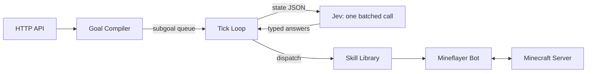

# Talos

A Minecraft agent with no LLM in the loop. Send it a command over HTTP — *"get me an iron pickaxe"*, *"follow Leon"*, *"kill that zombie"* — and it plays survival Minecraft to make it happen, using [TypeSafe's Jev](https://typesafe.ai) (a System One decision model) for every runtime judgment.

**The premise:** code owns the plan, the actions, and everything deterministic; Jev supplies fast, calibrated, typed judgment at every branch point. Jev never generates text — it answers typed questions (Choice / Score / Noul) over JSON state in one parallel pass, cheap and fast enough to consult every ~1.5 seconds while playing.

## How it works



1. **Goal compiler** ([src/goals/compiler.ts](src/goals/compiler.ts)) — parses the command using the [function-calling pattern](https://docs.typesafe.ai/cookbooks/function_calling.md): code extracts candidate values (fuzzy item matches against `minecraft-data`, online players, numbers in the text), one batched Jev call selects among them, code assembles the typed goal. Confidence is the weakest consumed judgment; ambiguous commands get a `422` with the probability distribution instead of a guess.
2. **Planner** ([src/goals/planner.ts](src/goals/planner.ts)) — the Minecraft tech tree is deterministic, so no AI is involved: a recursive planner over `minecraft-data` recipes, block drops, and harvest-tool requirements expands "obtain iron pickaxe" into the full bootstrap (logs → planks → crafting table → wooden pickaxe → cobblestone → stone pickaxe → iron ore → furnace → smelt → craft).
3. **Tick loop** ([src/loop/tick.ts](src/loop/tick.ts)) — every 1.5s, one batched Jev call ([speculative fan-out](https://docs.typesafe.ai/patterns/fan-out.md)) over the encoded world state:
   - `next_skill` **Choice** — which action now (or `continue_current` / `none_apply`)
   - `target` **Choice** — which enumerated block/entity candidate to act on
   - `in_danger` **Noul** — probability of imminent threat; ≥ 0.9 preempts everything
   - `subgoal_complete` **Noul** — fuzzy completion for what code can't verify (combat)
   - `progress` **Score** — stuck detection; persistent low progress triggers a replan
   
   Confidence gates every decision ([confidence-gated routing](https://docs.typesafe.ai/patterns/confidence-routing.md)): high confidence switches skills, low confidence falls back to the subgoal's canonical skill. Deterministic checks (inventory counts, block presence) stay in code and never burn a model call. Taking damage fires an immediate out-of-band tick (rate-limited), so danger reaction is bounded by the Jev round trip rather than the tick interval.
4. **Skills** ([src/skills/index.ts](src/skills/index.ts)) — bounded, deterministic executors built on the PrismarineJS ecosystem: `mineflayer-pathfinder` (navigation), `mineflayer-collectblock` (mine + pickup), `mineflayer-tool` (tool selection), `mineflayer-pvp` (combat).

## Quickstart

Requirements: Node 20+, Docker, a [TypeSafe API key](https://typesafe.ai).

```bash
git clone https://github.com/<you>/talos && cd talos
npm install
cp .env.example .env
# edit .env: set TYPESAFE_API_KEY, and EULA=true to accept Mojang's EULA
#   (https://aka.ms/MinecraftEULA — required to run the server)

docker compose up -d     # Paper server, offline mode, pinned to 26.1
npm run dev              # connects the bot, starts the HTTP API
```

Then command it:

```bash
curl -X POST localhost:3000/command \
  -H 'content-type: application/json' \
  -d '{"text": "get me a stone pickaxe"}'

curl localhost:3000/status   # goal, subgoals, running skill, last Jev decision
curl -X POST localhost:3000/stop
```

Watch it play at `http://localhost:3007` (prismarine-viewer), or join the server yourself (`localhost:25565`, offline mode) and say *"follow me"* via the API.

## Development

```bash
npm test            # unit tests (planner, compiler) — no API key needed
npm run typecheck
npx tsx scripts/plan.ts diamond_pickaxe   # print a plan without running anything
npm run e2e         # live test: requires running server + API key
```

`JEV_MODE=record` persists every Jev request/answer as a fixture in `test/fixtures/jev/`; `JEV_MODE=replay` serves those fixtures with no API key, which is how CI runs and how contributors without Jev access (it's waitlisted) can work on the project.

## Scope and honest limitations

- Goals: obtain-item (full gather/craft/smelt tech tree), follow player, attack mobs. No building, no nether, no enchanting.
- Jev is hosted-only and waitlisted; each tick is a network round trip (~70–500 ms), which bounds the effective decision rate.
- The planner treats wood species as interchangeable (any log/planks satisfies a wood step), but other item variants stick to common overworld defaults (cobblestone over deepslate).
- Calibration thresholds in [src/config.ts](src/config.ts) are starting points per TypeSafe's guidance, not tuned truths. Measure against your own play data.

## License

MIT. The Minecraft server container requires you to accept [Mojang's EULA](https://aka.ms/MinecraftEULA) yourself (`EULA=true`). Not affiliated with Mojang or TypeSafe.
