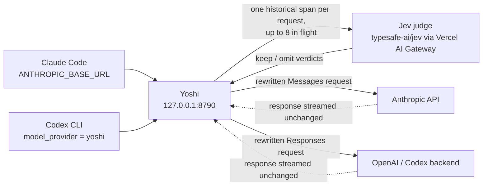

<div align="center">

# Yoshi

**A local context-pruning proxy for Claude Code and Codex.**

Jev judges new context once, above a configurable size gate. Yoshi applies the
validated omissions while keeping the protocol intact, then forwards the
request to Anthropic or OpenAI and streams the response back unchanged.

[](https://bun.sh)
[](tsconfig.json)
[](#status-and-limits)
[](docs/BENCHMARKS.md)

</div>

> [!WARNING]
> **Yoshi is a proof of concept. The real version is heading into [CompozyOS](https://github.com/compozy/compozy).**
> CompozyOS is an open-source operating system for AI agents: it runs Claude Code, Codex and other
> ACP agents as durable background sessions. There, context pruning becomes automatic for every
> session, the session goal and plan feed the judge, and judging runs between turns instead of on
> the request path, which removes the latency you will see below. If that is what you came for,
> [star CompozyOS](https://github.com/compozy/compozy) and follow along.

## What it does

Coding agents resend their whole conversation on every request. Most of that
history is completed tool input, tool output and teammate reports that the
model no longer needs. Yoshi sits between the client and the provider and:

- **Judges new spans once**: completed `Bash`, `Write` and `Edit` arguments, tool results and teammate reports. The default starts above 50,000 estimated input tokens. Previously forwarded content, human instructions, assistant notes, errors and opaque blocks stay protected. Cached omissions are replayed without rejudging.
- **Asks Jev, one span per request**, with up to eight requests in flight. Each
  request carries the current task, earlier user constraints, action chronology, paired completion results for input spans and a byte-bounded
  set of retained evidence, and asks two questions: would a required fact be
  lost, and would a binding user constraint be lost.
- **Applies only validated omissions.** A removed span becomes an explicit
  omission marker; tool IDs, names, file paths, callers and every unselected
  field stay byte-identical. Invalid, failed or timed-out judgments keep their
  span. Altered history is never executed.
- **Serves both protocols** on one loopback listener: the Anthropic Messages
  API for Claude Code and the OpenAI Responses API for Codex. Authentication
  headers pass through and are never written to traces.

Jev is the `typesafe-ai/jev` evaluation model reached through the Vercel AI
Gateway. Without a Gateway key, Yoshi forwards requests unchanged.

**Two things to know before you run it.** Both current v12 Yoshi trials were slower
than baseline, and a Jev outage can hold a request up to the 45-second evaluation
deadline. Jev-enabled requests send candidate spans to
TypeSafe through the Gateway, including source code from `Write`, `Edit` and
`Bash` arguments, with no zero-data-retention option. Read
[Privacy](#privacy) before pointing proprietary code at it.

## How it works



1. The client sends its full, unmodified conversation to Yoshi.
2. Below the size gate, new content passes without judging. Above it, Yoshi resolves completed call/result pairs and splits eligible arguments,
   results and reports into spans of about 1,200 characters at line boundaries.
3. Each span is judged independently. Both loss probabilities must be at most
   0.2 for an input/report span to be omitted. Tool results keep the calibrated Atomic relevance/coverage/conflict rule. Human instructions and assistant notes remain whole.
4. Source hashes and exact offsets are rechecked before a verdict is applied. Keep, omit, failed and skipped decisions are frozen; later turns only judge new arrivals. No automatic reasoning-drop control is added.
5. The rewritten request goes upstream. Receipts record per-kind coverage, Jev
   request bytes, applied spans, Gateway cost and provider usage.

Design details and the provider contract for signed thinking are in
[docs/CONTEXT-OPTIMIZATION.md](docs/CONTEXT-OPTIMIZATION.md).

## Benchmarks

The tables and figures below show the **current v12 studies**, including the native
Anthropic comparator. The Fable diagnostic reduced input; the synthetic long
Sonnet session showed no savings. Both Yoshi trials were slower and had judge
failures. **There is no single validated savings percentage for Yoshi.**

Input reduction counts accumulated provider input, including repeated cached
context. Peak context is the largest single request; cache writes are reported
separately. Each model/workload has one trial per arm. Historical v11 results
remain separate below and in [the full report](docs/BENCHMARKS.md).


### Accumulated provider input, three arms


### Reduction by workload


### Peak context per request


### Cache-write input


### Current three-arm matrix

<!-- bench:start -->

_Evidence date 2026-09-18 UTC. Current v12 results from [registered, hash-verified studies](benchmarks/results/index.json). Generated offline; no new model calls._

- **Fable evidence diagnostic** (claude-fable-5-1, high effort): Gate disabled; native trigger 1,000 tokens. One trial per arm; strict thinking errors enabled.
- **Sonnet mixed session** (claude-sonnet-5, low effort): 50,000-token gate; 190,000 synthetic padding characters; candidate floor 0. One trial per arm.

| Study / arm                          | Input tokens | Peak tokens | Cache-write tokens | Correct | Seconds | Jev calls / failures |
| ------------------------------------ | -----------: | ----------: | -----------------: | ------- | ------: | -------------------: |
| Fable evidence diagnostic / baseline |      115,455 |      23,787 |             23,755 | pass    |   39.77 |                0 / 0 |
| Fable evidence diagnostic / yoshi    |       75,750 |      13,924 |             12,610 | pass    |  210.54 |              301 / 3 |
| Fable evidence diagnostic / native   |      108,914 |      10,167 |             76,142 | pass    |   63.10 |                0 / 0 |
| Sonnet mixed session / baseline      |      693,241 |      82,858 |             78,139 | pass    |   35.14 |                0 / 0 |
| Sonnet mixed session / yoshi         |      693,461 |      82,908 |             78,189 | pass    |  171.99 |              142 / 3 |
| Sonnet mixed session / native        |      664,640 |      75,707 |             83,594 | pass    |   28.01 |                0 / 0 |

- **Fable evidence diagnostic:** 34.39% accumulated input reduction; 41.46% peak reduction. Baseline → Yoshi: 39.77 → 210.54 s; 3 Jev failures. Diagnostic result, not a production-wide savings claim.
- **Sonnet mixed session:** -0.03% accumulated input reduction; -0.06% peak reduction. Baseline → Yoshi: 35.14 → 171.99 s; 3 Jev failures. No savings demonstrated.

Both Yoshi combined costs are **unknown** because Jev usage is incomplete. All six final answers passed; there is one trial per arm. [Historical v11 results](docs/BENCHMARKS.md#historical-v11-studies) and [all development outcomes](docs/STICKY-VALIDATION.md) remain separate.

<!-- bench:end -->

### Latency and cost

Both current Yoshi trials were slower and had three Jev failures each. Their
combined provider-plus-Jev costs are **unknown** because usage receipts are
incomplete. Figures use frozen list-price equivalents, not subscription bills.
Fable list pricing was not inferred.


### Historical v11 results


The full report separates current v12 studies from historical v11 results,
including quality, latency, failures and unknown costs:

- [docs/BENCHMARKS.md](docs/BENCHMARKS.md), the single results entry point
- [docs/benchmark-report.html](docs/benchmark-report.html), the same evidence
  as a self-contained page with the charts above
- [docs/benchmark-results.json](docs/benchmark-results.json), machine-readable
- [benchmarks/README.md](benchmarks/README.md), reproduction and the rules for
  promoting a new run into the registered evidence

## Quick start

```sh
bun install
# New installations only: preserve an existing .env.
cp .env.example .env
bun start
```

Set `AI_GATEWAY_API_KEY` in `.env` to enable Jev. Without a key, the default
configuration forwards requests unchanged. `YOSHI_DRY_RUN=1` evaluates and logs
decisions without applying omissions.

Claude Code, in a separate terminal:

```sh
ANTHROPIC_BASE_URL=http://127.0.0.1:8790 claude
```

Codex, using the existing login and per-process configuration:

```sh
codex -c 'model_provider="yoshi"' \
  -c 'model_providers.yoshi={name="Yoshi",base_url="http://127.0.0.1:8790/v1",wire_api="responses",requires_openai_auth=true,supports_websockets=false}'
```

Both clients can run through the same Yoshi instance concurrently. Every
policy knob is documented in [`.env.example`](.env.example) and
[docs/CONFIGURATION.md](docs/CONFIGURATION.md); the Codex specifics are in
[docs/CODEX.md](docs/CODEX.md).

## Project layout

| Path                         | Purpose                                                              |
| ---------------------------- | -------------------------------------------------------------------- |
| `src/`                       | Proxy implementation and its canonical test suite                    |
| `benchmarks/`                | Measurement tools, reproduction instructions and registered evidence |
| `benchmarks/results/`        | Immutable registered results, audits and SHA-256 hashes              |
| `docs/BENCHMARKS.md`         | Consolidated measured results; generated offline                     |
| `docs/benchmark-report.html` | Static HTML presentation of the same evidence; generated offline     |
| `docs/assets/benchmarks/`    | README figures rendered from the HTML report                         |
| `docs/archive/`              | Superseded experiments and previous report presentations             |
| `.yoshi/`                    | Private selected raw runs, runtime receipts and reference inputs     |
| `.yoshi/archive/`            | Old raw experiments and probes; relocation index included            |

## Validate and reproduce

```sh
bun test                   # canonical suite; doubles only at model I/O boundaries
bun run check              # tsc, strict
bun run lint               # oxfmt --check and oxlint --deny-warnings
bun run summary            # account for a runtime log; no baseline means no savings claim
bun run bench:report       # verify hashes, rebuild docs/BENCHMARKS.md, the HTML report and this README's table
bun run bench:screenshots  # re-render docs/assets/benchmarks/*.png with a local headless Chrome
```

None of the commands above call a model. Real provider benchmarks are explicit
separate commands with their own output directories; see
[benchmarks/README.md](benchmarks/README.md). New runs never replace registered
numbers automatically.

## Privacy

- Jev-enabled requests send candidate spans and selected user/assistant context
  to the Gateway. No zero-data-retention option is requested.
- Ordinary logs and the decision store contain metadata only. Credentials are
  never logged.
- Explicit benchmark runs save raw local traces, including forwarded requests,
  under the git-ignored `.yoshi/` directory. They may contain private context
  and must not be published wholesale.

## Status and limits

This is an experimental proof of concept. Read the numbers with the evidence:

- Current v12 evidence consists of two separate studies, one trial per arm.
  All six final answers passed; this does not prove general semantic safety.
- The Fable diagnostic achieved 34.39% accumulated-input reduction with the gate
  disabled. The synthetic long Sonnet session approved no omissions and showed
  no savings. Neither result should be generalized across workloads or models.
- Yoshi latency increased in both studies. Six judge failures leave both
  combined-cost totals unknown. Native results are included for comparison.
- The strict Fable run reported no thinking drops while replaying real omissions.
  This proves transport acceptance for the measured run, not reasoning utilization.
- The v11 Claude/Codex measurements remain historical. No new live Codex
  benchmark was run for v12.

## Where this is going

Yoshi is a standalone proof of concept. The same selector is heading into
[Compozy](https://github.com/compozy/compozy) as a native context layer: every
agent session would get it without configuration, the session goal and plan
would feed the judge, and judging would run between turns instead of on the
request path, which is the only way to remove the latency cost above.

## Documentation

- [Configuration and operation](docs/CONFIGURATION.md)
- [Claude selection policy and protocol preservation](docs/CONTEXT-OPTIMIZATION.md)
- [Codex integration](docs/CODEX.md)
- [Sticky lifecycle validation](docs/STICKY-VALIDATION.md)
- [Current and historical measured results](docs/BENCHMARKS.md) · [HTML report](docs/benchmark-report.html)
- [Benchmark reproduction and result promotion](benchmarks/README.md)
- [Headroom findings applied to Yoshi](docs/HEADROOM-NOTES.md)
- [Historical context audit](docs/HISTORICAL-CONTEXT-AUDIT.md)
- [Archived experiments](docs/archive/README.md)

## References

Repositories used as research and study material:

- [vinilana/jev-eval-agent](https://github.com/vinilana/jev-eval-agent): the source
  snapshot frozen at commit
  [037de11](https://github.com/vinilana/jev-eval-agent/tree/037de1120c84b4b63cdf748e2acf258ff66d7731)
  is the fixture workspace for the operations and agent-reports workloads.
  `bench:prepare` fetches it and records the revision as part of the benchmark contract.
- [headroomlabs-ai/headroom](https://github.com/headroomlabs-ai/headroom): context
  compression proxy inspected at commit
  [b8b222f](https://github.com/headroomlabs-ai/headroom/tree/b8b222f9403878efe08376eac71a626caf1920d6).
  Its deduplication, preservation and cache-recovery findings are recorded in
  [docs/HEADROOM-NOTES.md](docs/HEADROOM-NOTES.md), and the installed 0.31.0 release was
  the comparator arm in the archived experiments.
- [webmachinelearning/webmcp](https://github.com/webmachinelearning/webmcp): the WebMCP
  proposal is the subject of the reviewed public-research session that the history
  workload replays.
- [AbdelStark/awesome-typesafe](https://github.com/AbdelStark/awesome-typesafe): discovery
  index for TypeSafe and Jev resources, used while researching the judge model. It is not
  evidence of savings.

Provider documentation the proxy and the cost tables rely on:

- Anthropic: [preserved thinking](https://platform.claude.com/docs/en/build-with-claude/preserved-thinking),
  [extended thinking](https://platform.claude.com/docs/en/build-with-claude/extended-thinking),
  [context editing](https://platform.claude.com/docs/en/build-with-claude/context-editing),
  [prompt caching](https://platform.claude.com/docs/en/build-with-claude/prompt-caching),
  [parallel tool use](https://platform.claude.com/docs/en/agents-and-tools/tool-use/parallel-tool-use)
  and [pricing](https://platform.claude.com/docs/en/about-claude/pricing).
- OpenAI: [API pricing](https://developers.openai.com/api/docs/pricing).
- Vercel AI Gateway: [Jev model page](https://vercel.com/ai-gateway/models/jev).
