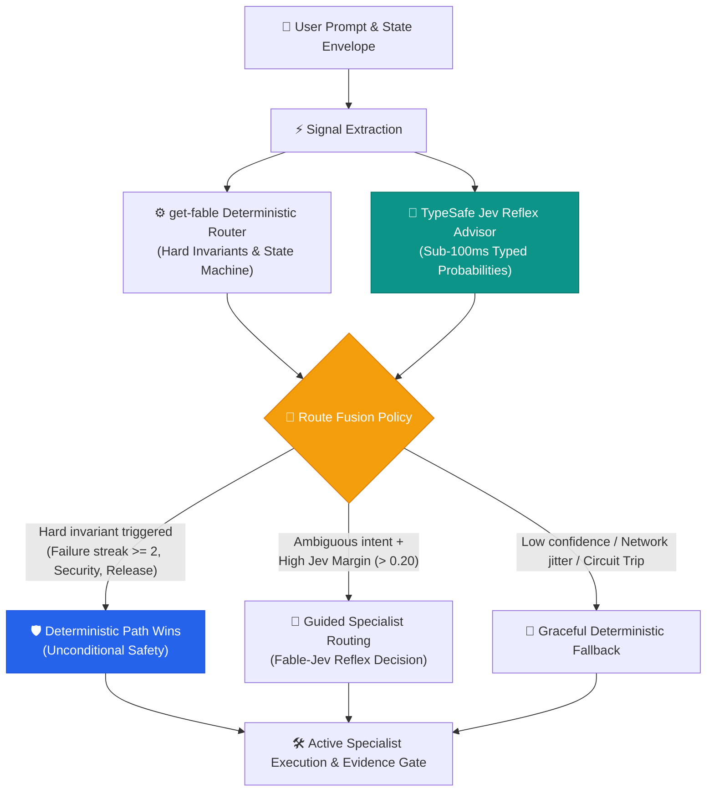

<div align="center">


# ⚡ Fable-Jev
### Sub-100ms Cognitive Reflexes for Autonomous Coding Agents

**Where TypeSafe AI's System One (Jev) meets get-fable's Deterministic Lifecycle Engine.**

[](https://github.com/imMamdouhaboammar/get-fable)
[](https://typesafe.ai)
[](docs/BENCHMARKS.md)
[](AWESOME.md)
[](LICENSE)

<br/>

[Architecture](docs/ARCHITECTURE.md) • [Fast Compaction](docs/COMPACTION.md) • [Awesome Jev](AWESOME.md) • [Playbook](docs/PLAYBOOK.md) • [Benchmarks](docs/BENCHMARKS.md) • [Roadmap](docs/ROADMAP.md) • [Parent Repo](https://github.com/imMamdouhaboammar/get-fable)

</div>

---

## 🔮 The Teaser: The Missing Half of Autonomous Agents

The dirty secret of modern AI coding agents is that they are **cognitively imbalanced**:

1. **They are sluggish and token-hungry**: Asking a 70B+ reasoning LLM to generate paragraphs of Chain-of-Thought just to pick which tool or skill to trigger next wastes 2 to 5 seconds and thousands of tokens per step.
2. **Brittle regexes fail in the wild**: Classical keyword routers are lightning-fast, but shatter the moment human instructions become ambiguous, sarcastic, or colloquial.
3. **Lossy summarization causes amnesia**: When context limits hit, naive agents ask an LLM to summarize conversation history. File paths, CLI flags, exact error codes, and line numbers vanish forever.

### The Breakthrough: Dual-Brain Architecture

Human cognition operates on two distinct systems (Kahneman):
- **System 1 (Reflex)**: Instantaneous, associative, gut-feeling, sub-100ms intuition.
- **System 2 (Reasoning)**: Deliberate, analytical, rule-governed, machine-checked rigor.

**Fable-Jev** bridges this gap for AI agents. By pairing **TypeSafe AI's Jev** (the world's premier System One foundation model) with the **[get-fable](https://github.com/imMamdouhaboammar/get-fable)** deterministic lifecycle harness, agents gain superhuman reflexes backed by mathematically unbreakable safety gates.

> ### 🛡️ The Golden Invariant
> **"Jev is allowed to be wrong. The system is never allowed to become unsafe."**
> 
> *Jev offers probabilistic intuition; `get-fable` enforces deterministic law. If Jev hiccups, times out, or hallucinates, hard invariants and circuit breakers take over instantaneously.*

---

## 🏗️ How It Works: Route Fusion & Reflex Pipeline



### Typed Decision Primitives (Zero Prose Waste)
Unlike chat models that vomit markdown, Jev answers strict, typed schemas:

| Primitive | What It Does | Why It Matters for Agents |
|:---|:---|:---|
| `Choice` | Selects exactly 1 candidate from a closed enum with probability distributions | Instant skill and subagent selection |
| `Score` | Evaluates a state on an ordered semantic rubric (0.0 to 1.0) | Urgency assessment, risk level, task complexity |
| `Noul` | Boolean truth estimation with calibrated certainty | Safety gates, context compaction keep/drop decisions |

---

## ⚡ Superpowers Inside Fable-Jev

### 1. 2-Stage Lookalike Disambiguation
When an agent faces overlapping skills (e.g., `fable-tdd` vs `fable-execute` vs `fable-discover`), Fable-Jev queries Jev in two rapid passes:
1. **Candidate Shortlist (`Choice`)**: Evaluates the top 3 semantic matches.
2. **Semantic Fitness Check (`Noul`)**: Checks whether the top candidate explicitly satisfies the task invariants before committing.

### 2. Fast Jev Compaction (Lossless Context Pruning)
Standard LLM summarization is toxic for developers: it turns `grep -rn "API_KEY" /var/log` into *"searched logs for keys"*.
**Fast Jev Compaction** does not summarize:
- It scores every historical tool call and output with Jev `Noul` questions.
- Retains critical technical strings, paths, and constraints verbatim.
- Prunes stale or redundant intermediary tool churn.
- **Result**: Up to **80% token reduction** with **0% hallucinated drift**. *(See [docs/COMPACTION.md](docs/COMPACTION.md))*.

### 3. Bulletproof Circuit Breakers & Shadow Mode
- **Zero-risk evaluation**: Run Fable-Jev in `shadow` mode where Jev evaluates every route in parallel with `get-fable`, recording telemetry to `.fable/reflex/events.jsonl` without modifying live execution.
- **Fail-Open / Fail-Safe**: If the TypeSafe API exceeds 1200ms or throws 3 consecutive errors, the circuit breaker opens instantly, falling back to deterministic get-fable routing with zero interruption.

---

## 📊 Benchmarks: The Speed of System One

| Metric | Traditional LLM Router (70B) | Static Regex Router | Fable-Jev Dual-Brain |
|:---|:---:|:---:|:---:|
| **Latency** | 2,200 ms – 4,500 ms | **< 1 ms** | **70 ms – 120 ms** |
| **Token Cost / 1k routes** | ~$15.00 – $30.00 | $0.00 | **$0.042** (99.8% cheaper) |
| **Ambiguity Handling** | Good (but slow/verbose) | ❌ Brittle / Fails | 🎯 **Calibrated & Robust** |
| **Safety Invariant Guarantee** | ❌ None (Hallucinations) | ✅ Strict | 🛡️ **100% Guaranteed** |
| **Context Compaction** | Lossy / Hallucinates | ❌ Not capable | ⚡ **Lossless & Verbatim** |

*(Explore full benchmark methodology in [docs/BENCHMARKS.md](docs/BENCHMARKS.md))*

---

## 💻 Live Experience in get-fable

The Fable-Jev Reflex Subsystem is integrated natively into the [`get-fable`](https://github.com/imMamdouhaboammar/get-fable) CLI:

```bash
# Check the status of your Fable-Jev reflex engine
bun ./bin/get-fable.js reflex status

# Run the live diagnostic doctor
bun ./bin/get-fable.js reflex doctor --live

# Test real-time reflex routing with live TypeSafe Jev arm
bun ./bin/get-fable.js reflex route "We need to trace how user tokens leak into auth logs" --live
```

Sample Doctor Output:
```text
--- Fable-Jev Reflex Doctor ---
Provider configured: typesafe-jev                    [ PASS ]
Model configuration: jev-latest                      [ PASS ]
API Key presence check                               [ PASS ]
Circuit Breaker State: CLOSED                        [ PASS ]
TypeSafe Live Reflex Ping: 84ms latency (Healthy)    [ PASS ]
Route Fusion Policy: Invariants Enforced             [ PASS ]
```

---

## 🌟 The "Awesome Jev & Fable" Collection

We maintain an authoritative, curated index of everything happening in the **Jev & System One ecosystem**:
- 📚 **[TypeSafe Jev Official Guides & APIs](AWESOME.md#official-resources)**
- ⚡ **[Fable-Jev Production Playbooks](docs/PLAYBOOK.md)**
- 🗜️ **[Lossless Compaction Benchmarks](docs/COMPACTION.md)**
- 🌐 **[Multi-Agent Topology & Distributed Workers](AWESOME.md#agent-tooling)**

👉 **[Browse the Full AWESOME.md Directory](AWESOME.md)**

---

## 🗺️ What We're Building Next (Roadmap)

- [x] **v1.0 (Shadow Mode)**: Non-blocking parallel advisory routing, telemetry logging, doctor diagnostics.
- [x] **v1.1 (Fast Compaction Engine)**: Lossless verbatim message compaction plugin for Claude Code, Antigravity, and Codex.
- [ ] **v1.2 (Guarded Override Mode)**: High-margin (>0.35) Jev recommendations automatically steer ambiguous discovery & planning phases.
- [ ] **v1.3 (Local Jev Edge Distillation)**: Sub-10ms local ONNX/WASM quantized reflex model for 100% offline environments.
- [ ] **v2.0 (Multi-Agent Reflex Fabric)**: Distributed reflex synchronization across swarm nodes using TOON format.

---

## 🤝 Join the Movement

1. **Star the Repositories**:
   - 🌟 Star the parent platform: [**imMamdouhaboammar/get-fable**](https://github.com/imMamdouhaboammar/get-fable)
   - 🌟 Star this documentation hub: [**imMamdouhaboammar/fable-jev**](https://github.com/imMamdouhaboammar/fable-jev)
2. **Explore the Specs**: Read the complete RFC in [docs/ARCHITECTURE.md](docs/ARCHITECTURE.md).
3. **Contribute**: Check out [CONTRIBUTING.md](CONTRIBUTING.md) to propose new Jev decision rubrics and playbooks.

---

<div align="center">
  <sub>Built with precision by <a href="https://github.com/imMamdouhaboammar">Mamdouh Aboammar</a> & the Fable Autonomous Systems Community.</sub>
  <br/>
  <sub>Powered by <a href="https://typesafe.ai">TypeSafe AI</a> & <a href="https://bun.sh">Bun</a>.</sub>
</div>
