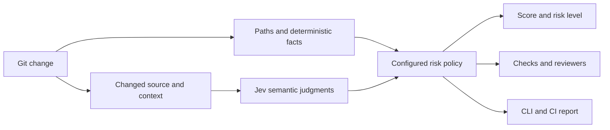

# check-risk

**Understand the risk of an AI-generated code change before you merge it.**

[](https://nodejs.org/)
[](https://www.typescriptlang.org/)
[](https://typesafe.ai/)

[Quick start](#quick-start) · [Example report](#example-report) · [How it works](#how-it-works) · [Configuration](#policy) · [GitHub Action](#github-action) · [Contributing](#contributing)

`check-risk` turns a Git change into an explainable risk score, required checks, and reviewer groups. Run it in your terminal after a coding session or use it to gate a pull request in GitHub Actions.

Your policy defines the sensitive parts of your repository. Deterministic checks catch changed paths, new dependencies, large diffs, and missing test changes. [TypeSafe Jev](https://typesafe.ai/) adds semantic signals about the behavior being changed. Every contribution leads back to a named rule.

Works with human-written code too. No agent plugin is required.

> **Project status:** [v0.1](https://github.com/moezubair/check-risk/releases/tag/v0.1), with source and an installable CLI archive. npm registry publication and live Jev validation remain pending. Licensed under MIT.

## At a glance

| | |
| --- | --- |
| Input | Local Git changes or a base/head comparison |
| Output | Risk level, score, reasons, checks, reviewers, and supporting evidence |
| Interfaces | Terminal CLI, JSON, reusable GitHub Action, TypeScript API |
| Repository support | Any language for path rules; Maven and npm dependency detection |
| Configuration | A versioned `.check-risk.yml` file |
| Model | Jev through the official TypeSafe SDK |
| Execution | Local Node.js process; semantic requests go to TypeSafe |
| Without an API key | Offline deterministic assessment, explicitly marked incomplete |

## Quick start

### 1. Build the CLI

Clone [moezubair/check-risk](https://github.com/moezubair/check-risk) and open a terminal in the clone. Install [Node.js](https://nodejs.org/) 22 or newer and Git first, then run:

```sh
git clone https://github.com/moezubair/check-risk.git
cd check-risk
npm install --global pnpm@11.19.0
pnpm install --frozen-lockfile --ignore-scripts
pnpm build
npm link
check-risk --help
```

`npm link` makes the local build available as `check-risk`. Prefer no global link? Run `node /absolute/path/to/check-risk/dist/cli.js` in place of `check-risk` in the examples below. For a prebuilt package, download `check-risk-cli-0.1.0.tgz` from the [v0.1 release](https://github.com/moezubair/check-risk/releases/tag/v0.1) and run `npm install --global ./check-risk-cli-0.1.0.tgz`. The package is not published to the npm registry.

### 2. Point it at your project

Open a terminal in the Git repository you want to assess. It must have at least one commit.

```sh
check-risk --init
```

This creates `.check-risk.yml`. Review the default paths, reviewer groups, and checks for your project. The financial-domain examples are a starting point; replace them with your own sensitive areas. Initialization refuses to overwrite an existing file.

### 3. Run an assessment

For a complete assessment, obtain a Jev API key from the [TypeSafe console](https://console.typesafe.ai/) and set it in the same terminal session.

**macOS / Linux:**

```sh
export TYPESAFE_API_KEY="your-api-key"
check-risk
```

**Windows PowerShell:**

```powershell
$env:TYPESAFE_API_KEY = "your-api-key"
check-risk
```

To try the deterministic rules without sending source code to TypeSafe:

```sh
check-risk --no-jev --format json
```

Offline mode intentionally returns exit code **2** and `status: "incomplete"`. You still get the deterministic score and findings; auto-merge eligibility remains disabled.

### Common commands

```sh
# Assess current local changes
check-risk

# Assess the branch relative to main
check-risk --base main --head HEAD

# Save a machine-readable report
check-risk --base main --head HEAD --format json --output risk-report.json

# Fail when a complete assessment reaches HIGH or CRITICAL
check-risk --fail-on HIGH

# Use a different full policy file
check-risk --config team-risk.yml
```

## Example report

Suppose a change touches P&L code, adds an npm dependency, and has no corresponding test change. Under the default policy, those signals contribute **40 + 15 + 20 = 75** points.

An illustrative report excerpt, assuming Jev adds no other findings or uncertainty:

```json
{
  "schemaVersion": 1,
  "risk": "HIGH",
  "score": 75,
  "reasons": [
    "P&L calculation area modified",
    "New Maven or npm dependency added",
    "Corresponding tests were not changed"
  ],
  "requiredChecks": [
    "dependency-scan",
    "integration-tests",
    "sonarqube",
    "unit-tests"
  ],
  "requiredReviewers": ["pnl-team", "senior-engineer"],
  "autoMergeAllowed": false,
  "status": "complete"
}
```

Full reports also include rule findings, deterministic facts, semantic probabilities, warnings, compared revisions, and input/policy hashes. The score expresses your policy's risk weighting, not the probability that the change will fail.

## How it works



1. **Collect the change.** Read the Git comparison and changed-file contents.
2. **Extract facts.** Identify path matches, dependency additions, diff size, and corresponding test changes.
3. **Ask focused questions.** Jev evaluates production behavior such as financial calculations or authorization changes.
4. **Apply policy.** Combine evidence, count each rule once, preserve risk floors, and collect requirements.
5. **Report the result.** Show the decision and evidence, or explain why assessment is incomplete.

The tool assesses risk and prescribes checks. Your CI still runs tests and scanners, your reviewers approve changes, and your merge controls decide whether to merge.

### Git comparison and exit codes

Without `--base`, compare HEAD with the current tracked working-tree contents (including staged changes) plus nonignored untracked files. Changes staged and subsequently reverted in the working tree are assessed as their final working-tree state. With `--base`, compare the merge base of base/head to head; head defaults to HEAD. A repository must have at least one commit. Resolve conflicts first. Git must have the necessary commit history locally.

Exit codes: **0** complete assessment below the requested threshold; **1** risk meets/exceeds `--fail-on`; **2** incomplete assessment or operational/configuration error. Without `--fail-on`, high risk alone does not fail the CLI. `--no-jev` deliberately produces an incomplete report and exit 2. An error before assessment writes a diagnostic to stderr, not a misleading risk report.

## Policy

Generate the complete configuration with `check-risk --init` or copy [examples/check-risk.yml](examples/check-risk.yml). Configuration is a **full policy**, not a partial merge. This excerpt shows one rule to edit within it:

```yaml
rules:
  - id: pnl
    reason: P&L calculation area modified
    points: 40
    paths: ["pnl/**"]
    minimumRisk: HIGH
    checks: []
    reviewers: ["pnl-team"]
    question: Does this change alter production profit-and-loss or financial calculation behavior?
```

The initial path policy is:

| Paths | Minimum risk |
| --- | --- |
| `pnl/**`, `trade-validation/**` | HIGH |
| `auth/**`, `iam/**` | CRITICAL |
| `terraform/**`, `database/migrations/**` | HIGH |
| `docs/**`, `tests/**` | LOW |

Rules have a unique ID, points, reason, path globs, optional minimum risk, checks, reviewers, and optionally a semantic question. Available conditions are `paths`, `dependency-added`, `large-change`, and `missing-tests`. All matching rules apply once per change set. A rule triggered by paths and Jev receives its points only once. Distinct rules remain additive; reuse a rule ID's question to model the same risk rather than creating a duplicate rule.

Paths are repository-relative, case-sensitive, slash-separated picomatch globs, including dotfiles. Both sides of a rename are checked. There is no first-match precedence; the highest matching minimum risk wins. `docs/**` and `tests/**` cannot override a higher-risk match.

Points sum to a maximum of 100. Defaults: LOW 0–24, MEDIUM 25–49, HIGH 50–79, CRITICAL 80–100. Path and semantic rule minimums can raise the classification without changing the score. For example, `auth/**` is CRITICAL even with score 0. Risk is a **policy index, not a probability of a production incident**.

Checks and reviewers accumulate from matching rules and all levels up to the final risk level. Configure these through `checksByRisk`, `reviewersByRisk`, and individual rules. `autoMergeMaxRisk` defaults to LOW. Eligibility also requires complete analysis and no uncertainty warnings; it does not mean checks passed or reviewers approved.

Default points: P&L 40, trade validation 25, production IAM 50, dependency addition 15, more than 500 added/deleted lines 10, migration 25, missing corresponding tests 20. Production IAM paths are explicitly `iam/production/**` and `terraform/production/iam/**`; adapt these to your repository. IAM generally remains CRITICAL.

### Dependencies and tests

- npm: compare names in dependencies, devDependencies, optionalDependencies, and peerDependencies in each changed `package.json`. Section moves count as additions; version-only updates do not. Lockfile-only changes and transitive dependency changes are not interpreted.
- Maven: compare explicit dependency coordinates in each changed `pom.xml`, including dependency management and profiles. Parent/BOM resolution and property expansion are not performed. Malformed manifests mark analysis incomplete.
- Java: `src/main/java/.../Foo.java` maps to `src/test/java/.../FooTest.java` or `FooTests.java`, including multi-module prefixes.
- JS/TS: look for adjacent `.test`/`.spec` files, matching `__tests__` files, or `tests/<source-stem>.test/spec.*`.
- `testMappings` override conventions for matching sources. Each mapping has a `source` glob and `tests` globs; any changed, nondeleted matching test satisfies that source. Test paths must also match `testPatterns`. `sourcePatterns` controls which files require tests.

A changed test is a heuristic, not proof of coverage or adequacy. The missing-tests rule fires once if any relevant source has no corresponding changed test, including deleted sources.

## Jev

Uses the official `@typesafe-ai/sdk`, pinned to 0.6.0. Independent Noul questions are batched into one request containing changed files' before/after contents and paths. Questions cover financial calculations, trade validation, authorization, and destructive migrations. Reason strings come from policy, not generated prose. See the [TypeSafe skill](https://github.com/typesafe-ai/skills/blob/main/skills/typesafe-ai/SKILL.md) and [SDK documentation](https://docs.typesafe.ai/sdk/javascript).

The model's yes-probability triggers a rule at `semantic.threshold` (default 0.8). Values strictly between `uncertainAbove` (0.2) and the threshold are recorded as uncertain and prevent auto-merge eligibility. These initial thresholds need evaluation against your own labeled changes. Noul has no separate confidence field.

Authenticated operation sends source contents to TypeSafe. `semantic.exclude` defaults to common secret-file patterns; if any excluded file changes, nothing is sent and semantic analysis is incomplete. This is not secret scanning: add your own exclusions or use `--no-jev` if the source may not leave the machine. No model call occurs for an empty diff or a policy without semantic questions.

Binary/unsupported files, missing credentials, invalid responses, and payloads exceeding `semantic.maxBytes` (120,000 UTF-8 bytes, including questions) mark semantic assessment incomplete. Oversized requests are rejected rather than silently truncated. Requests have a 15-second timeout and no retries. API errors are reported without response bodies or credentials.

Reports retain probabilities, the returned model name, a SHA-256 input hash, a policy hash, and compared revisions. They do not include source contents. Deterministic scoring is repeatable for the same facts, policy, and model answers. **Live model repeatability is not guaranteed**; `jev-latest` can change. Configure a fixed model identifier if TypeSafe provides one for your account. Typed answers do not guarantee correct judgments.

## GitHub Action

Replace `moezubair/check-risk@v0.1` in [the workflow example](examples/risk-workflow.yml) with a pinned commit SHA from this repository. The example checks out the base commit and fetches the PR head as data. It never runs PR code or installs PR dependencies. Do not run an untrusted PR's local `./action` with API secrets.

Add `TYPESAFE_API_KEY` as a repository Actions secret, then copy the workflow example to `.github/workflows/risk.yml` in the repository being assessed. Its Action invocation is:

```yaml
- uses: moezubair/check-risk@v0.1
  with:
    base: ${{ github.event.pull_request.base.sha }}
    head: ${{ github.event.pull_request.head.sha }}
    typesafe-api-key: ${{ secrets.TYPESAFE_API_KEY }}
    fail-on: HIGH
```

This is an excerpt; use the [complete workflow](examples/risk-workflow.yml) for checkout and fetch steps. For immutable consumption, replace `v0.1` with the release commit SHA.

The Action builds its own trusted source, compares explicit base/head commits, and loads policy from the base SHA. If the default policy file does not yet exist there, built-in defaults apply; an explicitly requested missing config fails. Policy edits become effective only after entering the trusted base branch. The Action uses Bash and is intended for Ubuntu runners.

The Action writes a JSON artifact and job summary, exposes `risk`, `score`, `status`, `requiredChecks`, `requiredReviewers`, and `autoMergeAllowed`, then enforces `fail-on` (HIGH by default). All JSON-array outputs are compact JSON. Configure branch protection separately. Fork PRs without secrets produce an incomplete assessment; do not expose credentials to untrusted workflows to bypass this.

## Contributing

Bug reports, reproducible change examples, and focused pull requests are welcome. Useful contributions include better source-to-test mappings, dependency detectors, and labeled cases that reveal inaccurate semantic judgments.

When reporting a problem, include the command, a minimal sanitized diff, the relevant policy, and the expected versus actual result. Remove credentials and private source before sharing reports.

For code changes:

1. Build from source using the quick start.
2. Add a regression test for the behavior you change. Normal tests use local fixtures and mocked model responses.
3. Run the checks below and update configuration examples or usage documentation when behavior changes.
4. Describe what changed and which checks passed in your pull request.

### Development checks

```sh
pnpm build
pnpm test
pnpm check
# Opt-in live test (requires TYPESAFE_API_KEY):
CHECK_RISK_LIVE=1 pnpm test
```

Tests use temporary Git repositories and mocked model responses; normal tests do not call TypeSafe. The repository CI runs on Ubuntu and Windows. Public exports include `assess`, `collectChanges`, `defaultConfig`, and `parseConfig`; `assess` accepts an injectable evaluator for testing. JSON reports include `schemaVersion: 1`.

In PowerShell, enable the optional live test with `$env:CHECK_RISK_LIVE = "1"` before running `pnpm test`. Live tests require TypeSafe access and may consume API quota.

### Project map

```text
src/          Git collection, facts, policy, Jev integration, and CLI
test/         Automated tests and temporary-repository fixtures
examples/     Complete policy and consuming GitHub workflow
action.yml    Reusable GitHub Action
```

See the [product requirements](prd.md), [implementation plan](plan.md), and [agent guidance](Agent.md) for scope, pending validation, and contribution context.

## Release readiness

- [x] CLI, configurable scoring, and TypeSafe SDK integration
- [x] Local build, type checks, and 16 passing automated tests
- [x] Reusable Action and workflow example
- [ ] Live Jev validation and evaluation on labeled changes
- [x] Hosted CLI tests on Ubuntu and Windows
- [ ] End-to-end GitHub Action validation with Jev
- [x] Public repository reference
- [x] MIT license
- [ ] npm publication, if desired

## License

[MIT](LICENSE) — Copyright (c) 2026 Zubair.
